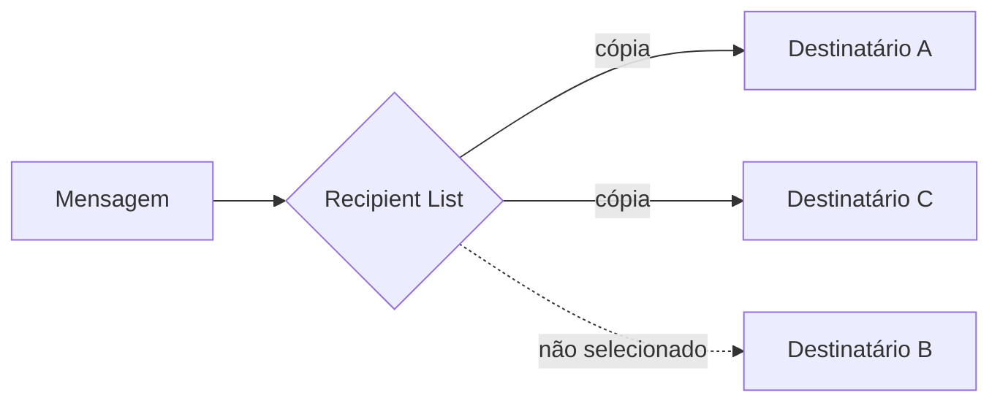

# Recipient List

## Descrição

O Recipient List roteia uma mensagem para uma lista de destinatários determinada dinamicamente, como a lista de destinatários de um e-mail. Existe um canal para cada destinatário possível. O componente examina cada mensagem, calcula quem deve recebê-la e encaminha uma cópia ao canal de cada um.

Conceitualmente tem duas partes: uma que calcula a lista e outra que percorre a lista enviando a mensagem. Na prática costumam ser combinadas. Como no Content-Based Router, o conteúdo normalmente não é alterado.

Exemplos: um pedido pequeno consulta uma agência de crédito, mas um pedido grande consulta várias para comparar; um pedido de cotação vai só a fornecedores escolhidos pelo usuário.

## Problemas que resolve

- O remetente ou a regra de negócio precisa controlar explicitamente o conjunto de destinatários
- O conjunto muda por mensagem, conforme dados ou preferências
- Fazer broadcast a todos desperdiça recursos e pode ser inadequado
- Cada destinatário selecionado precisa receber sua própria cópia

## Quando usar

- A mesma mensagem deve ir a vários destinos escolhidos caso a caso
- O destinatário certo depende de valor, preferência ou política
- Precisa-se de controle sobre quem recebe, sem broadcast

### Quando evitar

- Todos os assinantes recebem sempre tudo; um canal publish-subscribe basta
- Um único destino é escolhido pelo conteúdo; use um Content-Based Router

## Trade-offs

| Ganho | Custo / Risco |
| --- | --- |
| Controle preciso sobre os destinatários | O componente precisa conhecer o canal de cada destinatário |
| Evita envios desnecessários | Falha parcial: alguns recebem e outros não |
| Cada destinatário recebe sua cópia | Regras de seleção concentradas em um ponto |

- **Falhas parciais:** decida o que fazer se o envio a um destinatário falhar (repetir, ignorar, compensar).
- **Respostas:** se for preciso combinar respostas, use um Aggregator (veja Scatter-Gather).

## Diagrama

A lista calculada para a mensagem inclui A e C, que recebem cópias; B não é selecionado.

## Padrões relacionados

- [Content-Based Router](/architecture/eip/message-routing/content-based-router) — o remetente não controla o destino, que sai do conteúdo
- [Scatter-Gather](/architecture/eip/message-routing/scatter-gather) — usa uma Recipient List na variante de distribuição
- [Aggregator](/architecture/eip/message-routing/aggregator) — combina as respostas dos destinatários
- [Dynamic Router](/architecture/eip/message-routing/dynamic-router) — pode fornecer a lista a partir de registros
- [Publish-Subscribe Channel](/cloud/cloud-design-patterns/messaging/publisher-subscriber) — alternativa em que os assinantes decidem

## Referência

- [Página do padrão no Enterprise Integration Patterns](https://www.enterpriseintegrationpatterns.com/RecipientList.html)
