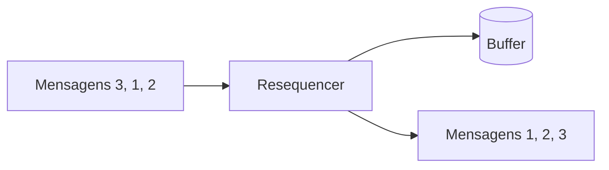

# Resequencer

## Descrição

O Resequencer é um filtro com estado que coleta e reordena mensagens antes de publicá-las. Mantém em um buffer interno as mensagens fora de ordem, espera até ter uma sequência consecutiva completa e então as publica em ordem no canal de saída.

O problema nasce porque roteadores e caminhos paralelos fazem cada mensagem seguir um percurso, e algumas chegam antes de outras. Certas etapas seguintes, porém, exigem sequência, por exemplo para preservar integridade referencial.

O Resequencer não altera o conteúdo, apenas a ordem. Para que a ordem se mantenha, o canal de saída também deve preservá-la.

## Problemas que resolve

- Mensagens relacionadas chegam embaralhadas depois de caminhos distintos
- Consumidores dependem da ordem para manter a consistência
- Processamento paralelo quebra a ordem original

## Quando usar

- A ordem de processamento importa e o transporte não a garante
- Há paralelismo ou roteamento que embaralha mensagens de uma mesma sequência
- As mensagens carregam número de sequência

### Quando evitar

- A ordem não importa para o consumidor
- É possível evitar o problema com um único consumidor ou partições por chave
- A tolerância a atraso é baixa e uma mensagem perdida bloquearia o fluxo

## Trade-offs

| Ganho | Custo / Risco |
| --- | --- |
| Ordem restaurada para quem a exige | Latência: mensagens esperam as faltantes |
| Consumidores mais simples | Memória para o buffer e estado |
| Conteúdo preservado | Mensagem perdida pode travar a sequência |

- **Timeout:** defina o que fazer com lacunas na sequência.
- **Sequência por grupo:** reordene por chave, para não bloquear grupos independentes.

## Diagrama

As mensagens chegam fora de ordem, ficam no buffer e saem em sequência.

## Padrões relacionados

- [Message Sequence](../message-construction/message-sequence.md) — fornece a numeração usada para reordenar
- [Aggregator](./aggregator.md) — outro filtro com estado, mas que combina mensagens
- [Message Router](./message-router.md) — roteamento que pode embaralhar a ordem
- [Sequential Convoy](../../../cloud/azure/messaging/sequential-convoy.md) — processa mensagens relacionadas em ordem

## Referência

- [Página do padrão no Enterprise Integration Patterns](https://www.enterpriseintegrationpatterns.com/Resequencer.html)
