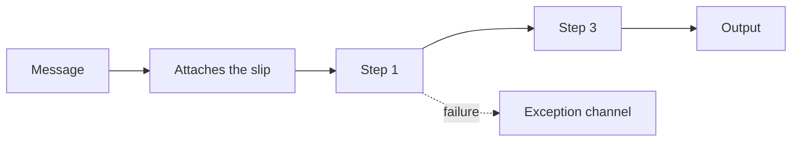

# Routing Slip

## Descrição

O Routing Slip resolve o caso em que uma mensagem deve passar por uma sequência de etapas que não é fixa e pode variar de uma mensagem para outra. Um componente no início calcula a lista de etapas necessárias e a anexa à mensagem como uma "ficha de roteamento". A mensagem é enviada à primeira etapa.

Cada componente de processamento é envolvido por um roteador que lê a ficha e encaminha a mensagem à etapa seguinte. Assim, os componentes continuam independentes e reutilizáveis, e o caminho é decidido por mensagem. Uma mensagem que falha em uma regra segue para um canal de exceção.

## Problemas que resolve

- Tipos diferentes de mensagem exigem sequências distintas de validação ou processamento
- Etapas devem ser puladas conforme o contexto (por exemplo, sem decriptação em uma conexão segura)
- Fixar a ordem no desenho do pipeline é rígido demais

## Quando usar

- O percurso depende do tipo ou da origem da mensagem
- Os passos são conhecidos no início e formam uma sequência linear
- Quer-se reaproveitar os mesmos componentes em fluxos diferentes

### Quando evitar

- O próximo passo depende de resultados intermediários ou há passos paralelos; use um [Process Manager](./process-manager.md)
- O percurso é sempre o mesmo

## Trade-offs

| Ganho | Custo / Risco |
| --- | --- |
| Percurso flexível por mensagem | Cada componente precisa de um roteador que entenda a ficha |
| Componentes independentes e reutilizáveis | A ficha viaja com a mensagem e deve ser protegida |
| Sem coordenador central | Difícil enxergar o estado do fluxo e tratar falhas |

- **Falhas:** a ficha não tem lógica condicional; trate exceções com um canal próprio.
- **Rastreamento:** registre a etapa atual para facilitar o diagnóstico.

## Diagrama

A ficha lista as etapas 1 e 3 (a 2 é pulada) e a mensagem percorre apenas esse caminho.

## Padrões relacionados

- [Process Manager](./process-manager.md) — alternativa para fluxos dinâmicos e com paralelismo
- [Pipes and Filters](../../../cloud/cloud-design-patterns/messaging/pipes-and-filters.md) — estrutura de etapas que o Routing Slip torna variável
- [Message Router](./message-router.md) — cada etapa tem um roteador local
- [Chain of Responsibility](../../../coding/gof/behavioral/chain-of-responsibility.md) — cadeia de handlers em orientação a objetos

## Referência

- [Página do padrão no Enterprise Integration Patterns](https://www.enterpriseintegrationpatterns.com/RoutingTable.html)
