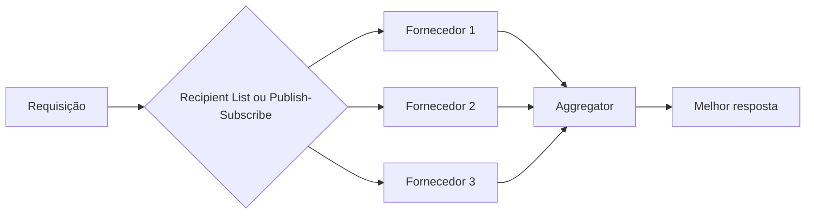

# Scatter-Gather

## Descrição

O Scatter-Gather envia uma requisição a vários destinatários e usa um Aggregator para coletar as respostas e combiná-las em uma só. O exemplo clássico é um item sem estoque que pode ser obtido de vários fornecedores, cada um com preço e prazo diferentes: pede-se cotação a todos e escolhe-se a melhor.

Há duas variantes. Na de **distribuição**, uma Recipient List envia a requisição a uma lista controlada, o que dá controle sobre os destinatários, mas exige conhecer o canal de cada um. Na variante de **leilão**, um canal publish-subscribe difunde a requisição a quem estiver interessado, usando um único canal e cedendo parte do controle.

## Problemas que resolve

- Vários destinatários devem ser consultados em paralelo para comparar ofertas
- As respostas chegam em tempos diferentes e algumas podem não chegar
- O chamador precisa de uma única resposta, não de um fluxo de respostas parciais

## Quando usar

- Cotações, leilões e consultas a várias fontes redundantes
- Quando a latência total deve ser a do mais lento (ou do primeiro) e não a soma
- O número de destinatários pode ser fixo ou calculado em tempo de execução

### Quando evitar

- Há um único destino; use um roteador comum
- Não se tolera tráfego multiplicado ou os destinatários têm custo por consulta alto
- Não há critério claro para combinar ou escolher respostas

## Trade-offs

| Ganho | Custo / Risco |
| --- | --- |
| Resposta consolidada e melhor escolha | Mais tráfego e consumo de recursos nos destinatários |
| Paralelismo reduz a latência total | Decidir quando parar de esperar |
| Distribuição dá controle; leilão dá flexibilidade | Distribuição acopla aos canais; leilão perde controle |

- **Erros por rota:** uma rota que falha pode sinalizar falha geral ou apenas ser ignorada, conforme o caso.
- **Completude:** reutilize as estratégias do Aggregator (timeout, primeira resposta etc.).

## Diagrama

A requisição é espalhada aos fornecedores e as respostas são reunidas em um único resultado.

## Padrões relacionados

- [Recipient List](/architecture/eip/message-routing/recipient-list) — distribui na variante controlada
- [Aggregator](/architecture/eip/message-routing/aggregator) — reúne as respostas
- [Composed Message Processor](/architecture/eip/message-routing/composed-message-processor) — divide em partes distintas em vez de replicar
- [Publish-Subscribe Channel](/architecture/cloud-design-patterns/messaging/publisher-subscriber) — usado na variante de leilão
- [Gateway Aggregation](/architecture/cloud-design-patterns/gateways-and-edge/gateway-aggregation) — agrega chamadas a vários serviços
- [API Composition](/architecture/microservices/service-collaboration/api-composition) — combina dados de vários serviços

## Referência

- [Página do padrão no Enterprise Integration Patterns](https://www.enterpriseintegrationpatterns.com/BroadcastAggregate.html)
