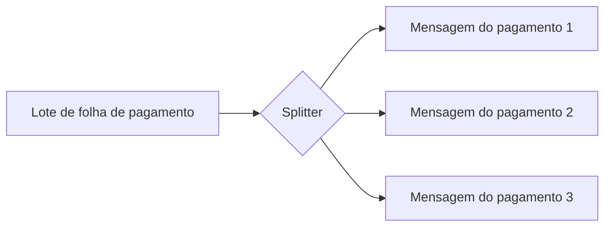

# Splitter

## Descrição

O Splitter consome uma mensagem que contém uma lista de elementos repetidos e publica uma mensagem separada para cada elemento, ou para um subconjunto deles. Cada mensagem resultante pode então ser roteada e processada de forma independente.

O exemplo típico é um pedido com vários itens, em que cada item pode precisar de um tratamento diferente, como uma checagem em um sistema de estoque distinto. O Splitter permite lidar com o pedido como um todo sem deixar de tratar cada item individualmente.

Para que as partes possam ser recombinadas depois, é comum que cada mensagem carregue um identificador de correlação e informações de sequência.

## Problemas que resolve

- Uma mensagem composta tem partes que exigem processamento distinto
- Processar tudo em bloco impede paralelismo e roteamento por elemento
- Cada elemento precisa chegar ao sistema responsável por ele

## Quando usar

- A mensagem contém coleções que podem ser tratadas separadamente
- Quer-se processar elementos em paralelo
- Cada parte é roteada para destinos diferentes

## Quando evitar

- O processamento exige visão atômica do conjunto e não pode ser dividido
- O custo de reagrupar as partes supera o ganho de dividir

## Trade-offs

| Ganho | Custo / Risco |
| --- | --- |
| Processamento paralelo e granular | É preciso correlacionar e recombinar as partes |
| Roteamento independente por elemento | Perda da atomicidade do conjunto |
| Mensagens menores e mais simples | Mais mensagens trafegando |

- **Correlação e sequência:** inclua um identificador do grupo e a posição de cada parte para permitir a agregação.
- **Falhas parciais:** defina o que acontece se apenas alguns elementos falharem.

## Diagrama

O lote é dividido em uma mensagem por pagamento, prontas para roteamento independente. A fonte ilustra o padrão com um pedido de vários itens.

## Padrões relacionados

- [Aggregator](/architecture/eip/message-routing/aggregator) — recombina as partes depois do processamento
- [Composed Message Processor](/architecture/eip/message-routing/composed-message-processor) — combina Splitter, roteador e Aggregator
- [Content-Based Router](/architecture/eip/message-routing/content-based-router) — roteia cada item para o sistema certo
- [Message Sequence](/architecture/eip/message-construction/message-sequence) — numeração das partes
- [Correlation Identifier](/architecture/eip/message-construction/correlation-identifier) — liga as partes ao original

## Referência

- [Página do padrão no Enterprise Integration Patterns](https://www.enterpriseintegrationpatterns.com/Sequencer.html)
