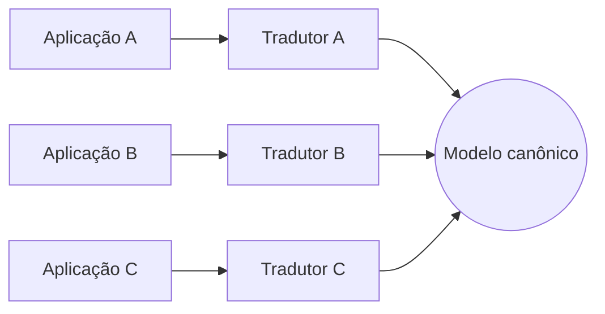

# Canonical Data Model

## Descrição

O Canonical Data Model define um formato de dados comum, independente de qualquer aplicação, que passa a ser a "língua franca" da integração. Cada aplicação só precisa traduzir entre o seu formato interno e o formato canônico, nunca diretamente para o formato das demais.

Sem esse modelo, a integração ponto a ponto exige uma tradução para cada par de aplicações, e o número de tradutores cresce de forma quadrática. Com o modelo canônico, cada aplicação tem um único tradutor, e incluir um novo participante significa escrever apenas mais um.

O modelo pertence ao conjunto de aplicações e não a um sistema específico, o que evita que o formato de uma delas se imponha às outras.

## Problemas que resolve

- Aplicações com formatos internos distintos não devem depender diretamente do formato umas das outras.
- Traduções entre todos os pares crescem rapidamente (dois sistemas precisam de 2 tradutores, seis precisam de 30).
- Adicionar ou trocar uma aplicação obriga a alterar vários tradutores existentes.
- Falta de um vocabulário comum para os dados trocados.

## Quando usar

- Muitas aplicações precisam se integrar, ou esse número deve crescer.
- Há necessidade de desacoplar produtores e consumidores dos formatos internos uns dos outros.
- A organização quer um vocabulário de dados compartilhado e governado.

### Quando evitar

- Poucas aplicações (duas ou três) se integram: o modelo intermediário dá mais trabalho que traduzir diretamente.
- O consenso sobre um modelo comum é inviável ou custoso, e o modelo tende a virar um denominador comum pobre.
- Os contextos têm semânticas realmente diferentes, e forçar um modelo único apaga distinções importantes.

## Trade-offs

| Ganho | Custo / Risco |
| --- | --- |
| Um tradutor por aplicação, independentemente do total | Cada mensagem passa por duas traduções (origem para canônico, canônico para destino) |
| Novas aplicações entram sem alterar as existentes | Esforço de projetar e governar o modelo comum |
| Desacoplamento entre formatos internos | O modelo pode virar gargalo de evolução, pois mudanças afetam todos |
| Vocabulário compartilhado | Risco de modelo genérico demais, que não atende bem a ninguém |

- Estabeleça um processo claro de versionamento e evolução do modelo.
- Use um Format Indicator para suportar múltiplas versões em convivência.

## Diagrama

Cada aplicação se conecta ao modelo canônico por um único tradutor, em vez de manter tradutores para todas as outras aplicações.

## Padrões relacionados

- [Message Translator](/architecture/eip/message-transformation/message-translator) — realiza a conversão entre o formato da aplicação e o canônico.
- [Normalizer](/architecture/eip/message-transformation/normalizer) — converte formatos variados para o formato comum.
- [Messaging Mapper](/architecture/eip/messaging-endpoints/messaging-mapper) — liga os dados internos da aplicação ao formato de mensagem.
- [Format Indicator](/architecture/eip/message-construction/format-indicator) — identifica a versão ou o formato usado na mensagem.
- [Message Bus](/architecture/eip/messaging-channels/message-bus) — a arquitetura de barramento costuma pressupor um modelo canônico.
- [Message Router](/architecture/eip/message-routing/message-router) — direciona mensagens no formato comum.
- [Shared Database](/architecture/microservices/service-collaboration/shared-database) — alternativa de integração em que o modelo comum é o esquema compartilhado.
- [Published Language](/design/ddd/context-mapping/published-language) — conceito equivalente no DDD: linguagem documentada e compartilhada entre contextos.

## Referência

- [Página do padrão no Enterprise Integration Patterns](https://www.enterpriseintegrationpatterns.com/CanonicalDataModel.html)
