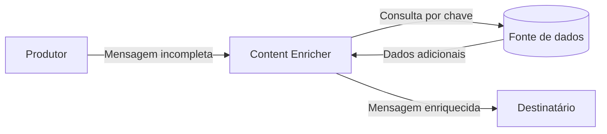

# Content Enricher

## Descrição

O Content Enricher é um transformador especializado que completa uma mensagem com dados que o destinatário precisa e que o remetente não enviou. Ele usa campos-chave da mensagem recebida (um CEP, um identificador de cliente, um número de pedido) para obter a informação ausente e a acrescenta ao conteúdo.

A informação pode vir de três fontes: de um cálculo (derivar o estado a partir do CEP), do ambiente (um timestamp atual) ou de outro sistema (banco de dados, arquivo, serviço, diretório). O último caso é o mais comum e é o que torna o padrão útil em integrações.

Com isso, remetentes não precisam carregar todos os campos que qualquer destinatário possa vir a exigir, e as mensagens permanecem enxutas na origem.

## Problemas que resolve

- O destinatário precisa de dados (nome e endereço) que a mensagem não traz (apenas um ID de cliente).
- O remetente não tem acesso à informação adicional ou não deveria ser responsável por ela.
- Diferentes destinatários exigem dados distintos, e embutir tudo na mensagem original a incharia.
- Etapas posteriores precisam recuperar dados que foram removidos antes (por exemplo, com Claim Check).

## Quando usar

- A origem não consegue fornecer todos os dados que o destino precisa, mas eles estão disponíveis em uma fonte confiável.
- É necessário converter identificadores em informação completa antes de roteamento ou processamento.
- Dados guardados temporariamente por um Claim Check precisam voltar à mensagem.

### Quando evitar

- A informação adicional não é confiável ou muda tão rápido que o valor consultado fica inconsistente.
- A consulta ao sistema externo é lenta ou pouco disponível e pode se tornar gargalo para o fluxo.
- O próprio remetente pode enviar o dado sem custo; enriquecer depois só adiciona dependência.

## Trade-offs

| Ganho | Custo / Risco |
| --- | --- |
| Mensagens menores e remetentes simples | Dependência de uma fonte de dados externa a cada mensagem |
| Destinatários recebem dados completos | Latência adicional pela consulta |
| Enriquecimento centralizado e reutilizável | Risco de dados desatualizados ou inconsistentes em relação ao momento do evento |
| Evita duplicar lógica de busca em vários consumidores | Falhas na fonte afetam o fluxo inteiro (exige retry, cache ou fallback) |

- Considere usar cache para consultas repetidas e defina o comportamento quando a fonte estiver indisponível.
- Decida se a mensagem enriquecida preserva os campos originais ou os substitui.

## Diagrama

O enricher usa uma chave da mensagem para buscar os dados ausentes na fonte e entrega ao destinatário a mensagem completa.

## Padrões relacionados

- [Content Filter](./content-filter.md) — o inverso: remove dados desnecessários em vez de adicionar.
- [Message Translator](./message-translator.md) — o enriquecimento por cálculo se aproxima de uma tradução simples.
- [Claim Check](../../../cloud/azure/messaging/claim-check.md) — o dado guardado é recuperado depois por um enricher.
- [Envelope Wrapper](./envelope-wrapper.md) — outra forma de adicionar informação à mensagem, voltada aos cabeçalhos.
- [Message Filter](../message-routing/message-filter.md) — descarta mensagens inteiras, não altera o conteúdo.
- [Message Channel](../messaging-channels/message-channel.md) — canal pelo qual a mensagem enriquecida segue.

## Referência

- [Página do padrão no Enterprise Integration Patterns](https://www.enterpriseintegrationpatterns.com/DataEnricher.html)
