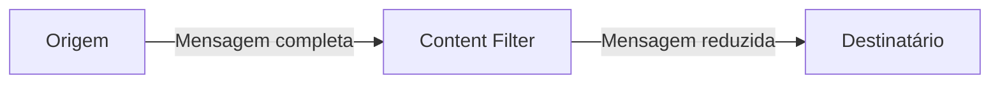

# Content Filter

## Descrição

O Content Filter remove de uma mensagem os campos que o destinatário não precisa, entregando uma versão mais simples e enxuta. Também pode achatar estruturas aninhadas, convertendo uma árvore profunda de grupos repetidos em uma lista de elementos fácil de processar.

Mensagens vindas de sistemas externos ou pacotes costumam refletir estruturas normalizadas de bancos de dados, com muitos níveis e grupos repetitivos. Quando as restrições conhecidas tornam essa complexidade desnecessária, o filtro elimina o excesso e poupa os consumidores de interpretá-la.

É o oposto do Content Enricher: em vez de adicionar o que falta, retira o que sobra. Não confunda com o Message Filter, que descarta mensagens inteiras; aqui a mensagem continua existindo, só com menos conteúdo.

## Problemas que resolve

- A mensagem é grande e o destinatário usa apenas alguns campos.
- A estrutura aninhada ou repetitiva é mais complexa do que o consumidor precisa.
- Dados sensíveis ou irrelevantes não devem chegar a certos destinatários.
- O custo de transmitir e interpretar campos inúteis prejudica o desempenho.

## Quando usar

- O destinatário precisa só de parte da mensagem.
- É preciso limitar a exposição de informações sensíveis a um consumidor específico.
- Estruturas complexas devem ser simplificadas ou achatadas antes de seguir adiante.

### Quando evitar

- Outros consumidores posteriores podem precisar dos campos removidos e não há como recuperá-los (considere Claim Check para guardar o conteúdo).
- O que se quer é descartar mensagens inteiras: use Message Filter.
- A remoção de campos esconde informação necessária para auditoria ou diagnóstico.

## Trade-offs

| Ganho | Custo / Risco |
| --- | --- |
| Mensagens menores e mais simples para o consumidor | Perda irreversível dos campos removidos |
| Menor exposição de dados sensíveis | Regras de filtragem precisam acompanhar mudanças de schema |
| Menos processamento e tráfego | Mais um componente na cadeia |

- Documente claramente quais campos são mantidos e quais são descartados.
- Para preservar dados que serão usados mais adiante, armazene-os antes e recupere-os depois com Claim Check e Content Enricher.

## Diagrama

O filtro recebe a mensagem completa, descarta os campos desnecessários e entrega uma versão simplificada ao destinatário.

## Padrões relacionados

- [Content Enricher](/architecture/eip/message-transformation/content-enricher) — o inverso: acrescenta dados ausentes.
- [Claim Check](/architecture/cloud-design-patterns/messaging/claim-check) — guarda dados para recuperá-los depois, enquanto o filtro os descarta de vez.
- [Message Translator](/architecture/eip/message-transformation/message-translator) — o filtro pode ser visto como uma tradução que reduz o conteúdo.
- [Message Filter](/architecture/eip/message-routing/message-filter) — descarta mensagens inteiras; o Content Filter remove campos.
- [Splitter](/architecture/eip/message-routing/splitter) — divide a mensagem em partes, outra forma de simplificar estruturas complexas.
- [Channel Adapter](/architecture/eip/messaging-channels/channel-adapter) — pode aplicar a filtragem ao ler dados de sistemas externos.

## Referência

- [Página do padrão no Enterprise Integration Patterns](https://www.enterpriseintegrationpatterns.com/ContentFilter.html)
