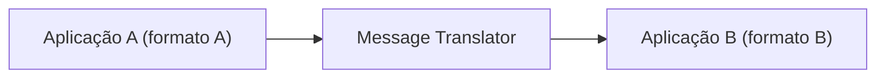

# Message Translator

## Descrição

O Message Translator é um componente (um filtro no estilo Pipes and Filters) colocado entre dois participantes de uma integração para converter o formato de uma mensagem em outro. Ele recebe a mensagem no formato da origem, aplica as regras de mapeamento e emite a mensagem no formato esperado pelo destino.

A tradução pode atuar em vários níveis: estrutura de dados (campos, nomes, tipos), representação (XML, JSON, CSV, binário) e até o transporte. Como cada aplicação tem seu modelo interno, o tradutor isola essas diferenças e evita que origem e destino precisem conhecer o formato um do outro.

É o equivalente, no mundo da mensageria, do Adapter do GoF: adapta uma interface (aqui, um formato de mensagem) para que dois componentes incompatíveis possam conversar.

## Problemas que resolve

- Aplicações legadas, pacotes e sistemas de parceiros têm modelos de dados próprios e incompatíveis (o que é um "Cliente" varia de sistema para sistema).
- Cada aplicação espera receber mensagens no seu formato interno, e alterá-la para aceitar outro formato costuma ser inviável.
- Padrões externos do setor (como RosettaNet, ebXML ou OAGIS) diferem dos formatos proprietários usados internamente.
- Lógica de conversão espalhada dentro das aplicações aumenta o acoplamento e dificulta a manutenção.

## Quando usar

- Sistemas com formatos distintos precisam trocar mensagens e não é possível ou desejável alterá-los.
- É necessário falar o formato padrão de um parceiro externo mantendo o formato interno.
- Você quer concentrar a conversão em um ponto reutilizável e testável de forma isolada.

### Quando evitar

- Os formatos já são compatíveis, ou a diferença é só a ausência de campos (nesse caso, um Content Enricher basta).
- Muitas aplicações trocam mensagens entre si: traduções ponto a ponto explodem em quantidade e um Canonical Data Model é mais adequado.
- A conversão exige conhecimento de domínio complexo e vira lógica de negócio escondida em infraestrutura.

## Trade-offs

| Ganho | Custo / Risco |
| --- | --- |
| Origem e destino permanecem desacoplados do formato um do outro | Mais um componente para implantar, versionar e operar |
| Aplicações existentes participam da integração sem modificação | Latência e processamento adicionais por mensagem |
| Regras de mapeamento centralizadas e testáveis | Mudanças de schema exigem atualizar o tradutor |
| Facilidade de trocar um sistema por outro mudando só o tradutor | Perda ou distorção de informação se os modelos não forem equivalentes |

- Em integrações com muitos participantes, o número de tradutores cresce rapidamente; combine com um Canonical Data Model.
- Registre e monitore falhas de tradução, direcionando mensagens inválidas para um canal próprio.

## Diagrama

A mensagem sai da aplicação A no seu formato, é convertida pelo tradutor e chega à aplicação B no formato que ela entende.

## Padrões relacionados

- [Canonical Data Model](./canonical-data-model.md) — reduz o número de tradutores ao definir um formato comum.
- [Normalizer](./normalizer.md) — combina um roteador com vários tradutores para unificar formatos.
- [Content Enricher](./content-enricher.md) — acrescenta dados que faltam, em vez de apenas converter o formato.
- [Content Filter](./content-filter.md) — remove dados desnecessários da mensagem.
- [Envelope Wrapper](./envelope-wrapper.md) — adapta a mensagem aos requisitos de cabeçalho da infraestrutura.
- [Channel Adapter](../messaging-channels/channel-adapter.md) — conecta a aplicação ao canal; a tradução do formato fica no tradutor.
- [Pipes and Filters](../../../cloud/cloud-design-patterns/messaging/pipes-and-filters.md) — o tradutor é um filtro dentro de uma cadeia de processamento.
- [Adapter](../../../coding/gof/structural/adapter.md) — o análogo em orientação a objetos.
- [Anti-Corruption Layer](../../../cloud/cloud-design-patterns/integration-and-modernization/anti-corruption-layer.md) — camada que traduz entre modelos para proteger o domínio.

## Referência

- [Página do padrão no Enterprise Integration Patterns](https://www.enterpriseintegrationpatterns.com/MessageTranslator.html)
