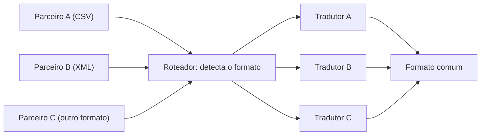

# Normalizer

## Descrição

O Normalizer processa mensagens semanticamente equivalentes que chegam em formatos diferentes e as converte para um único formato comum. Ele é composto por um Message Router, que identifica o tipo de cada mensagem recebida, e um conjunto de Message Translators, um para cada formato conhecido, todos produzindo a mesma saída.

O desafio central é a detecção do formato. Parceiros raramente informam um tipo confiável, e as mensagens muitas vezes chegam como arquivos (CSV, XML sem schema). O roteador recorre a pistas indiretas: o elemento raiz do XML, a presença de nós específicos (via XPath), a quantidade e os tipos de campos de um CSV, ou até o nome e a pasta do arquivo, que funcionam como um Datatype Channel improvisado.

Com os dados normalizados, todo o processamento posterior trabalha com uma estrutura única, sem se preocupar com a variedade de entrada.

## Problemas que resolve

- Muitos parceiros enviam a mesma informação, cada um em um formato próprio.
- O tipo da mensagem não vem indicado de forma confiável.
- O processamento posterior ficaria cheio de ramificações para tratar cada formato.
- Adicionar um novo parceiro não deveria afetar o restante do fluxo.

## Quando usar

- Dados semanticamente equivalentes chegam em vários formatos, tipicamente de parceiros B2B.
- A identificação do tipo depende de inspecionar o conteúdo ou o contexto da mensagem.
- Você quer que os consumidores recebam sempre um formato consistente.

## Quando evitar

- Há apenas um ou dois formatos conhecidos: um Message Translator simples resolve.
- As mensagens já trazem um indicador de formato confiável; um Content-Based Router com Format Indicator basta.
- Os formatos de entrada não são equivalentes semanticamente e exigem lógica de negócio diferente em cada caso.

## Trade-offs

| Ganho | Custo / Risco |
| --- | --- |
| Processamento posterior simplificado, com um só formato | Detecção de formato baseada em heurísticas pode errar |
| Novos parceiros entram adicionando apenas um tradutor | Cada formato novo exige manutenção do tradutor e do critério de detecção |
| Isolamento da variedade de entrada | Mensagens não reconhecidas precisam de tratamento (canal de mensagens inválidas) |

- Defina um destino para mensagens cujo formato não seja reconhecido.
- Monitore a taxa de falhas de detecção por parceiro.

## Diagrama

O roteador identifica o formato de cada mensagem e a envia ao tradutor correspondente; todos os tradutores produzem o mesmo formato comum.

## Padrões relacionados

- [Message Translator](/architecture/eip/message-transformation/message-translator) — realiza a conversão de cada formato.
- [Canonical Data Model](/architecture/eip/message-transformation/canonical-data-model) — o formato comum de saída costuma ser o modelo canônico.
- [Content-Based Router](/architecture/eip/message-routing/content-based-router) — base do roteador que detecta o formato.
- [Format Indicator](/architecture/eip/message-construction/format-indicator) — quando a mensagem informa o formato, a detecção fica trivial.
- [Datatype Channel](/architecture/eip/messaging-channels/datatype-channel) — nomes de arquivo ou pastas podem fazer esse papel.
- [Invalid Message Channel](/architecture/eip/messaging-channels/invalid-message-channel) — destino para mensagens de formato desconhecido.

## Referência

- [Página do padrão no Enterprise Integration Patterns](https://www.enterpriseintegrationpatterns.com/Normalizer.html)
