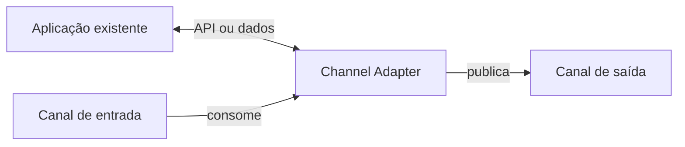

# Channel Adapter

## Descrição

O Channel Adapter conecta uma aplicação que não sabe enviar nem receber mensagens ao sistema de mensageria. Ele lê dados pela API ou pela camada de dados da aplicação e os publica como mensagens em um canal; no sentido inverso, recebe mensagens do canal e aciona funções da aplicação por meio de uma interface que ela oferece.

O adaptador é, ele próprio, um cliente de mensageria. Uma vez que a aplicação ganha um adaptador, ela passa a participar da integração sem ser reescrita em torno do sistema de mensageria.

Onde o adaptador se liga depende da arquitetura da aplicação e dos dados de que a integração precisa: pode ser a interface de usuário, uma API de negócio, a lógica ou diretamente o banco de dados. Não confunda com o Adapter do GoF, que converte interfaces entre classes dentro de um programa.

## Problemas que resolve

- Aplicações existentes não foram projetadas para usar mensageria e não têm cliente do sistema de mensageria.
- Cada aplicação expõe interfaces e dados de forma diferente, e é preciso escolher o ponto certo de conexão.
- Reescrever aplicações legadas para participar da integração é caro e arriscado.

## Quando usar

- Integrar sistemas legados ou pacotes de terceiros ao sistema de mensageria.
- Expor dados de um banco ou de uma API como mensagens, e vice-versa.
- Conectar uma aplicação a vários canais sem alterar seu código interno.

### Quando evitar

- Quando a aplicação pode ser modificada com facilidade para usar a mensageria diretamente por meio de um endpoint próprio.
- Quando o acesso direto ao banco da aplicação violaria regras de negócio ou o encapsulamento, e há uma API melhor.

## Trade-offs

| Ganho | Custo / Risco |
| --- | --- |
| Aplicação existente entra na integração sem reescrita | Mais um componente a implantar e manter |
| Isola a aplicação dos detalhes da mensageria | Adaptar via banco de dados pode contornar a lógica de negócio |
| Reutilizável para qualquer aplicação com a interface adequada | Pode ser necessário traduzir formatos de mensagem |

- **Ponto de acoplamento:** escolha a camada de integração (UI, API, lógica, dados) pesando estabilidade e acesso.
- **Tradução:** costuma ser usado junto com um Message Translator e um modelo de dados canônico.
- **Transações:** quando o adaptador consome e atualiza a aplicação, use semântica transacional para não perder mensagens.

## Diagrama

O adaptador transforma dados ou chamadas da aplicação em mensagens e mensagens em chamadas, ligando a aplicação aos canais.

## Padrões relacionados

- [Message Channel](/architecture/eip/messaging-channels/message-channel) — o canal ao qual o adaptador se conecta.
- [Messaging Bridge](/cloud/cloud-design-patterns/messaging/messaging-bridge) — formado por pares de adaptadores entre sistemas de mensageria.
- [Message Bus](/architecture/eip/messaging-channels/message-bus) — usa adaptadores para ligar cada sistema ao barramento.
- [Message Translator](/architecture/eip/message-transformation/message-translator) — converte o formato entre aplicação e canal.
- [Canonical Data Model](/architecture/eip/message-transformation/canonical-data-model) — formato comum para o qual o adaptador traduz.
- [Transactional Client](/architecture/eip/messaging-endpoints/transactional-client) — garante atomicidade entre a aplicação e a mensageria.
- [Adapter](/coding/gof/structural/adapter) — mesmo nome, mas converte interfaces entre classes, não integra aplicações por mensageria.
- [Ambassador](/cloud/cloud-design-patterns/integration-and-modernization/ambassador) — proxy auxiliar que também intermedeia a comunicação de uma aplicação com o exterior.

## Referência

- [Página do padrão no Enterprise Integration Patterns](https://www.enterpriseintegrationpatterns.com/ChannelAdapter.html)
