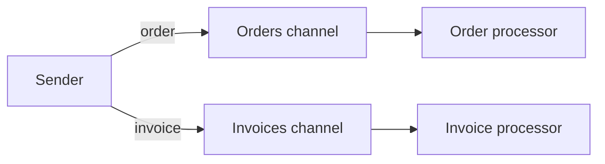

# Datatype Channel

## Descrição

O Datatype Channel dedica um canal a cada tipo de dado. Todas as mensagens de um mesmo canal têm o mesmo formato e significado, e o remetente escolhe o canal conforme o tipo do que está enviando (por exemplo, um canal para pedidos de compra e outro para faturas).

Com isso, o receptor sabe o que esperar apenas pelo canal de onde a mensagem veio. Ele não precisa inspecionar o conteúdo para decidir como tratá-la, o que simplifica o código de consumo e reduz a chance de interpretar uma mensagem de forma errada.

O custo é multiplicar canais: cada novo tipo de dado exige um novo canal, e o remetente passa a precisar conhecer o mapeamento entre tipos e canais.

## Problemas que resolve

- Receptores não sabem como processar uma mensagem quando tipos diferentes chegam misturados em um mesmo canal.
- Inspecionar cada mensagem para descobrir seu tipo adiciona lógica de despacho a todo consumidor.
- Mensagens de formato inesperado chegam a consumidores que não as entendem e causam falhas.

## Quando usar

- Há poucos tipos de dado bem definidos, cada um com consumidores próprios.
- O consumidor se especializa em um único tipo de documento ou comando.
- Se deseja segurança e monitoramento diferenciados por tipo de dado.

### Quando evitar

- Quando o número de tipos é grande ou muda com frequência, levando a uma explosão de canais; considere um indicador de formato dentro da mensagem ou um modelo de dados canônico.
- Quando as mensagens variam só em pequenos detalhes de um mesmo tipo.

## Trade-offs

| Ganho | Custo / Risco |
| --- | --- |
| Receptor sabe o tipo pelo canal, sem inspecionar a mensagem | Mais canais para criar, nomear e administrar |
| Isolamento de falhas por tipo de dado | O remetente precisa conhecer o mapeamento tipo-canal |
| Controle de acesso e métricas por tipo | Evolução de formato exige coordenação entre canais |

- **Alternativas:** um indicador de formato na própria mensagem permite um canal só, ao custo de lógica de despacho no consumidor.
- **Versões:** versionar o formato muitas vezes implica novo canal ou campo de versão.

## Diagrama

O remetente escolhe o canal segundo o tipo de dado, e cada processador recebe somente o formato que sabe tratar.

## Padrões relacionados

- [Message Channel](./message-channel.md) — o conceito geral que este padrão especializa.
- [Invalid Message Channel](./invalid-message-channel.md) — destino de mensagens que mesmo assim chegam em formato incorreto.
- [Message Bus](./message-bus.md) — usa canais por tipo de dado para rotear mensagens aos endpoints certos.
- [Format Indicator](../message-construction/format-indicator.md) — alternativa que marca o formato dentro da mensagem.
- [Command Message](../message-construction/command-message.md) — tipo de mensagem comum em canais dedicados.
- [Canonical Data Model](../message-transformation/canonical-data-model.md) — reduz a variedade de tipos a traduzir.
- [Message Dispatcher](../messaging-endpoints/message-dispatcher.md) — distribui mensagens aos consumidores certos.
- [Selective Consumer](../messaging-endpoints/selective-consumer.md) — filtra por tipo quando não há canais dedicados.

## Referência

- [Página do padrão no Enterprise Integration Patterns](https://www.enterpriseintegrationpatterns.com/DatatypeChannel.html)
