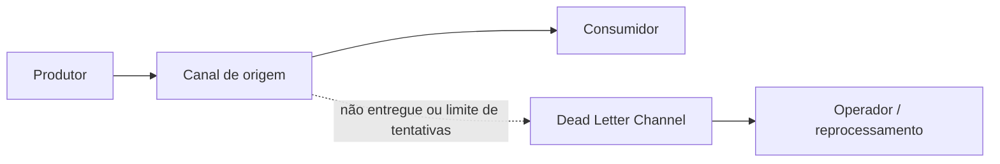

# Dead Letter Channel

## Descrição

O Dead Letter Channel é o destino para onde o sistema de mensageria move uma mensagem que decidiu não poder ou não dever entregar. Em vez de perder a mensagem ou deixá-la bloqueando o tráfego normal, ela é preservada em um canal à parte, conhecido também como dead letter queue (DLQ).

Em geral, cada máquina que executa o sistema de mensageria tem seu próprio canal local de mensagens mortas, de modo que mover uma mensagem para ele seja uma operação local, sem o risco de uma transferência pela rede. O sistema costuma registrar também onde ocorreu a falha e, opcionalmente, o canal originalmente pretendido.

Em muitos produtos o mecanismo é automático: depois de um número configurado de tentativas de entrega ou de expiração da mensagem, ela é encaminhada ao canal de mensagens mortas. Nem todo produto o oferece, e alguns exigem configuração explícita.

## Problemas que resolve

- Mensagens que não conseguem ser entregues se perderiam silenciosamente.
- Uma mensagem problemática reentregue indefinidamente bloqueia ou degrada o consumo das demais.
- Operadores precisam saber o que falhou, onde e por quê, para corrigir e, se for o caso, reenviar.

## Quando usar

- A perda de mensagens é inaceitável e é preciso poder inspecioná-las depois.
- Existe limite de tentativas ou de validade, e mensagens que o ultrapassam devem ser separadas.
- Consumidores podem falhar de forma persistente com certas mensagens (poison messages).

### Quando evitar

- Quando a perda de algumas mensagens é aceitável e o custo de operar o canal não compensa.
- Quando não há processo para monitorar e tratar o canal: ele vira um depósito esquecido.

## Trade-offs

| Ganho | Custo / Risco |
| --- | --- |
| Nenhuma mensagem se perde silenciosamente | Alguém precisa monitorar e esvaziar o canal |
| O fluxo principal segue sem bloqueio | Mensagens mortas podem conter dados sensíveis e exigem proteção |
| Metadados de falha ajudam o diagnóstico | Reprocessar pode reintroduzir duplicatas ou quebrar a ordem |

- **Limite de tentativas:** escolha um número de reentregas que absorva falhas transitórias sem demorar a isolar as permanentes.
- **Alertas:** configure alertas de profundidade e idade das mensagens no canal.
- **Reprocessamento:** defina como e quando devolver mensagens ao fluxo, preferindo consumidores idempotentes.
- **Retenção:** estabeleça por quanto tempo as mensagens mortas são guardadas.

## Diagrama

Quando a mensagem não pode ser entregue ou excede as tentativas, ela é movida ao canal de mensagens mortas, onde um operador ou processo a analisa.

## Padrões relacionados

- [Invalid Message Channel](./invalid-message-channel.md) — para mensagens inválidas para o receptor, não apenas não entregues.
- [Guaranteed Delivery](./guaranteed-delivery.md) — persistência evita perdas; o canal de mortas cobre o que mesmo assim não é entregue.
- [Message Channel](./message-channel.md) — o conceito geral de canal.
- [Message Expiration](../message-construction/message-expiration.md) — mensagens expiradas costumam ir ao canal de mortas.
- [Message Store](../system-management/message-store.md) — guarda mensagens para análise posterior.
- [Retry](../../../cloud/cloud-design-patterns/resiliency/retry.md) — as tentativas ocorrem antes de a mensagem ser considerada morta.

## Referência

- [Página do padrão no Enterprise Integration Patterns](https://www.enterpriseintegrationpatterns.com/DeadLetterChannel.html)
