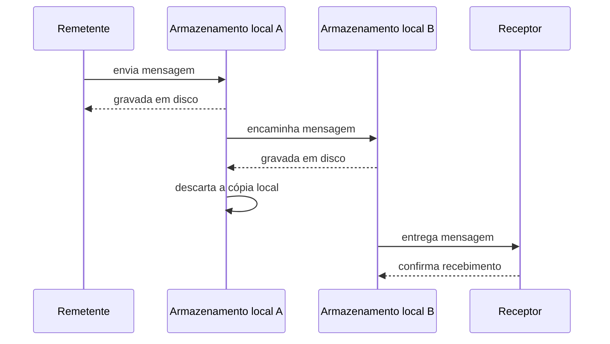

# Guaranteed Delivery

## Descrição

O Guaranteed Delivery faz o sistema de mensageria tornar as mensagens persistentes, de modo que não se percam se o próprio sistema falhar. Cada máquina que executa o sistema mantém um armazenamento local em disco, e um envio só é considerado concluído quando a mensagem está gravada com segurança nele.

Ao passar a mensagem adiante, o armazenamento anterior só a descarta depois que o próximo confirmou tê-la guardado. Assim, a mensagem permanece em disco em pelo menos uma máquina até que o receptor a confirme.

A garantia vem ao preço de gravar em disco a cada salto, o que aumenta a latência e reduz a vazão em comparação com mensagens apenas em memória.

## Problemas que resolve

- O remetente precisa de segurança de que a mensagem chegará mesmo que o sistema de mensageria caia no meio do caminho.
- Uma queda de máquina ou de processo perderia mensagens mantidas apenas em memória.
- A rede entre remetente e receptor é pouco confiável ou o receptor pode estar indisponível por um tempo.

## Quando usar

- Mensagens críticas, como pedidos, pagamentos e eventos de negócio que não podem ser perdidos.
- O receptor pode ficar offline e precisa receber o que perdeu quando voltar.
- A confiabilidade da entrega vale mais que a latência.

### Quando evitar

- Dados efêmeros ou de alta frequência, como leituras de sensores ou métricas, em que perder alguns é aceitável.
- Cenários de baixa latência em que o custo de gravar em disco a cada salto inviabiliza a vazão necessária.

## Trade-offs

| Ganho | Custo / Risco |
| --- | --- |
| Mensagens sobrevivem a falhas do sistema de mensageria | Latência e consumo de I/O maiores por salto |
| Remetente pode confiar na entrega eventual | Armazenamento persistente a dimensionar e proteger |
| Receptores offline recuperam o que perderam | Entrega pelo menos uma vez pode gerar duplicatas |

- **Duplicatas:** a garantia costuma ser de entrega ao menos uma vez; use receptores idempotentes.
- **Configuração:** em geral é preciso habilitar a persistência por canal ou por mensagem.
- **Capacidade:** acompanhe o uso de disco quando o receptor está parado e as mensagens se acumulam.
- **Transações:** combine com cliente transacional para que envio e recebimento sejam atômicos.

## Diagrama

Cada salto grava a mensagem em disco antes de confirmar, e a cópia só é descartada quando o próximo armazenamento a assumiu, até a confirmação do receptor.

## Padrões relacionados

- [Dead Letter Channel](./dead-letter-channel.md) — destino das mensagens que, mesmo persistidas, não puderam ser entregues.
- [Point-to-Point Channel](./point-to-point-channel.md) — canal ao qual a persistência se aplica.
- [Publish-Subscribe Channel](../../../cloud/cloud-design-patterns/messaging/publisher-subscriber.md) — idem, para múltiplos assinantes.
- [Durable Subscriber](../messaging-endpoints/durable-subscriber.md) — retém mensagens para assinantes offline.
- [Transactional Client](../messaging-endpoints/transactional-client.md) — agrupa envio e recebimento em uma transação.
- [Idempotent Receiver](../../../cloud/cloud-design-patterns/messaging/idempotent-consumer.md) — tolera as duplicatas da entrega ao menos uma vez.
- [Message Expiration](../message-construction/message-expiration.md) — limita por quanto tempo a mensagem permanece válida.
- [Message Store](../system-management/message-store.md) — registra mensagens para auditoria e análise.

## Referência

- [Página do padrão no Enterprise Integration Patterns](https://www.enterpriseintegrationpatterns.com/GuaranteedMessaging.html)
