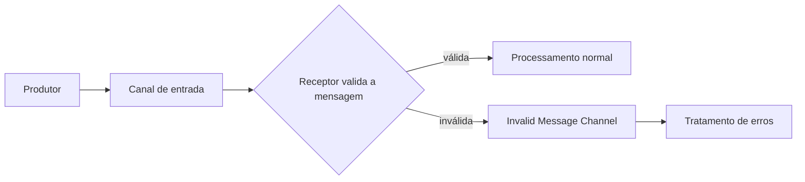

# Invalid Message Channel

## Descrição

O Invalid Message Channel é um canal separado para onde o receptor desvia as mensagens que recebeu mas não consegue entender ou processar, por exemplo por formato incorreto, campos ausentes ou conteúdo que viola o contrato esperado. Em vez de falhar, descartar ou travar o fluxo normal, o receptor move a mensagem para esse canal.

Os administradores definem um ou mais canais desse tipo ao projetar o sistema. Como o tráfego saudável nunca passa por ali, as mensagens problemáticas não interferem na operação normal, e um processo de tratamento de erros pode ser ligado ao canal para inspecioná-las e diagnosticar a causa.

A distinção importante é que a mensagem chegou ao destino, mas é inválida para ele. Isso difere do Dead Letter Channel, que trata mensagens que o sistema de mensageria não conseguiu entregar.

## Problemas que resolve

- O receptor recebe uma mensagem sem sentido e não deve falhar nem processá-la de forma incorreta.
- Mensagens ruins repetidas bloqueiam a fila ou geram loops de reprocessamento.
- Sem um destino para elas, as mensagens inválidas são perdidas e ninguém consegue diagnosticar o problema.

## Quando usar

- O receptor valida o conteúdo das mensagens e pode rejeitá-las de forma explícita.
- É importante preservar mensagens inválidas para análise, correção e eventual reprocessamento.
- Vários produtores enviam para o mesmo canal e nem todos respeitam o contrato.

### Quando evitar

- Quando a falha é transitória (por exemplo, dependência fora do ar): a mensagem é válida e deve ser tentada de novo, não desviada.
- Quando o canal é totalmente controlado e validado na origem, e rejeições são impossíveis na prática.

## Trade-offs

| Ganho | Custo / Risco |
| --- | --- |
| O fluxo normal não é interrompido por mensagens ruins | Alguém precisa monitorar e tratar o canal de inválidas |
| Mensagens problemáticas ficam disponíveis para diagnóstico | Dados potencialmente sensíveis ficam retidos e exigem proteção |
| Separação clara entre erro de conteúdo e erro de entrega | O receptor precisa implementar validação e decisão de desvio |

- **Contexto:** inclua na mensagem desviada o motivo da rejeição e o canal de origem para facilitar o diagnóstico.
- **Reprocessamento:** após corrigir a causa, defina como reinserir as mensagens no fluxo.
- **Alertas:** o crescimento do canal é um sinal de problema de contrato entre produtor e consumidor.

## Diagrama

O receptor valida cada mensagem; as válidas seguem o fluxo normal e as inválidas vão ao canal dedicado, onde um processo de erros as analisa.

## Padrões relacionados

- [Dead Letter Channel](/architecture/eip/messaging-channels/dead-letter-channel) — trata mensagens que não puderam ser entregues, em vez de mensagens inválidas.
- [Datatype Channel](/architecture/eip/messaging-channels/datatype-channel) — canais por tipo reduzem a chance de formato errado.
- [Message Channel](/architecture/eip/messaging-channels/message-channel) — o conceito geral de canal.
- [Message Expiration](/architecture/eip/message-construction/message-expiration) — mensagens vencidas também podem ser desviadas.
- [Retry](/architecture/cloud-design-patterns/resiliency/retry) — falhas transitórias pedem nova tentativa, não desvio como inválida.
- [Service Activator](/architecture/eip/messaging-endpoints/service-activator) — endpoint que costuma validar e despachar a mensagem.

## Referência

- [Página do padrão no Enterprise Integration Patterns](https://www.enterpriseintegrationpatterns.com/InvalidMessageChannel.html)
