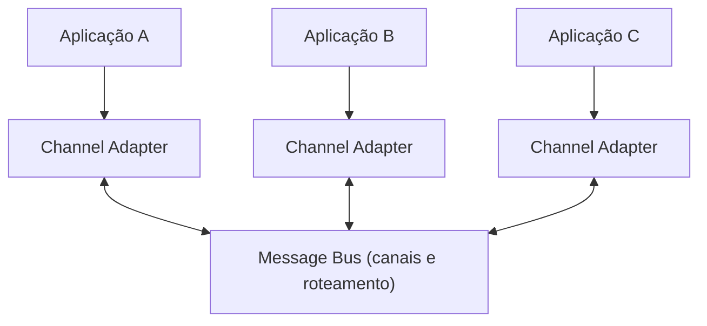

# Message Bus

## Descrição

O Message Bus é uma arquitetura de integração em que várias aplicações existentes, heterogêneas, cooperam por meio de uma infraestrutura comum de mensageria, permanecendo desacopladas. Novas aplicações entram e antigas saem sem que o restante precise mudar.

A analogia é o barramento de hardware de um computador, que liga processador, memória e periféricos. Aqui, o barramento é o middleware que liga aplicações, com mensagens bem mais granulares que as operações de leitura e escrita de baixo nível do hardware.

O padrão combina três elementos: uma infraestrutura de comunicação comum (canais, roteadores, canais de publicação e assinatura), adaptadores que ligam cada sistema ao barramento e traduzem seus dados, e uma estrutura comum de comandos e formatos que permite aos participantes pedir operações uns aos outros.

## Problemas que resolve

- Sistemas existentes, de plataformas e linguagens diferentes, precisam compartilhar dados e responder de forma unificada a pedidos de negócio.
- Adicionar ou remover aplicações não deve interromper as demais.
- Sem formatos e comandos comuns, cada par de sistemas precisa de sua própria integração ponto a ponto.
- Algumas interações têm um destinatário, outras precisam alcançar vários.

## Quando usar

- Há um portfólio de aplicações que devem colaborar de forma flexível e evoluir de forma independente.
- A empresa quer um vocabulário comum de comandos e dados entre sistemas.
- Espera-se incluir novos participantes com frequência.

### Quando evitar

- Poucas aplicações com integração estável, em que ligações diretas bastam.
- Quando não há disposição para manter um modelo de dados e comandos compartilhado, pois o barramento perde o sentido.
- Quando o barramento viraria ponto único de falha e de contenção sem a devida alta disponibilidade.

## Trade-offs

| Ganho | Custo / Risco |
| --- | --- |
| Aplicações desacopladas, que entram e saem sem impacto nas demais | Infraestrutura central a operar e escalar |
| Menos integrações ponto a ponto | Exige consenso sobre formatos e comandos comuns |
| Reuso de adaptadores e canais | Barramento pode virar gargalo ou ponto único de falha |
| Cooperação entre tecnologias heterogêneas | Governança e versionamento do modelo compartilhado |

- **Modelo canônico:** o formato comum é o que mantém o acoplamento baixo, mas precisa ser administrado.
- **Roteamento:** roteadores e canais por tipo de dado direcionam cada mensagem ao endpoint certo.
- **Disponibilidade:** o barramento deve ser redundante, pois muitas aplicações dependem dele.

## Diagrama

Cada aplicação se liga ao barramento por um adaptador, e o barramento oferece canais e roteamento comuns para que elas colaborem sem se conhecer.

## Padrões relacionados

- [Channel Adapter](./channel-adapter.md) — liga cada aplicação ao barramento.
- [Datatype Channel](./datatype-channel.md) — direciona tipos de mensagem a endpoints específicos.
- [Publish-Subscribe Channel](../../../cloud/azure/messaging/publisher-subscriber.md) — alcança vários receptores.
- [Message Channel](./message-channel.md) — os canais que compõem o barramento.
- [Canonical Data Model](../message-transformation/canonical-data-model.md) — formato de dados comum a todos os participantes.
- [Command Message](../message-construction/command-message.md) — estrutura comum de comandos entre os sistemas.
- [Message Router](../message-routing/message-router.md) — direciona mensagens dentro do barramento.
- [Service Activator](../messaging-endpoints/service-activator.md) — invoca serviços das aplicações a partir de mensagens.
- [Messaging](../../microservices/communication-styles/messaging.md) — o estilo de integração sobre o qual o barramento se apoia.

## Referência

- [Página do padrão no Enterprise Integration Patterns](https://www.enterpriseintegrationpatterns.com/MessageBus.html)
