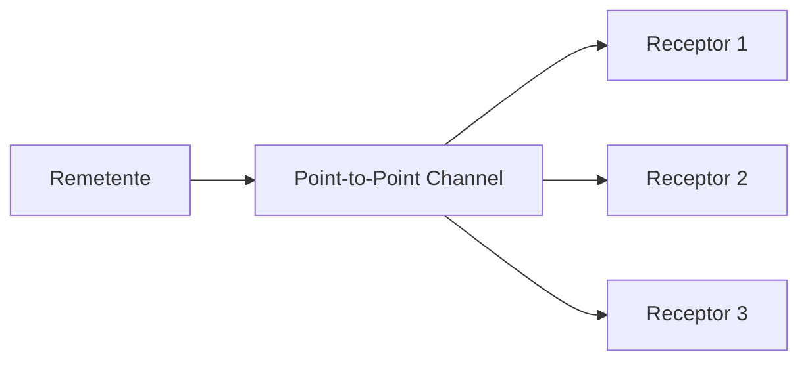

# Point-to-Point Channel

## Descrição

O Point-to-Point Channel garante que cada mensagem enviada seja consumida por exatamente um receptor. Pode haver vários receptores ligados ao mesmo canal, mas, quando disputam a mesma mensagem, o canal permite que apenas um deles a obtenha. Os receptores não precisam se coordenar entre si.

É o canal natural para mensagens que representam uma chamada de procedimento ou a transferência de um documento, em que a ação deve ocorrer uma única vez. Quem envia tem a segurança de que a operação não será executada em duplicidade por consumidores diferentes.

Como o canal entrega cada mensagem a um só consumidor, vários receptores podem trabalhar em paralelo, cada um tratando mensagens distintas, o que dá escala de processamento sem esforço adicional de sincronização no código da aplicação.

## Problemas que resolve

- O remetente precisa de garantia de que apenas um receptor executará a chamada ou receberá o documento.
- Vários receptores devem poder dividir o trabalho sem processar a mesma mensagem duas vezes.
- Os receptores não devem precisar de um protocolo próprio de coordenação para evitar duplicidade.

## Quando usar

- Envio de comandos ou requisições que devem ser executados uma única vez.
- Transferência de documentos para um processador específico.
- Distribuição de carga entre várias instâncias de um mesmo serviço.
- Troca de requisição e resposta, em que cada resposta volta a um único solicitante.

### Quando evitar

- Quando vários consumidores diferentes precisam, cada um, receber a mesma informação; use um canal de publicação e assinatura.
- Quando a ordem estrita de processamento é necessária e há muitos consumidores concorrentes, pois a concorrência pode reordenar o tratamento.

## Trade-offs

| Ganho | Custo / Risco |
| --- | --- |
| Cada mensagem é tratada uma só vez | Só um consumidor vê a mensagem; novos interessados não recebem cópia |
| Escala horizontal com consumidores concorrentes | A ordem de processamento entre consumidores não é garantida |
| Sem coordenação explícita entre receptores | Se o consumidor falha após receber, é preciso reentrega e tratamento de duplicatas |

- **Entrega:** na prática, a garantia é de uma entrega ao canal e uma retirada por um consumidor; falhas podem causar reentrega, então torne os receptores idempotentes.
- **Backlog:** se não houver receptores, as mensagens se acumulam no canal; monitore a profundidade.

## Diagrama

O remetente publica no canal e cada mensagem é entregue a apenas um dos receptores ligados a ele.

## Padrões relacionados

- [Message Channel](./message-channel.md) — o conceito geral que este padrão especializa.
- [Publish-Subscribe Channel](../../../cloud/azure/messaging/publisher-subscriber.md) — a alternativa em que todos os assinantes recebem uma cópia.
- [Competing Consumers](../../../cloud/azure/messaging/competing-consumers.md) — vários receptores disputando as mensagens do mesmo canal.
- [Idempotent Receiver](../../../cloud/azure/messaging/idempotent-consumer.md) — tolera reentregas do canal.
- [Request-Reply](../message-construction/request-reply.md) — troca bidirecional muito construída sobre canais ponto a ponto.
- [Command Message](../message-construction/command-message.md) — mensagem que pede uma ação, típica deste canal.
- [Document Message](../message-construction/document-message.md) — mensagem que transfere dados.
- [Messaging](../../microservices/communication-styles/messaging.md) — o estilo de integração em que o padrão se insere.

## Referência

- [Página do padrão no Enterprise Integration Patterns](https://www.enterpriseintegrationpatterns.com/PointToPointChannel.html)
