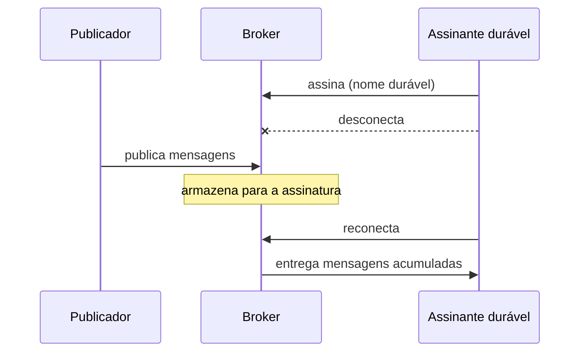

# Durable Subscriber

## Descrição

Durable Subscriber é um assinante de um Publish-Subscribe Channel cuja assinatura sobrevive à sua desconexão. O sistema de mensageria guarda as mensagens publicadas enquanto o assinante está offline e as entrega quando ele se reconecta.

Para o assinante conectado e para o broker, nada muda em relação a uma assinatura comum; a diferença só aparece durante o período offline. Em geral a assinatura durável é identificada por um nome registrado no broker.

Sem isso, um assinante que cai, é reiniciado ou está em manutenção perde tudo o que foi publicado nesse intervalo.

## Problemas que resolve

- Perda de mensagens por assinante temporariamente desconectado.
- Necessidade de reconstruir estado perdido após uma indisponibilidade.

## Quando usar

- Quando cada evento é importante e o assinante pode ficar offline.
- Quando é preciso garantir entrega a assinantes lentos ou intermitentes.

### Quando evitar

- Quando apenas o estado mais recente interessa (mensagens antigas perdem valor).
- Quando o acúmulo de mensagens para assinantes ausentes pode esgotar o broker.

## Trade-offs

| Ganho | Custo / Risco |
| --- | --- |
| Nenhuma mensagem perdida por indisponibilidade | O broker precisa armazenar mensagens por tempo indeterminado |
| Recuperação simples ao reconectar | Assinaturas abandonadas acumulam dados |
| Comportamento idêntico ao de assinatura comum quando online | Rajada de mensagens atrasadas na reconexão |

- Combine com Message Expiration para limitar o acúmulo e monitore o tamanho das assinaturas.

## Diagrama

O broker guarda as mensagens enquanto o assinante está ausente e as entrega quando ele volta.

## Padrões relacionados

- [Publish-Subscribe Channel](../../../cloud/cloud-design-patterns/messaging/publisher-subscriber.md) — o canal ao qual o assinante durável se inscreve.
- [Guaranteed Delivery](../messaging-channels/guaranteed-delivery.md) — persistência de mensagens no broker, base da durabilidade.
- [Point-to-Point Channel](../messaging-channels/point-to-point-channel.md) — canal em que a fila já retém mensagens.
- [Message Expiration](../message-construction/message-expiration.md) — limita o acúmulo de mensagens.
- [Message Endpoint](./message-endpoint.md) — o assinante é um endpoint de recebimento.
- [Polling Consumer](./polling-consumer.md) — modo de consumo possível.
- [Event-Driven Consumer](./event-driven-consumer.md) — modo de consumo possível.

## Referência

- [Página do padrão no Enterprise Integration Patterns](https://www.enterpriseintegrationpatterns.com/DurableSubscription.html)
