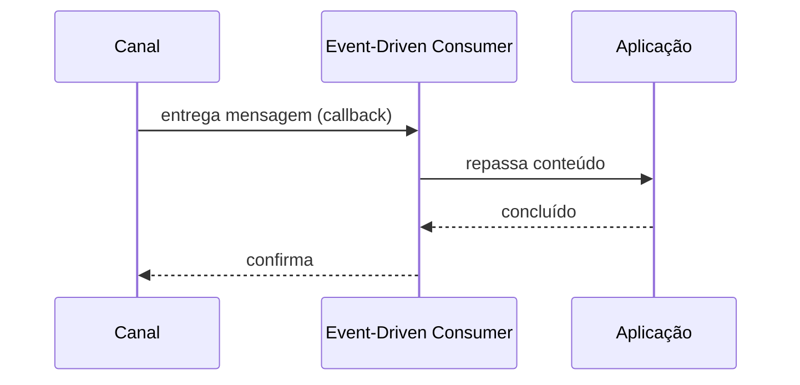

# Event-Driven Consumer

## Descrição

Event-Driven Consumer é um consumidor que o próprio sistema de mensageria invoca quando uma mensagem chega ao canal, por meio de um callback. Enquanto não há mensagens, o consumidor pode ficar inativo, sem thread dedicada. Também é chamado de receptor assíncrono.

O modelo dá resposta imediata e evita consultas repetidas ao canal. Como a entrega é realmente orientada a eventos ou não é um detalhe de implementação do cliente de mensageria; o que importa é que a aplicação é acionada quando há mensagem.

Atenção à confirmação: confirmar automaticamente na entrega, antes de processar, é simples, mas perde o trabalho se o processamento falhar; nesse caso o consumidor não é um Transactional Client.

## Problemas que resolve

- Latência causada por polling.
- Threads ociosas esperando mensagens.
- Código de laço de consumo repetido em cada aplicação.

## Quando usar

- Quando a mensagem deve ser tratada o quanto antes.
- Quando o volume é irregular e manter consumidores ativos seria desperdício.

### Quando evitar

- Quando o consumidor precisa controlar a taxa de entrada, pois o push pode sobrecarregá-lo.
- Quando o processamento deve ocorrer só em janelas específicas.

## Trade-offs

| Ganho | Custo / Risco |
| --- | --- |
| Baixa latência | Consumidor pode ser inundado se não houver limite de prefetch |
| Sem consultas vazias | Menor controle do ritmo |
| Código simples baseado em callback | Confirmação automática pode perder mensagens |

- Limite a quantidade de mensagens em voo (prefetch) para proteger o consumidor.

## Diagrama

O canal aciona o consumidor, que repassa o conteúdo à aplicação e confirma ao final.

## Padrões relacionados

- [Polling Consumer](./polling-consumer.md) — alternativa baseada em pull.
- [Message Endpoint](./message-endpoint.md) — tipo de endpoint de recebimento.
- [Competing Consumers](../../../cloud/azure/messaging/competing-consumers.md) — vários consumidores orientados a eventos no mesmo canal.
- [Message Dispatcher](./message-dispatcher.md) — distribui mensagens recebidas a executores.
- [Selective Consumer](./selective-consumer.md) — aceita só parte das mensagens.
- [Durable Subscriber](./durable-subscriber.md) — assinante que não perde mensagens offline.
- [Transactional Client](./transactional-client.md) — confirmação controlada pelo cliente.
- [Observer (GoF)](../../../coding/gof/behavioral/observer.md) — o mesmo modelo de notificação em escala de objetos.

## Referência

- [Página do padrão no Enterprise Integration Patterns](https://www.enterpriseintegrationpatterns.com/EventDrivenConsumer.html)
