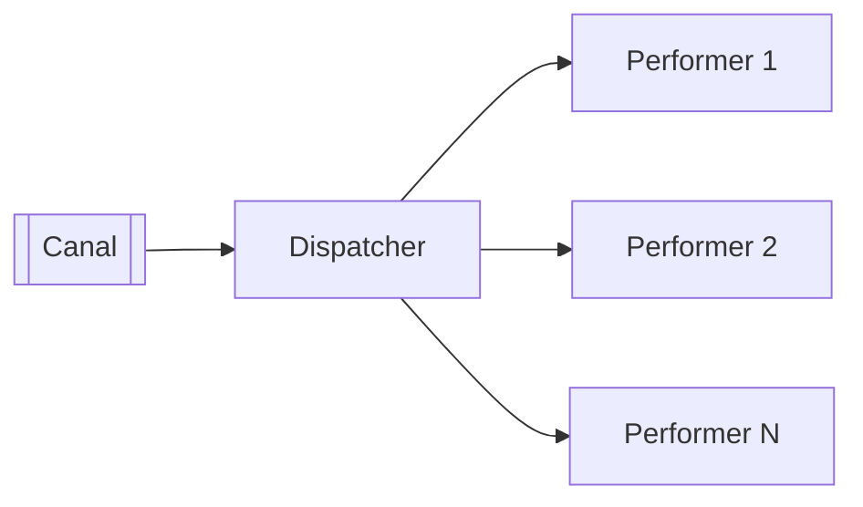

# Message Dispatcher

## Descrição

Message Dispatcher coordena vários consumidores de um mesmo canal. Ele tem dois papéis: o dispatcher retira cada mensagem do canal e a repassa; o performer recebe a mensagem e faz o processamento, podendo recorrer ao restante da aplicação.

Os performers podem ser criados sob demanda ou obtidos de um pool, cada um em sua própria thread, o que permite processar mensagens em paralelo com um único consumidor do canal. O dispatcher pode enviar qualquer mensagem a qualquer performer ou escolher performers especializados com base nas propriedades da mensagem.

Difere do Competing Consumers, em que cada consumidor tem sua própria conexão ao canal e compete diretamente; aqui há um único ponto de leitura que distribui internamente.

## Problemas que resolve

- Consumidor único que processa mensagens em série e não acompanha o ritmo.
- Custo de manter muitas conexões ao canal.
- Necessidade de rotear mensagens para tratadores diferentes conforme o tipo.

## Quando usar

- Quando se quer concorrência dentro de um único processo consumidor.
- Quando diferentes tipos de mensagem exigem tratadores distintos.

### Quando evitar

- Quando a ordem das mensagens precisa ser estritamente preservada.
- Quando o escalonamento horizontal com Competing Consumers é suficiente.

## Trade-offs

| Ganho | Custo / Risco |
| --- | --- |
| Paralelismo com uma só conexão | Ordem de processamento não garantida |
| Roteamento interno por tipo | Dispatcher pode virar gargalo e ponto único de falha |
| Pool de performers controla recursos | Gerenciar threads e falhas dos performers adiciona complexidade |

- Defina o que acontece com a mensagem se um performer falhar e se o pool estiver cheio.

## Diagrama

O dispatcher lê do canal e distribui cada mensagem a um performer.

## Padrões relacionados

- [Competing Consumers](../../../cloud/azure/messaging/competing-consumers.md) — alternativa em que cada consumidor lê do canal.
- [Selective Consumer](./selective-consumer.md) — filtragem que pode ser feita pelo dispatcher.
- [Event-Driven Consumer](./event-driven-consumer.md) — forma comum de alimentar o dispatcher.
- [Polling Consumer](./polling-consumer.md) — outra forma de alimentá-lo.
- [Message Endpoint](./message-endpoint.md) — o dispatcher é parte do endpoint.
- [Transactional Client](./transactional-client.md) — cada performer pode ter sua transação.
- [Datatype Channel](../messaging-channels/datatype-channel.md) — alternativa de separar tipos por canal.

## Referência

- [Página do padrão no Enterprise Integration Patterns](https://www.enterpriseintegrationpatterns.com/MessageDispatcher.html)
