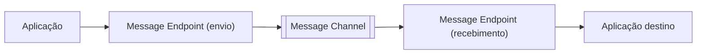

# Message Endpoint

## Descrição

Message Endpoint é a camada que conecta uma aplicação a um canal de mensageria. Ele é, ao mesmo tempo, um cliente do sistema de mensageria e uma parte da aplicação: conhece a API do cliente de mensageria de um lado e os dados e comandos da aplicação do outro.

Ao enviar, o endpoint converte o que a aplicação quer comunicar em uma mensagem e a publica no canal. Ao receber, extrai o conteúdo da mensagem e o entrega à aplicação em uma forma utilizável. O restante da aplicação continua lidando apenas com seus próprios objetos e requisições, sem conhecer formatos de mensagem, canais ou detalhes da API de mensageria.

Na prática, o endpoint é um padrão "guarda-chuva": os demais padrões do grupo (Messaging Gateway, Messaging Mapper, Polling Consumer, Event-Driven Consumer, Service Activator etc.) descrevem facetas e variações de como construí-lo.

## Problemas que resolve

- Aplicações que não foram escritas para mensageria precisam enviar e receber mensagens por canais.
- Código de negócio acoplado a formatos de mensagem, nomes de canal e API do cliente de mensageria fica difícil de testar e de evoluir.
- É preciso um ponto único onde decisões de envio e recebimento (transações, confirmação, consumo) sejam tomadas.

## Quando usar

- Sempre que uma aplicação participa de uma integração por mensageria, seja produzindo ou consumindo mensagens.
- Quando se quer isolar a aplicação da tecnologia de mensageria escolhida.

## Quando evitar

- Quando o próprio código da aplicação já é nativo de mensageria e uma camada extra só repetiria a API do cliente.
- Em integrações muito simples e descartáveis, em que a separação não compensa.

## Trade-offs

| Ganho | Custo / Risco |
| --- | --- |
| Aplicação isolada dos detalhes de mensageria | Camada adicional a desenvolver e manter |
| Ponto central para tratar transações, confirmações e erros | Abstração mal feita pode esconder comportamentos importantes (ordem, duplicatas) |
| Troca de tecnologia de mensageria com impacto localizado | Cada aplicação tende a ter seu próprio endpoint, com risco de inconsistência |

- Endpoints de envio e de recebimento têm responsabilidades diferentes e costumam ser projetados separadamente.
- A observabilidade (métricas de envio, consumo e falhas) é mais simples quando concentrada no endpoint.

## Diagrama

Cada aplicação acessa o canal por meio de seu endpoint, que traduz entre o mundo da aplicação e o da mensageria.

## Padrões relacionados

- [Messaging Gateway](/architecture/eip/messaging-endpoints/messaging-gateway) — encapsula o envio por trás de uma interface do domínio.
- [Messaging Mapper](/architecture/eip/messaging-endpoints/messaging-mapper) — converte entre objetos de domínio e mensagens.
- [Polling Consumer](/architecture/eip/messaging-endpoints/polling-consumer) — recebimento em que a aplicação decide quando buscar.
- [Event-Driven Consumer](/architecture/eip/messaging-endpoints/event-driven-consumer) — recebimento em que o sistema de mensageria aciona a aplicação.
- [Service Activator](/architecture/eip/messaging-endpoints/service-activator) — conecta mensagens a um serviço da aplicação.
- [Channel Adapter](/architecture/eip/messaging-channels/channel-adapter) — endpoint para aplicações que não conhecem mensageria.
- [Message Channel](/architecture/eip/messaging-channels/message-channel) — o canal ao qual o endpoint se conecta.
- [Message](/architecture/eip/message-construction/message) — a unidade de dados trocada pelo endpoint.

## Referência

- [Página do padrão no Enterprise Integration Patterns](https://www.enterpriseintegrationpatterns.com/MessageEndpoint.html)
