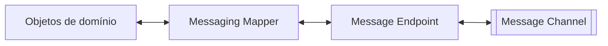

# Messaging Mapper

## Descrição

Messaging Mapper é um componente separado que converte entre objetos de domínio e mensagens. Ao enviar, lê os objetos e monta a mensagem para o canal; ao receber, cria ou atualiza objetos de domínio a partir do conteúdo da mensagem.

Nem os objetos de domínio nem a infraestrutura de mensageria conhecem o mapper, e por isso os dois lados evoluem de forma independente. É a especialização para mensageria do padrão Mapper de Fowler, análoga ao Data Mapper no mapeamento objeto-relacional.

O desafio é que objetos usam referências e herança, recursos que muitas infraestruturas de mensageria não suportam, e que a mensagem deve ser legível por aplicações que nem são orientadas a objetos.

## Problemas que resolve

- Acoplamento entre o modelo de domínio e o formato das mensagens.
- Dificuldade de representar grafos de objetos e herança em mensagens.
- Duplicação de código de conversão espalhado pela aplicação.

## Quando usar

- Quando o modelo de domínio é rico e precisa ser trocado por mensagens sem se acoplar a elas.
- Quando o formato da mensagem é definido por terceiros ou por um modelo canônico.

### Quando evitar

- Quando as mensagens são simples e o próprio objeto de dados já é a mensagem.
- Quando um serializador genérico do framework resolve sem lógica de mapeamento específica.

## Trade-offs

| Ganho | Custo / Risco |
| --- | --- |
| Domínio e mensageria independentes | Código de mapeamento a manter em cada mudança de modelo |
| Mudanças de formato ficam localizadas | Mapeamento de grafos e herança é complexo |
| Reuso do mesmo mapper em vários endpoints | Possível perda de informação na conversão |

- Convém versionar o formato da mensagem e testar o mapper com mensagens antigas e novas.

## Diagrama

O mapper fica entre o domínio e o endpoint, convertendo nos dois sentidos.

## Padrões relacionados

- [Message Endpoint](/architecture/eip/messaging-endpoints/message-endpoint) — usa o mapper para preencher e ler mensagens.
- [Messaging Gateway](/architecture/eip/messaging-endpoints/messaging-gateway) — frequentemente delega a conversão ao mapper.
- [Message Translator](/architecture/eip/message-transformation/message-translator) — traduz entre formatos de mensagem, e não entre objetos e mensagens.
- [Canonical Data Model](/architecture/eip/message-transformation/canonical-data-model) — formato comum para o qual o mapper pode converter.
- [Document Message](/architecture/eip/message-construction/document-message) — tipo de mensagem muitas vezes produzido pelo mapper.
- [Command Message](/architecture/eip/message-construction/command-message) — outro tipo de mensagem produzido pelo mapper.
- [Mapper (PoEAA)](/application/poeaa/base/mapper) — padrão geral do qual deriva.
- [Data Mapper (PoEAA)](/application/poeaa/data-source-architectural/data-mapper) — análogo para persistência.

## Referência

- [Página do padrão no Enterprise Integration Patterns](https://www.enterpriseintegrationpatterns.com/MessagingMapper.html)
