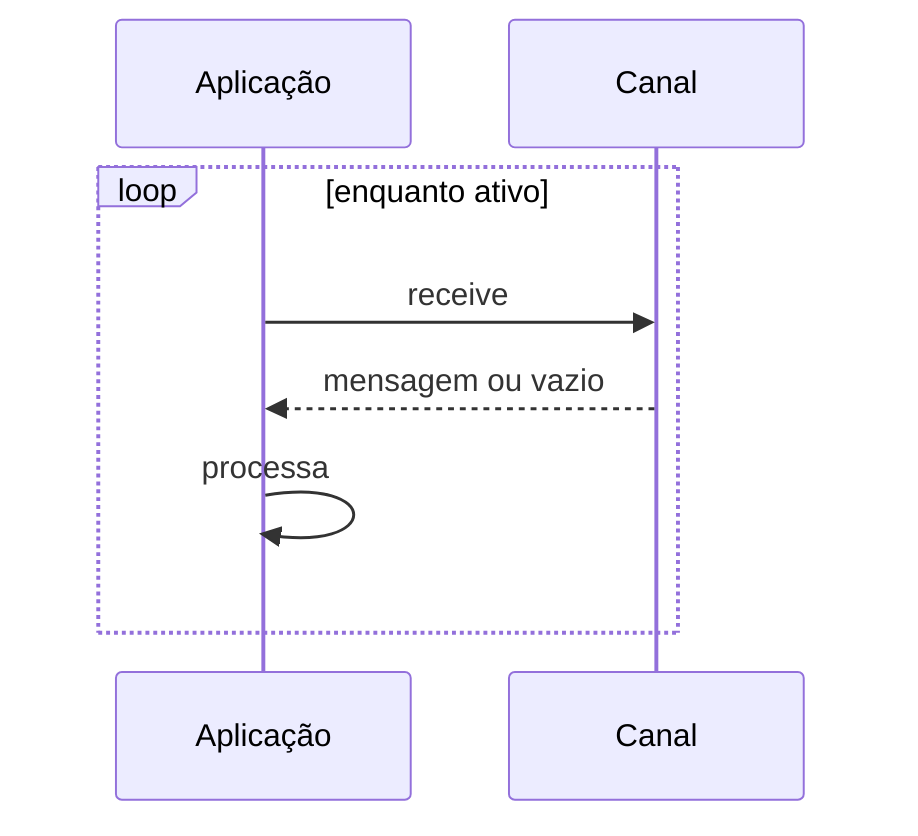

# Polling Consumer

## Descrição

Polling Consumer é um consumidor que só recebe uma mensagem quando a aplicação pede. Funciona como um laço: pede uma mensagem, processa, pede a próxima. Assim a aplicação controla o ritmo e decide quando está pronta para trabalhar.

As APIs de mensageria costumam oferecer receive bloqueante, que espera até chegar uma mensagem, e não bloqueante, que retorna imediatamente se não houver nenhuma. O primeiro prende uma thread; o segundo pode desperdiçar ciclos se a chegada for lenta.

É o oposto do Event-Driven Consumer, em que o sistema de mensageria aciona a aplicação.

## Problemas que resolve

- Consumidor que precisa limitar sua taxa de processamento (backpressure natural).
- Aplicação que só pode processar mensagens em determinadas janelas.
- Ambientes onde não há callback disponível.

## Quando usar

- Quando a aplicação precisa controlar quando e quantas mensagens consome.
- Em processamento em lote ou em janelas definidas.

### Quando evitar

- Quando a latência de entrega deve ser mínima e o intervalo de polling a prejudicaria.
- Quando o polling vazio gera custo desnecessário (por exemplo, serviços cobrados por requisição).

## Trade-offs

| Ganho | Custo / Risco |
| --- | --- |
| Controle de ritmo e de carga pelo consumidor | Latência até o próximo polling |
| Simplicidade de implementação | Consultas vazias consomem recursos |
| Fácil de combinar com lotes | Receive bloqueante ocupa threads |

- O intervalo de polling é um parâmetro de ajuste entre latência e custo.

## Diagrama

A aplicação pede mensagens em laço e processa cada uma que chega.

## Padrões relacionados

- [Event-Driven Consumer](./event-driven-consumer.md) — alternativa baseada em push.
- [Message Endpoint](./message-endpoint.md) — o polling consumer é um tipo de endpoint de recebimento.
- [Competing Consumers](../../../cloud/cloud-design-patterns/messaging/competing-consumers.md) — vários polling consumers no mesmo canal.
- [Transactional Client](./transactional-client.md) — o receive pode ser transacional.
- [Selective Consumer](./selective-consumer.md) — o polling pode ser filtrado.
- [Durable Subscriber](./durable-subscriber.md) — assinante que também pode usar polling.
- [Message Dispatcher](./message-dispatcher.md) — distribui o que o consumidor recebe.
- [Polling Publisher](../../microservices/transactional-messaging/polling-publisher.md) — uso de polling no lado do publicador.

## Referência

- [Página do padrão no Enterprise Integration Patterns](https://www.enterpriseintegrationpatterns.com/PollingConsumer.html)
