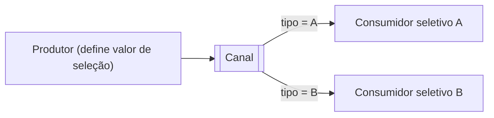

# Selective Consumer

## Descrição

Selective Consumer é um consumidor que filtra as mensagens do canal e aceita somente as que atendem a seus critérios. O produtor define um valor de seleção na mensagem (por exemplo, um tipo ou uma propriedade) e o consumidor declara um seletor sobre esse valor.

Em canais ponto a ponto, vários consumidores seletivos funcionam como consumidores concorrentes, mas cada mensagem só vai para um que a aceite; mensagens sem consumidor compatível ficam no canal até expirar. Em canais publish-subscribe, cada assinante só recebe as cópias de seu interesse, e o sistema pode evitar enviar cópias que seriam descartadas.

Com isso, um único canal pode se comportar como vários Datatype Channels, o que ajuda quando o número de canais suportado é limitado.

## Problemas que resolve

- Consumidor que recebe mensagens que não lhe interessam.
- Proliferação de canais, um por tipo de mensagem.
- Tráfego desnecessário de cópias descartadas.

## Quando usar

- Quando um canal carrega vários tipos de mensagem e cada consumidor trata um subconjunto.
- Quando o sistema de mensageria suporta seletores no servidor.

### Quando evitar

- Quando há canais dedicados por tipo com custo aceitável.
- Quando mensagens sem consumidor compatível poderiam ficar paradas indefinidamente.

## Trade-offs

| Ganho | Custo / Risco |
| --- | --- |
| Menos canais para gerenciar | Seletor mal escrito deixa mensagens órfãs |
| Menos tráfego inútil | Carga de filtragem no broker |
| Consumidores especializados | Acoplamento entre produtor e critérios do consumidor |

- Documente o contrato do valor de seleção e monitore mensagens que ninguém consome.

## Diagrama

Cada consumidor recebe apenas as mensagens cujo valor de seleção atende a seu critério.

## Padrões relacionados

- [Message Filter](/architecture/eip/message-routing/message-filter) — descarta mensagens no meio do fluxo, em vez de no consumidor.
- [Datatype Channel](/architecture/eip/messaging-channels/datatype-channel) — alternativa com um canal por tipo.
- [Content-Based Router](/architecture/eip/message-routing/content-based-router) — roteia ativamente com base no conteúdo.
- [Competing Consumers](/architecture/cloud-design-patterns/messaging/competing-consumers) — consumidores seletivos competem entre os compatíveis.
- [Publish-Subscribe Channel](/architecture/cloud-design-patterns/messaging/publisher-subscriber) — cada assinante filtra suas cópias.
- [Message Dispatcher](/architecture/eip/messaging-endpoints/message-dispatcher) — pode escolher performers por propriedades.
- [Message Endpoint](/architecture/eip/messaging-endpoints/message-endpoint) — o seletor faz parte do endpoint.

## Referência

- [Página do padrão no Enterprise Integration Patterns](https://www.enterpriseintegrationpatterns.com/MessageSelector.html)
