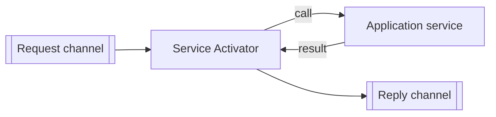

# Service Activator

## Descrição

Service Activator fica entre o canal de mensageria e um serviço da aplicação. Ele recebe mensagens do canal e invoca o serviço correspondente, tornando-o acessível por mensageria sem que o serviço saiba disso.

Pode tratar requisições de mão única ou trocas Request-Reply, em que o resultado é enviado ao canal de resposta. O serviço costuma ser uma chamada local simples, por exemplo parte de uma camada de serviço. O activator pode sempre chamar o mesmo serviço ou escolher o alvo com base na mensagem, por exemplo por reflexão.

Como o activator cuida de todos os detalhes de mensageria, o serviço é chamado como por qualquer outro cliente e pode ser reutilizado por outros meios de acesso.

## Problemas que resolve

- Expor um serviço existente via mensageria sem alterá-lo.
- Misturar lógica de negócio com código de consumo de mensagens.

## Quando usar

- Quando um serviço deve ser invocado por mensagens de comando ou de requisição.
- Quando o mesmo serviço também é acessível por outros meios (API, chamada local).

### Quando evitar

- Quando o serviço já é nativo de mensageria.
- Quando a conversão exigida é tão grande que pede um componente de transformação separado.

## Trade-offs

| Ganho | Custo / Risco |
| --- | --- |
| Serviço independente da mensageria | Componente adicional por serviço |
| Reuso do serviço por vários canais de acesso | Tratamento de erros e reentregas precisa ser definido no activator |
| Ponto único para adaptar mensagens a chamadas | Resposta assíncrona exige correlação |

- Decida o comportamento diante de mensagens inválidas, enviando-as a um Invalid Message Channel.

## Diagrama

O activator traduz a mensagem em chamada ao serviço e, se necessário, devolve o resultado por outro canal.

## Padrões relacionados

- [Message Endpoint](./message-endpoint.md) — o activator é um tipo de endpoint de recebimento.
- [Messaging Gateway](./messaging-gateway.md) — contraparte do lado emissor.
- [Command Message](../message-construction/command-message.md) — mensagem típica que aciona o serviço.
- [Request-Reply](../message-construction/request-reply.md) — interação suportada pelo activator.
- [Event-Driven Consumer](./event-driven-consumer.md) — forma habitual de recepção.
- [Polling Consumer](./polling-consumer.md) — outra forma de recepção.
- [Message Dispatcher](./message-dispatcher.md) — pode distribuir mensagens a vários activators.
- [Invalid Message Channel](../messaging-channels/invalid-message-channel.md) — destino de mensagens que o serviço não entende.

## Referência

- [Página do padrão no Enterprise Integration Patterns](https://www.enterpriseintegrationpatterns.com/MessagingAdapter.html)
