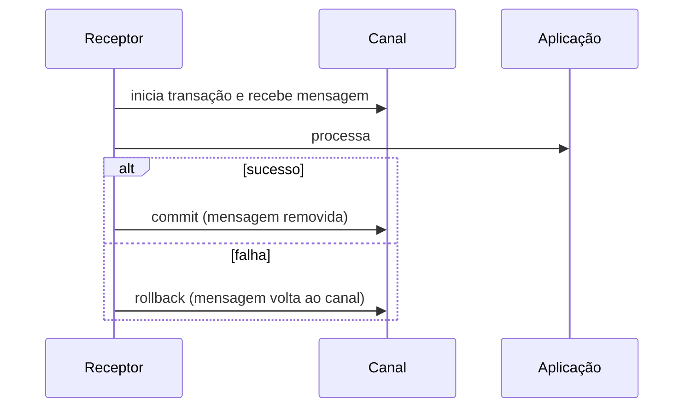

# Transactional Client

## Descrição

Transactional Client torna transacional a sessão do cliente com o sistema de mensageria, de modo que o próprio cliente define os limites da transação. Do lado emissor, a mensagem só é efetivamente colocada no canal quando o emissor faz commit. Do lado receptor, a mensagem só é removida do canal quando o receptor faz commit.

Assim, se o receptor falha no meio do processamento, faz rollback e a mensagem continua disponível para nova tentativa. Emissores e receptores transacionais e não transacionais podem conviver no mesmo canal.

Em sistemas amplamente distribuídos, semântica transacional custa caro em desempenho, e muitos serviços de mensageria em nuvem preferem alternativas, como o tempo de visibilidade (a mensagem recebida fica oculta e reaparece se não for confirmada).

## Problemas que resolve

- Perda de mensagem quando o consumidor falha depois de recebê-la e antes de concluir o trabalho.
- Envio parcial: um grupo de mensagens que deveria sair junto sai pela metade.
- Necessidade de coordenar mensagens com outros recursos transacionais.

## Quando usar

- Quando o processamento de uma mensagem precisa ser tudo ou nada.
- Quando várias mensagens devem ser publicadas atomicamente.

### Quando evitar

- Em sistemas de alta vazão e muito distribuídos, em que o custo transacional é inaceitável.
- Quando o consumidor é idempotente e pode usar confirmação simples com reentrega.

## Trade-offs

| Ganho | Custo / Risco |
| --- | --- |
| Processamento tudo ou nada | Menor desempenho e maior contenção |
| Reentrega automática após rollback | Transações longas seguram recursos do broker |
| Envio atômico de várias mensagens | Transação distribuída com o banco de dados exige coordenação adicional |

- Uma transação de mensageria não cobre o banco de dados do aplicativo, a menos que haja coordenação; para isso, veja o Transactional Outbox.
- Mensagens que sempre falham geram laços de reentrega e pedem Dead Letter Channel.

## Diagrama

A mensagem só deixa o canal no commit; no rollback ela fica disponível para outra tentativa.

## Padrões relacionados

- [Message Endpoint](./message-endpoint.md) — o endpoint é quem controla a transação.
- [Guaranteed Delivery](../messaging-channels/guaranteed-delivery.md) — persistência do canal, complementar às transações.
- [Dead Letter Channel](../messaging-channels/dead-letter-channel.md) — destino para mensagens que falham repetidamente.
- [Competing Consumers](../../../cloud/azure/messaging/competing-consumers.md) — rollback devolve a mensagem a outro consumidor.
- [Polling Consumer](./polling-consumer.md) — pode receber dentro de uma transação.
- [Event-Driven Consumer](./event-driven-consumer.md) — idem, com confirmação após o callback.
- [Transactional Outbox](../../microservices/transactional-messaging/transactional-outbox.md) — alternativa para atomicidade entre banco e mensageria.

## Referência

- [Página do padrão no Enterprise Integration Patterns](https://www.enterpriseintegrationpatterns.com/TransactionalClient.html)
