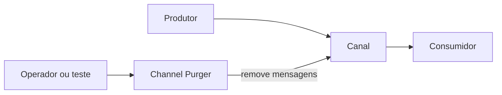

# Channel Purger

## Descrição

O Channel Purger remove mensagens indesejadas de um canal. Na forma mais simples, esvazia o canal por completo para devolver o sistema a um estado conhecido. Numa forma seletiva, remove apenas mensagens que atendam a critérios, como um identificador ou o valor de algum campo.

Mensageria persistente e assíncrona pode deixar mensagens perdidas no caminho. Elas ficam esperando e acabam consumidas por quem não devia, produzindo comportamento estranho e difícil de diagnosticar.

## Problemas que resolve

- Mensagens residuais de execuções anteriores interferem em testes e em sistemas em execução.
- Em request-reply, uma resposta antiga pode ser lida por um novo solicitante no lugar da resposta correta.
- Testes precisam começar de um estado consistente.
- Em produção, às vezes é preciso retirar mensagens específicas sem perturbar o restante.

## Quando usar

- Preparar ambientes de teste para que cada execução comece com canais vazios.
- Limpar filas de resposta após falhas de solicitantes.
- Remover mensagens problemáticas identificadas durante a operação.

### Quando evitar

- Quando as mensagens têm valor de negócio e não podem ser perdidas; prefira movê-las para um [Dead Letter Channel](../messaging-channels/dead-letter-channel.md).
- Sem controle de acesso, pois a operação é destrutiva.
- Como substituto de tratamento adequado de erros e expiração de mensagens.

## Trade-offs

| Ganho | Custo / Risco |
| --- | --- |
| Restaura rapidamente um estado limpo | Perda irreversível das mensagens removidas |
| Torna testes repetíveis | Pode apagar mensagens legítimas se usado sem critério |
| Permite remoção seletiva em produção | Precisa de permissões restritas e de registro da operação |

- Convém registrar o que foi removido, por exemplo copiando para um [Message Store](./message-store.md).
- Muitos brokers oferecem a operação de purge pronta, por exemplo no console da fila.

## Diagrama

O purger age diretamente sobre o canal, removendo todas as mensagens ou só as que atendem ao critério.

## Padrões relacionados

- [Dead Letter Channel](../messaging-channels/dead-letter-channel.md) — preserva mensagens problemáticas em vez de descartá-las.
- [Message Store](./message-store.md) — registra o que foi purgado.
- [Control Bus](./control-bus.md) — pode acionar a limpeza remotamente.
- [Point-to-Point Channel](../messaging-channels/point-to-point-channel.md) — canal em que as mensagens residuais mais atrapalham.
- [Correlation Identifier](../message-construction/correlation-identifier.md) — evita confundir respostas, e serve como critério de purga seletiva.
- [Invalid Message Channel](../messaging-channels/invalid-message-channel.md) — destino alternativo para mensagens inválidas.

## Referência

- [Página do padrão no Enterprise Integration Patterns](https://www.enterpriseintegrationpatterns.com/ChannelPurger.html)
