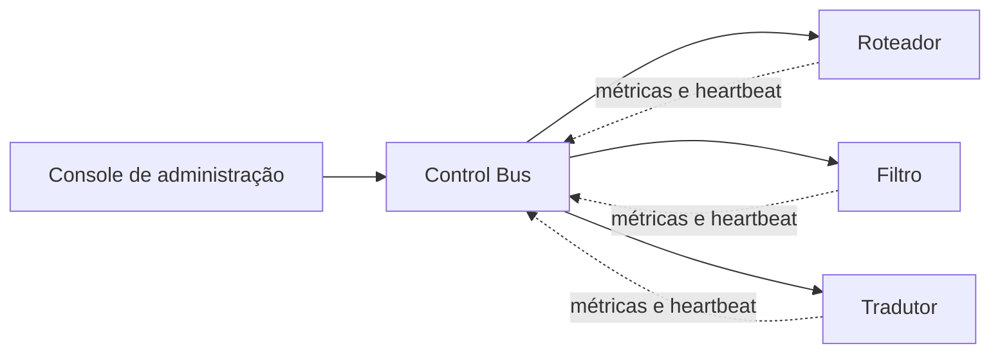

# Control Bus

## Descrição

O Control Bus é um canal de gerenciamento paralelo ao fluxo de dados da aplicação. Ele usa a mesma infraestrutura de mensageria, mas transporta mensagens de controle: comandos de configuração, pedidos de status, heartbeats, métricas e alterações de comportamento.

Cada componente da solução se conecta a dois subsistemas: o fluxo de mensagens de negócio e o Control Bus. Assim, uma única ferramenta de administração consegue monitorar e comandar componentes espalhados por várias plataformas, redes e localidades, sem acessá-los um a um.

## Problemas que resolve

- Administrar uma solução de integração distribuída em várias plataformas e regiões geográficas.
- Evitar que a informação de gerenciamento se misture com os dados de negócio.
- Reconfigurar roteadores, filtros e outros componentes em tempo de execução, sem reiniciá-los.
- Coletar saúde e métricas de componentes heterogêneos de forma uniforme.

## Quando usar

- Solução com muitos componentes distribuídos que precisam ser monitorados e configurados de forma central.
- Necessidade de alterar regras de roteamento ou ligar e desligar rotas dinamicamente.
- Quando já existe infraestrutura de mensageria que pode ser reaproveitada para o gerenciamento.

### Quando evitar

- Soluções pequenas, com poucos componentes, em que configuração por arquivo ou console local basta.
- Quando comandos de controle exigem resposta síncrona e garantida que o canal assíncrono não oferece.
- Quando não há controle de acesso adequado, pois o canal permite alterar o comportamento do sistema.

## Trade-offs

| Ganho | Custo / Risco |
| --- | --- |
| Administração centralizada e uniforme | Canal de controle é um alvo sensível e exige autenticação e autorização |
| Separação entre dados de negócio e de gerenciamento | Cada componente precisa de uma segunda conexão e de lógica de tratamento de comandos |
| Reconfiguração em tempo de execução | Mudanças dinâmicas dificultam reproduzir o estado do sistema |
| Reaproveita a infraestrutura de mensageria | Se o próprio broker falhar, o controle também fica indisponível |

- Mensagens de controle são assíncronas, então o efeito de um comando não é imediato.
- Convém padronizar o formato dos comandos e das métricas entre componentes.

## Diagrama

O console envia comandos pelo Control Bus aos componentes, que respondem com métricas e heartbeats pelo mesmo canal, separado do fluxo de dados.

## Padrões relacionados

- [Detour](/architecture/eip/system-management/detour) — o Control Bus comanda a troca de rota do Detour.
- [Test Message](/architecture/eip/system-management/test-message) — complementa os heartbeats verificando se a saída dos componentes está correta.
- [Message History](/architecture/eip/system-management/message-history) — ajuda a analisar o que o Control Bus observa.
- [Wire Tap](/architecture/eip/system-management/wire-tap) — instrumentação passiva que pode alimentar o gerenciamento.
- [Message Store](/architecture/eip/system-management/message-store) — armazena informações de mensagens para relatórios.
- [Content-Based Router](/architecture/eip/message-routing/content-based-router) — componente cuja regra de roteamento costuma ser alterada via Control Bus.
- [External Configuration Store](/cloud/cloud-design-patterns/deployment-and-topology/external-configuration-store) — alternativa de configuração centralizada baseada em repositório, em vez de mensagens.

## Referência

- [Página do padrão no Enterprise Integration Patterns](https://www.enterpriseintegrationpatterns.com/ControlBus.html)
