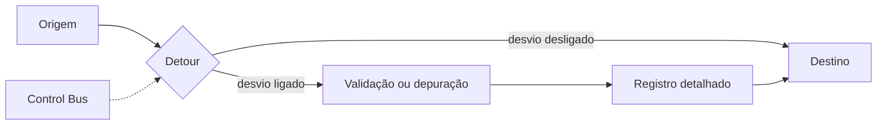

# Detour

## Descrição

O Detour é um roteador simples, baseado em contexto, com duas saídas. Na primeira, a mensagem segue direto ao destino original, sem alteração. Na segunda, ela passa antes por etapas intermediárias, como validação, registro detalhado ou transformação, e só então segue ao mesmo destino.

A escolha da saída é controlada por fora, normalmente por mensagens enviadas pelo Control Bus. Em operação normal o desvio fica desligado e o custo é mínimo. Quando é preciso inspecionar ou alterar o tráfego, liga-se o desvio sem mudar a topologia permanente.

## Problemas que resolve

- Inspecionar o fluxo é fácil com Wire Tap, mas modificar ou interceptar mensagens exige um mecanismo ativo.
- Passar mensagens por etapas extras de validação, teste ou depuração apenas quando necessário.
- Evitar a sobrecarga permanente de componentes que só são úteis de forma ocasional.

## Quando usar

- Depuração de um problema em produção, inserindo temporariamente um componente de análise ou correção.
- Testes e validações que não devem rodar o tempo todo.
- Quando é necessário alterar o conteúdo ou o caminho da mensagem sem redesenhar o fluxo.

## Quando evitar

- Se só é preciso observar mensagens, [Wire Tap](/architecture/eip/system-management/wire-tap) é mais seguro, pois não interfere no fluxo.
- Se as etapas extras devem ser sempre aplicadas, basta colocá-las no fluxo normal.
- Quando não há um canal de controle confiável para acionar o desvio.

## Trade-offs

| Ganho | Custo / Risco |
| --- | --- |
| Etapas extras só entram quando necessário | O roteador de desvio é mais um ponto de falha e de latência |
| Ligar e desligar sem mudar a topologia | O comportamento do sistema passa a depender de um estado de controle dinâmico |
| Permite alterar mensagens, não apenas observá-las | Desvio esquecido ligado degrada o desempenho ou altera dados indevidamente |

- Mensagens em trânsito durante a troca de rota podem seguir caminhos diferentes, o que afeta a ordem.
- O estado do desvio deve ser visível na observabilidade.

## Diagrama

O roteador envia a mensagem direto ao destino ou pelas etapas intermediárias, conforme o comando recebido do Control Bus.

## Padrões relacionados

- [Control Bus](/architecture/eip/system-management/control-bus) — aciona a troca entre as duas saídas.
- [Wire Tap](/architecture/eip/system-management/wire-tap) — observação passiva, enquanto o Detour permite intervir.
- [Content-Based Router](/architecture/eip/message-routing/content-based-router) — o Detour é um roteador cuja decisão vem do contexto e não do conteúdo.
- [Publish-Subscribe Channel](/architecture/cloud-design-patterns/messaging/publisher-subscriber) — alternativa para distribuir cópias a observadores.

## Referência

- [Página do padrão no Enterprise Integration Patterns](https://www.enterpriseintegrationpatterns.com/Detour.html)
