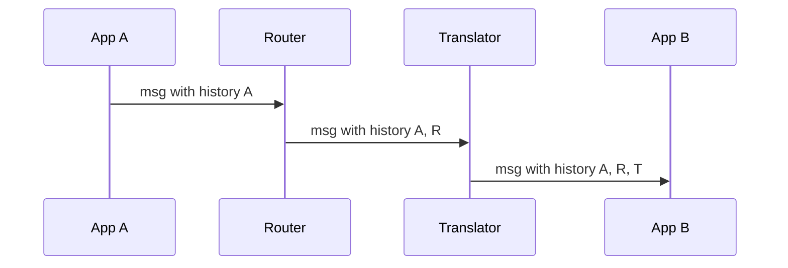

# Message History

## Descrição

O Message History anexa à própria mensagem a lista dos componentes pelos quais ela passou desde a origem. Cada componente, inclusive o originador, acrescenta uma entrada à lista, normalmente com identificação e, se útil, horário.

A lista fica no cabeçalho, separada do payload de negócio, mantendo dados de controle do sistema fora dos dados da aplicação. Isso devolve parte da visibilidade que o acoplamento fraco da mensageria esconde: o receptor passa a saber de onde a mensagem veio e por onde andou.

## Problemas que resolve

- Em mensageria, o receptor normalmente não sabe quem enviou a mensagem nem por quais etapas ela passou, o que dificulta depurar.
- Avaliar o impacto de mudar um formato de mensagem, descobrindo quais aplicações o produzem.
- Rastrear mensagens agregadas, que combinam várias entradas, cada uma com seu próprio histórico.

## Quando usar

- Fluxos com muitos componentes intermediários em que o caminho real da mensagem é difícil de determinar.
- Depuração e análise de impacto em soluções com acoplamento fraco.
- Quando se quer rastreabilidade sem consultar um repositório externo.

### Quando evitar

- Quando o histórico revelaria topologia interna a destinatários externos.
- Quando as mensagens são muito pequenas e o cabeçalho crescente pesaria no tráfego.
- Se já existe tracing distribuído que cobre a necessidade com um sistema dedicado.

## Trade-offs

| Ganho | Custo / Risco |
| --- | --- |
| Rastreio do caminho embutido na mensagem | O cabeçalho cresce a cada etapa |
| Dados de controle separados do payload | Todos os componentes precisam respeitar a convenção |
| Útil para depuração e análise de impacto | Pode expor detalhes internos da arquitetura |

- Em agregações, é preciso decidir entre guardar uma árvore com o histórico de cada entrada ou só o da mensagem principal.
- O histórico não substitui um armazenamento persistente; se a mensagem se perde, o rastro também.

## Diagrama

A cada componente a mensagem ganha uma entrada no histórico, de modo que o destino conhece todo o caminho percorrido.

## Padrões relacionados

- [Message Store](./message-store.md) — guarda os dados das mensagens em um local central.
- [Wire Tap](./wire-tap.md) — outra forma de observar o tráfego.
- [Control Bus](./control-bus.md) — usado para gerenciar os componentes que mantêm o histórico.
- [Correlation Identifier](../message-construction/correlation-identifier.md) — liga mensagens relacionadas, enquanto o histórico mostra o caminho.
- [Distributed Tracing](../../microservices/observability/distributed-tracing.md) — abordagem equivalente em microservices, com spans coletados externamente.

## Referência

- [Página do padrão no Enterprise Integration Patterns](https://www.enterpriseintegrationpatterns.com/MessageHistory.html)
