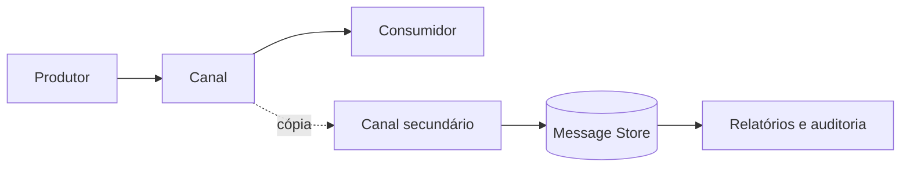

# Message Store

## Descrição

O Message Store captura informações sobre cada mensagem em um local central. Quando uma mensagem é enviada a um canal, uma cópia segue para um canal secundário do qual o repositório a coleta. O próprio componente pode fazer a duplicação, ou um [Wire Tap](./wire-tap.md) pode ser inserido no canal.

O envio da cópia é fire-and-forget, para não atrasar o fluxo principal. Em geral guardam-se apenas os campos úteis para análise posterior, como identificador, canal, horário e talvez o corpo, em vez de tudo.

## Problemas que resolve

- O acoplamento fraco torna o comportamento dinâmico da solução difícil de observar.
- Gerar relatórios sobre o tráfego sem perturbar o fluxo transitório da mensageria.
- Capturar mensagens completas aumenta o tráfego, então é preciso guardar só o necessário.

## Quando usar

- Auditoria, análise de desempenho e reconstrução do que aconteceu em um fluxo.
- Relatórios sobre volumes, latências e rotas.
- Reprocessamento ou investigação posterior de falhas.

### Quando evitar

- Mensagens com dados sensíveis, se não houver controle de acesso e retenção adequados.
- Alto volume de mensagens grandes, em que a cópia completa tem custo desproporcional.
- Se o histórico precisa ser a fonte de verdade do estado, caso em que cabe event sourcing.

## Trade-offs

| Ganho | Custo / Risco |
| --- | --- |
| Visibilidade central do tráfego | Custo de armazenamento e de rede crescente |
| Análise sem afetar o fluxo principal | Cópias sensíveis exigem proteção e política de retenção |
| Base para auditoria e relatórios | Armazenar só metadados limita investigações posteriores |

- O envio assíncrono pode perder cópias em falhas, então o repositório não é um registro garantido.
- Definir o que e por quanto tempo guardar é uma decisão de projeto importante.

## Diagrama

Cada mensagem segue ao consumidor e uma cópia chega ao repositório central, de onde saem relatórios.

## Padrões relacionados

- [Wire Tap](./wire-tap.md) — mecanismo comum para alimentar o repositório.
- [Message History](./message-history.md) — acrescenta o caminho percorrido às informações guardadas.
- [Control Bus](./control-bus.md) — gerencia a captura e consulta de dados.
- [Event Sourcing](../../../cloud/azure/data-management/event-sourcing.md) — guarda eventos como fonte de verdade, enquanto o Message Store serve à observação.
- [Audit Logging](../../microservices/observability/audit-logging.md) — registro de auditoria que o repositório pode sustentar.

## Referência

- [Página do padrão no Enterprise Integration Patterns](https://www.enterpriseintegrationpatterns.com/MessageStore.html)
