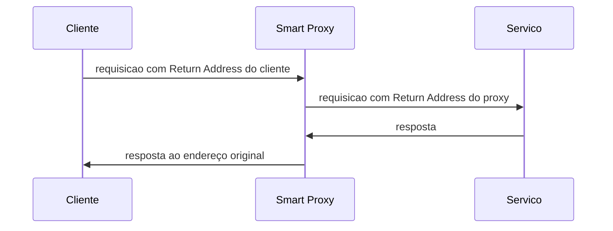

# Smart Proxy

## Descrição

O Smart Proxy é colocado no canal de requisição de um serviço. Para cada requisição, ele guarda o Return Address original do solicitante e o substitui por um canal de resposta próprio. O serviço, sem saber, responde ao proxy.

Quando a resposta chega, o proxy consulta o endereço guardado, usa um roteador de mensagens para encaminhá-la ao solicitante original e, nesse meio tempo, observa tanto a requisição quanto a resposta. Isso permite medir tempos, contar chamadas e registrar resultados.

## Problemas que resolve

- Um par de Wire Taps só rastreia um componente que publica em um canal de saída fixo.
- Serviços que respondem ao Return Address informado por cada solicitante não podem ser acompanhados de forma simples.
- Medir latência e registrar pares requisição-resposta sem alterar o serviço.

## Quando usar

- Monitorar serviços de request-reply cujas respostas vão para endereços variáveis.
- Obter métricas de tempo de resposta por serviço ou por cliente.
- Instrumentar serviços que não podem ser modificados.

## Quando evitar

- Se o serviço publica em um canal de saída fixo, dois [Wire Taps](/architecture/eip/system-management/wire-tap) bastam.
- Quando a latência adicional do proxy não é aceitável.
- Para comunicação sem resposta (apenas eventos ou comandos).

## Trade-offs

| Ganho | Custo / Risco |
| --- | --- |
| Observa requisição e resposta de serviços dinâmicos | O proxy guarda estado (endereços) e vira ponto de falha |
| Não exige mudanças no serviço | Acrescenta um salto de rede e latência |
| Possibilita métricas por chamada | Mais complexidade para correlacionar respostas e requisições |

- Respostas que nunca chegam deixam entradas pendentes, exigindo expiração do estado.
- Depende de [Correlation Identifier](/architecture/eip/message-construction/correlation-identifier) para casar resposta e requisição.

## Diagrama

O proxy troca o endereço de retorno, recebe a resposta e a repassa ao cliente, observando o ciclo completo.

## Padrões relacionados

- [Return Address](/architecture/eip/message-construction/return-address) — o endereço que o proxy guarda e substitui.
- [Correlation Identifier](/architecture/eip/message-construction/correlation-identifier) — associa respostas às requisições.
- [Request-Reply](/architecture/eip/message-construction/request-reply) — interação que o proxy intermedia.
- [Wire Tap](/architecture/eip/system-management/wire-tap) — solução mais simples para canais de saída fixos.
- [Proxy](/coding/gof/structural/proxy) — o equivalente em design de classes: um intermediário que controla o acesso ao objeto real.

## Referência

- [Página do padrão no Enterprise Integration Patterns](https://www.enterpriseintegrationpatterns.com/SmartProxy.html)
