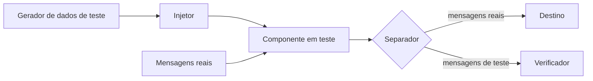

# Test Message

## Descrição

O Test Message injeta mensagens sintéticas no fluxo normal e verifica o resultado que sai do outro lado. Heartbeats enviados ao Control Bus mostram que um componente está vivo, mas não que sua saída está correta; um componente pode continuar processando e, ainda assim, corromper o resultado por uma falha interna.

O padrão tem quatro papéis: um gerador de dados de teste, um injetor que marca as mensagens (em geral por um campo de cabeçalho), um separador que retira as respostas de teste da saída (tipicamente via Content-Based Router) e um verificador que compara o resultado real com o esperado.

## Problemas que resolve

- Verificar a saúde do processamento, e não apenas a presença do componente.
- Detectar falhas silenciosas que geram saída incorreta sem derrubar o processo.
- Distinguir dados de teste dos dados reais, sem contaminar os resultados de negócio.

## Quando usar

- Componentes críticos em que resultados errados são mais perigosos do que indisponibilidade.
- Monitoramento contínuo de pipelines de transformação e roteamento.
- Validar o fluxo de ponta a ponta em produção, com mensagens controladas.

### Quando evitar

- Se as mensagens de teste puderem causar efeitos colaterais reais (cobranças, envio de e-mails).
- Quando não é possível marcar as mensagens com um campo de cabeçalho e a alternativa é usar valores especiais em campos de negócio.
- Fluxos simples, em que um check de saúde básico é suficiente.

## Trade-offs

| Ganho | Custo / Risco |
| --- | --- |
| Verifica a correção da saída, e não só a vida do componente | Exige gerador, injetor, separador e verificador |
| Detecta falhas silenciosas | Mensagens de teste que vazam para o fluxo real causam danos |
| Pode rodar continuamente em produção | Gera carga extra e precisa de dados esperados atualizados |

- Marcar o teste em campos de negócio mistura controle com dados e deve ser último recurso.
- O resultado esperado precisa ser mantido junto com as regras do componente.

## Diagrama

O injetor insere mensagens marcadas no fluxo, o separador as desvia da saída e o verificador compara o resultado com o esperado.

## Padrões relacionados

- [Control Bus](/architecture/eip/system-management/control-bus) — recebe heartbeats e alertas de falha do verificador.
- [Content-Based Router](/architecture/eip/message-routing/content-based-router) — base do separador de mensagens de teste.
- [Return Address](/architecture/eip/message-construction/return-address) — pode direcionar as respostas de teste ao verificador.
- [Health Endpoint Monitoring](/cloud/cloud-design-patterns/resiliency/health-endpoint-monitoring) — verificação de saúde de serviços, mais superficial que a validação do resultado.

## Referência

- [Página do padrão no Enterprise Integration Patterns](https://www.enterpriseintegrationpatterns.com/TestMessage.html)
