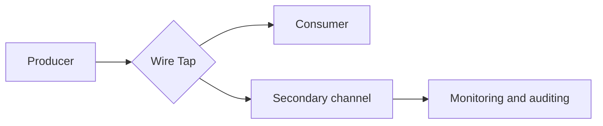

# Wire Tap

## Descrição

O Wire Tap é uma derivação passiva num canal ponto a ponto. Funciona como uma Recipient List fixa com duas saídas: cada mensagem é copiada, sem alteração, para o destino original e para um canal secundário.

A lógica de análise (monitoramento, auditoria, depuração) fica em um componente separado que consome o canal secundário. Como o canal principal não muda de comportamento, o tap pode ser inserido em quase qualquer canal com baixo risco para a solução existente.

## Problemas que resolve

- Canais ponto a ponto entregam cada mensagem a um único consumidor, o que impede inspecionar todo o tráfego.
- Necessidade de testar, monitorar e diagnosticar fluxos sem alterar os componentes envolvidos.
- Reaproveitar uma instrumentação genérica em vários canais.

## Quando usar

- Monitoramento e auditoria de mensagens em canais ponto a ponto.
- Diagnóstico de problemas em ambientes onde não se pode alterar o produtor nem o consumidor.
- Alimentar um [Message Store](./message-store.md) ou ferramentas de análise com cópias do tráfego.

### Quando evitar

- Em canais publish-subscribe, em que basta adicionar outro assinante.
- Quando as cópias contêm dados sensíveis e o canal secundário não tem a mesma proteção do original.
- Quando for preciso modificar ou redirecionar mensagens, caso em que [Detour](./detour.md) é mais adequado.

## Trade-offs

| Ganho | Custo / Risco |
| --- | --- |
| Observação sem alterar o fluxo principal | Duplica o volume de mensagens e o consumo de recursos |
| Fácil de acrescentar a canais existentes | A cópia pode vazar dados sensíveis se o canal secundário for menos protegido |
| Análise desacoplada, em outro componente | O roteador do tap é um novo ponto de falha e de latência |

- O envio da cópia deve ser tipo fire-and-forget para não atrasar o fluxo principal.
- A cópia pode ficar fora de ordem ou atrasada em relação à entrega original.

## Diagrama

O tap entrega a mensagem ao consumidor e uma cópia idêntica ao canal secundário, onde um componente de análise a consome.

## Padrões relacionados

- [Message Store](./message-store.md) — guarda as informações capturadas pelo tap.
- [Message History](./message-history.md) — complementa o tap com o caminho percorrido pela mensagem.
- [Detour](./detour.md) — versão ativa, capaz de alterar o fluxo.
- [Smart Proxy](./smart-proxy.md) — permite rastrear serviços cujas respostas vão para um Return Address dinâmico.
- [Control Bus](./control-bus.md) — pode ligar e desligar taps dinamicamente.
- [Publish-Subscribe Channel](../../../cloud/cloud-design-patterns/messaging/publisher-subscriber.md) — dispensa o tap quando o canal já é de difusão.
- [Log Aggregation](../../microservices/observability/log-aggregation.md) — consolida os registros gerados pela análise das cópias.

## Referência

- [Página do padrão no Enterprise Integration Patterns](https://www.enterpriseintegrationpatterns.com/WireTap.html)
