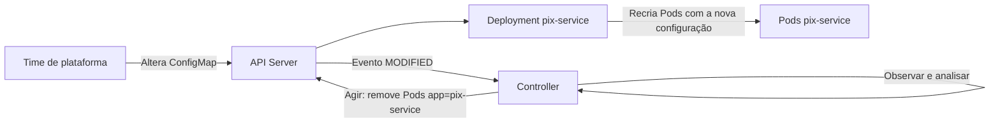

# Controller

## Descrição

O padrão Controller é um processo que observa continuamente um conjunto de recursos do Kubernetes e age para aproximar o estado real do estado desejado declarado neles. O próprio Kubernetes é, em essência, uma frota de controllers: o controller de Deployment, de ReplicaSet e de StatefulSet rodam em um laço de reconciliação sem fim, e você pode plugar os seus no mesmo mecanismo.

A API do Kubernetes é declarativa: em vez de mandar "crie um Pod", você altera o campo `replicas` de um Deployment e os controllers fazem o resto. Cada mudança gera um evento, e cada controller interessado reage em três passos: **observar** (acompanhar eventos de mudança dos recursos), **analisar** (calcular a diferença para o estado desejado) e **agir** (criar, alterar ou remover recursos pela API). Essas ações geram novos eventos, que outros controllers podem consumir, sem que um conheça o outro.

Um controller customizado é só uma aplicação que roda de forma permanente, em qualquer linguagem capaz de falar com a API. Para guardar a configuração que ele lê, as opções mais simples são labels (indexadas, boas para seletores), annotations (metadados não identificadores, sem custo de índice) e ConfigMaps. Quando o domínio pede um tipo próprio de recurso, o passo seguinte é o [Operator](/architecture/kubernetes-patterns/advanced/operator).

## Problemas que resolve

- Necessidade de estender o Kubernetes com comportamento próprio sem alterar nem quebrar o código da plataforma
- Tarefas operacionais repetitivas, feitas à mão, que dependem de reagir a mudanças em recursos existentes
- Automações que precisam ser declarativas e reconciliadas continuamente, em vez de scripts que rodam uma vez e deixam o estado divergir
- Acoplamento entre a plataforma e extensões: os eventos oferecem uma fronteira técnica clara

## Quando usar

- Quando o comportamento desejado pode ser expresso observando e agindo sobre recursos padrão (Deployment, Service, ConfigMap, Node)
- Para reiniciar cargas quando uma configuração muda, expor Services automaticamente ou aplicar convenções de metadados em toda a plataforma
- Quando você não tem permissão de administrador do cluster para registrar CustomResourceDefinitions
- Quando uma anotação ou um ConfigMap bastam para descrever a intenção do usuário

## Quando evitar

- Quando o domínio precisa de um tipo próprio de recurso, com validação de esquema, versionamento e RBAC por tipo: use um [Operator](/architecture/kubernetes-patterns/advanced/operator)
- Quando o problema não é declarativo ou os dados não cabem no modelo de recursos do Kubernetes: uma API própria exposta por um Service pode ser mais simples
- Quando um recurso nativo já resolve (por exemplo, um Deployment com [Health Probe](/architecture/kubernetes-patterns/foundational/health-probe) já reinicia contêineres doentes)
- Quando a equipe não consegue assumir a manutenção de mais um componente permanente da plataforma

## Trade-offs

| Ganho | Custo / Risco |
| --- | --- |
| Extensão da plataforma sem modificar o Kubernetes | Mais um componente de longa duração para operar, monitorar e atualizar |
| Automação reativa e declarativa, reconciliada continuamente | Fluxo assíncrono de eventos difícil de depurar, sem pontos de parada simples |
| Qualquer linguagem pode implementar um controller | Controllers ingênuos perdem eventos ou param quando a conexão cai |
| Funciona com recursos padrão, sem permissões de administrador do cluster | Labels, annotations e ConfigMaps não têm validação nem versionamento de uma CRD |

- **Replica única:** controllers costumam rodar como Deployment com uma réplica, seguindo o [Singleton Service](/architecture/kubernetes-patterns/behavioral/singleton-service); o bloqueio otimista da API evita conflitos de escrita.
- **Robustez:** observar eventos não basta. Controllers de produção reiniciam o stream quando ele cai e fazem uma listagem completa de tempos em tempos para recuperar eventos perdidos.
- **Permissões mínimas:** a ServiceAccount do controller deve ter só os verbos e recursos de que precisa.
- **Labels ou annotations:** use labels quando precisar de seletor e annotations para o restante, já que não são indexadas.
- **Idempotência:** a reconciliação roda várias vezes sobre o mesmo estado e precisa produzir sempre o mesmo resultado.

## Diagrama



O controller observa eventos de ConfigMap, identifica pela anotação quais Pods dependem dele e age pela API; o Deployment recria os Pods, que já sobem com a configuração nova.

## Exemplo

Na fintech, o `pix-service` lê limites e horários de corte de um ConfigMap exposto como variáveis de ambiente, o que exige reinício para valer. Um controller próprio reinicia os Pods quando o ConfigMap marcado com a annotation muda. O primeiro manifesto é o ConfigMap com a intenção declarada; o segundo é o Deployment do controller, com uma réplica e a namespace observada vinda da [Downward API](/architecture/kubernetes-patterns/behavioral/self-awareness).

```yaml
apiVersion: v1
kind: ConfigMap
metadata:
  name: pix-service-config
  namespace: fintech
  annotations:
    # lido pelo controller: Pods a reiniciar quando este ConfigMap mudar
    fintech.example/restart-pods-selector: "app=pix-service"
data:
  PIX_NIGHT_LIMIT_CENTS: "100000"
  PIX_MAX_TRANSFER_CENTS: "500000"
```

```yaml
apiVersion: apps/v1
kind: Deployment
metadata:
  name: config-restart-controller
  namespace: fintech
spec:
  replicas: 1 # uma única instância reconciliando
  selector:
    matchLabels:
      app: config-restart-controller
  template:
    metadata:
      labels:
        app: config-restart-controller
    spec:
      serviceAccountName: config-restart-controller # com permissão de watch em ConfigMaps e delete em Pods
      containers:
        - name: controller
          image: registry.fintech.example/config-restart-controller:0.3.0
          env:
            - name: WATCH_NAMESPACE
              valueFrom:
                fieldRef:
                  fieldPath: metadata.namespace
          resources:
            requests:
              cpu: 50m
              memory: 64Mi
```

## Padrões relacionados

- [Operator](/architecture/kubernetes-patterns/advanced/operator) — evolução do Controller que usa CustomResourceDefinitions para modelar o domínio da aplicação
- [Singleton Service](/architecture/kubernetes-patterns/behavioral/singleton-service) — controllers rodam com uma única instância ativa para não agir em duplicidade
- [Configuration Resource](/architecture/kubernetes-patterns/configuration/configuration-resource) — ConfigMaps e annotations são a forma mais simples de informar a intenção a um controller
- [Ambassador](/architecture/cloud-design-patterns/integration-and-modernization/ambassador) — um proxy auxiliar no mesmo Pod pode expor a API do Kubernetes em localhost para o controller
- [Leader Election](/architecture/cloud-design-patterns/distributed-coordination/leader-election) — permite várias réplicas do controller com apenas uma ativa, para alta disponibilidade

## Referência

- [Kubernetes Patterns, capítulo 22: Controller](https://k8spatterns.com/)
- [Controllers (documentação do Kubernetes)](https://kubernetes.io/docs/concepts/architecture/controller/)
- [Operator pattern (documentação do Kubernetes)](https://kubernetes.io/docs/concepts/extend-kubernetes/operator/)
