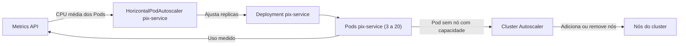

# Elastic Scale

## Descrição

O padrão Elastic Scale faz a capacidade de uma aplicação acompanhar a carga automaticamente, escalando em várias dimensões: horizontalmente (número de réplicas de Pod), verticalmente (requests e limits de cada Pod) e no nível do cluster (número de nós). Em vez de um humano observar a carga e decidir quanto escalar, o Kubernetes mede o uso real e ajusta o estado desejado.

A forma mais direta é o **HorizontalPodAutoscaler (HPA)**, que lê métricas (CPU e memória, métricas customizadas de Pod ou de objeto e métricas externas, como a profundidade de uma fila) e calcula as réplicas necessárias, proporcionais à razão entre o valor atual e o alvo. O **Vertical Pod Autoscaler (VPA)** recomenda ou aplica requests e limits ajustados ao consumo real, e o **Cluster Autoscaler** adiciona ou remove nós quando há Pods que não cabem ou nós ociosos. A escala manual, imperativa ou declarativa, continua válida para cargas previsíveis.

Os níveis são complementares e independentes: ajustar a própria aplicação, definir requests corretos (VPA), variar o número de Pods (HPA) e variar o número de nós (Cluster Autoscaler). Os autoscalers dependem de que os [Predictable Demands](/architecture/kubernetes-patterns/foundational/predictable-demands) estejam declarados, já que as porcentagens são calculadas sobre os requests.

## Problemas que resolve

- Cargas sazonais ou imprevisíveis, em que um número fixo de réplicas ou fica pequeno demais ou desperdiça recursos
- Dificuldade de dimensionar com precisão quantas réplicas e quantos recursos cada contêiner precisa
- Intervenção manual lenta e propensa a erro durante picos de tráfego
- Custo de infraestrutura pago em horários de baixa demanda

## Quando usar

- Quando a carga varia ao longo do dia, da semana ou do mês, como em dias de pagamento de boletos ou de grandes campanhas
- Em serviços sem estado, que escalam bem horizontalmente
- Quando há uma métrica correlacionada ao número de Pods, como CPU, requisições por segundo ou tamanho da fila
- Quando o cluster roda em uma nuvem capaz de provisionar e remover nós sob demanda

## Quando evitar

- Quando a métrica escolhida não cai ao adicionar Pods (memória em aplicações que não liberam dados é o caso clássico), pois o HPA escalaria até o máximo
- Em aplicações com estado difícil de redistribuir, em que escalar horizontalmente é complexo ou arriscado
- Quando a carga é estável e previsível: um número fixo de réplicas é mais simples
- Quando os requests não foram definidos, já que as porcentagens de uso não têm referência
- Sem cuidado, quando HPA e VPA agem sobre as mesmas métricas de CPU e memória, que podem gerar escala dupla

## Trade-offs

| Ganho | Custo / Risco |
| --- | --- |
| Capacidade acompanha a demanda sem intervenção humana | Reação com atraso: coleta de métricas, ciclo do HPA e inicialização dos Pods |
| Menos custo, pois só se paga o que é preciso | Métricas mal escolhidas causam escala excessiva ou oscilação (thrashing) |
| Maior disponibilidade em picos de tráfego | VPA reinicia Pods para aplicar novos requests, o que pode causar interrupções |
| Escala em vários níveis, de Pods a nós | Configuração e ajuste fino são trabalhosos e dependem de experimentação |

- **Escolha da métrica:** prefira uma métrica correlacionada, de preferência linear, ao número de Pods, como CPU ou requisições por segundo.
- **Estabilização:** use janelas de estabilização e políticas de escala para evitar oscilações, principalmente na redução.
- **Limites:** defina mínimo e máximo de réplicas, para ter capacidade em picos e proteger o orçamento e as dependências, como o banco de dados.
- **Aplicar o HPA ao Deployment:** aplicá-lo a um ReplicaSet gerenciado perde a configuração a cada atualização.
- **Prontidão:** réplicas novas só devem receber tráfego quando prontas; combine com [Health Probe](/architecture/kubernetes-patterns/foundational/health-probe) e com um encerramento gracioso.
- **VPA no modo de recomendação:** começar com o modo que apenas sugere valores ajuda a ajustar requests sem disrupção.

## Diagrama



O HPA compara o uso medido com o alvo e ajusta as réplicas do Deployment; se faltar espaço para os novos Pods, o Cluster Autoscaler aumenta o número de nós.

## Exemplo

O `pix-service` recebe picos nos horários de pagamento. Este HorizontalPodAutoscaler (`autoscaling/v2`) mantém a CPU média em 60% dos requests, entre 3 e 20 réplicas, sobe rápido e reduz devagar para evitar oscilações. O Deployment precisa declarar `resources.requests.cpu` e o cluster precisa ter o metrics-server.

```yaml
apiVersion: autoscaling/v2
kind: HorizontalPodAutoscaler
metadata:
  name: pix-service
  namespace: fintech
spec:
  scaleTargetRef:
    apiVersion: apps/v1
    kind: Deployment
    name: pix-service
  minReplicas: 3
  maxReplicas: 20
  metrics:
    - type: Resource
      resource:
        name: cpu
        target:
          type: Utilization
          averageUtilization: 60
  behavior:
    scaleUp:
      stabilizationWindowSeconds: 0
      policies:
        - type: Percent
          value: 100
          periodSeconds: 60
    scaleDown:
      stabilizationWindowSeconds: 300 # espera 5 minutos antes de reduzir
```

## Padrões relacionados

- [Predictable Demands](/architecture/kubernetes-patterns/foundational/predictable-demands) — requests e limits declarados são a base dos cálculos de HPA, VPA e Cluster Autoscaler
- [Declarative Deployment](/architecture/kubernetes-patterns/foundational/declarative-deployment) — o HPA deve ser aplicado ao Deployment, que preserva a escala nas atualizações
- [Health Probe](/architecture/kubernetes-patterns/foundational/health-probe) — garante que réplicas recém-criadas só recebam tráfego quando estiverem prontas
- [Automated Placement](/architecture/kubernetes-patterns/foundational/automated-placement) — define em quais nós os novos Pods são agendados, e dispara o Cluster Autoscaler quando não há espaço
- [Queue-Based Load Leveling](/architecture/cloud-design-patterns/messaging/queue-based-load-leveling) — a profundidade da fila é uma métrica externa útil para escalar consumidores
- [Competing Consumers](/architecture/cloud-design-patterns/messaging/competing-consumers) — escalar réplicas de consumidores aumenta o paralelismo sobre a mesma fila

## Referência

- [Kubernetes Patterns, capítulo 24: Elastic Scale](https://k8spatterns.com/)
- [Horizontal Pod Autoscaling (documentação do Kubernetes)](https://kubernetes.io/docs/tasks/run-application/horizontal-pod-autoscale/)
- [Node Autoscaling (documentação do Kubernetes)](https://kubernetes.io/docs/concepts/cluster-administration/node-autoscaling/)
