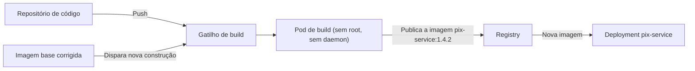

# Image Builder

## Descrição

O padrão Image Builder constrói as imagens de contêiner dentro do próprio cluster Kubernetes, usando o escalonador e os recursos da plataforma para executar os builds em vez de um sistema de build externo. A abordagem clássica compila a imagem fora do cluster, envia ao registry e só então referencia a imagem nos Deployments; aqui, build e execução acontecem no mesmo lugar.

Os ganhos vêm de unificar a infraestrutura: um único cluster reduz custo de manutenção e simplifica o planejamento de capacidade, e o escalonador do Kubernetes é adequado para encontrar recursos livres para jobs de build. Além disso, como o cluster conhece tanto o build quanto o deployment, ele pode reagir automaticamente: se uma imagem base com uma vulnerabilidade é corrigida, todas as imagens que dependem dela podem ser reconstruídas e as aplicações reimplantadas sem intervenção.

O custo é segurança. Fora do cluster, o build roda isolado; dentro, ele disputa o mesmo ambiente das cargas de produção. Por isso o padrão pede **builds sem daemon e sem privilégios de root**, com ferramentas que montam a imagem sem um daemon de contêiner privilegiado. O livro (2019) ilustra o padrão com o subsistema de build do OpenShift (com Source-to-Image, builds a partir de Dockerfile, ImageStreams e triggers de reconstrução) e com o Knative Build (um recurso de build cujos passos viram contêineres executados em sequência no Pod). Essas ferramentas específicas mudaram desde então: o próprio livro antecipa que o Knative Build seria substituído por um projeto sucessor. Trate-as como ilustrações históricas e consulte a documentação atual da ferramenta que pretende adotar.

## Problemas que resolve

- Infraestrutura duplicada: um cluster para executar aplicações e outro sistema de CI para construir as imagens
- Planejamento de capacidade separado e agendamento ineficiente de jobs de build em máquinas dedicadas
- Distância entre o build e o deployment, que dificulta reconstruir e reimplantar automaticamente quando uma imagem base muda
- Dependência de um daemon de contêiner privilegiado para montar imagens

## Quando usar

- Quando a política da empresa permite concentrar build e execução no mesmo cluster
- Quando você quer reconstruir e reimplantar automaticamente as aplicações ao corrigir uma imagem base
- Quando já existe um cluster com capacidade e escalonamento que pode absorver os jobs de build
- Quando o time consegue operar builds sem privilégios de root e isolá-los das cargas de produção

## Quando evitar

- Quando a política de segurança exige isolamento forte entre o ambiente de build e o de produção
- Quando um serviço de build gerenciado ou o CI atual já atende, sem custo extra de operação
- Quando os builds são pesados e podem disputar recursos com cargas críticas, sem namespaces, quotas ou nós dedicados para isolá-los
- Quando a equipe não tem como manter o ferramental de build dentro da plataforma

## Trade-offs

| Ganho | Custo / Risco |
| --- | --- |
| Infraestrutura única para construir e executar, com menos custo de manutenção | Builds rodam no mesmo cluster das cargas de produção, ampliando a superfície de ataque |
| Aproveita o escalonador do Kubernetes para alocar jobs de build | Builds pesados podem competir por recursos com serviços críticos |
| Reconstrução e reimplantação automáticas quando a imagem base muda | Dependência de ferramentas específicas, algumas em evolução rápida ou já descontinuadas |
| Builds sem daemon e sem root reduzem o risco de escape de contêiner | Imagens de build costumam ser mais lentas, sem cache de camadas e de dependências |

- **Sem privilégios:** prefira ferramentas de build sem daemon e sem root; evite montar o socket do daemon do host no contêiner de build.
- **Isolamento:** use namespaces, ResourceQuotas, [Predictable Demands](/architecture/kubernetes-patterns/foundational/predictable-demands) e nós dedicados para que builds não afetem os serviços.
- **Imagem enxuta:** separe o ambiente de build do runtime (builds em múltiplos estágios ou encadeados) para não levar compiladores à produção.
- **Cache:** um repositório de dependências interno ao cluster reduz o tempo de build.
- **Credenciais:** o acesso ao registry e ao repositório de código deve usar Secrets com permissões mínimas.
- **Ferramentas em mudança:** valide a situação atual de cada ferramenta antes de adotá-la.

## Diagrama

O build roda como um Pod do próprio cluster; a imagem publicada alimenta o Deployment, e a atualização de uma imagem base dispara uma nova construção.

## Padrões relacionados

- [Declarative Deployment](/architecture/kubernetes-patterns/foundational/declarative-deployment) — implanta a imagem produzida pelo build, com estratégia de atualização controlada
- [Batch Job](/architecture/kubernetes-patterns/behavioral/batch-job) — um build é uma carga finita, executada até o fim
- [Init Container](/architecture/kubernetes-patterns/structural/init-container) — passos de build podem ser executados em sequência como contêineres de inicialização de um Pod
- [Immutable Configuration](/architecture/kubernetes-patterns/configuration/immutable-configuration) — imagens versionadas e imutáveis tornam o resultado do build reprodutível
- [Operator](/architecture/kubernetes-patterns/advanced/operator) — ferramentas de build dentro do cluster costumam ser implementadas como Operators com CRDs próprias

## Referência

- [Kubernetes Patterns, capítulo 25: Image Builder](https://k8spatterns.com/)
