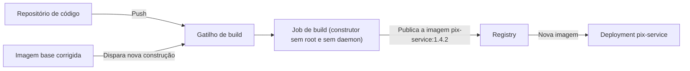

# Image Builder

## Descrição

O padrão Image Builder constrói as imagens de contêiner dentro do próprio cluster Kubernetes, usando o escalonador e os recursos da plataforma para executar os builds em vez de um sistema de build externo. A abordagem clássica compila a imagem fora do cluster, envia ao registry e só então referencia a imagem nos Deployments; aqui, build e execução acontecem no mesmo lugar.

Os ganhos vêm de unificar a infraestrutura: um único cluster reduz custo de manutenção e simplifica o planejamento de capacidade, e o escalonador do Kubernetes é adequado para encontrar recursos livres para jobs de build. Além disso, como o cluster conhece tanto o build quanto o deployment, ele pode reagir automaticamente: se uma imagem base com uma vulnerabilidade é corrigida, todas as imagens que dependem dela podem ser reconstruídas e as aplicações reimplantadas sem intervenção.

O ecossistema de ferramentas é amplo e se sobrepõe, e se divide em duas categorias. Os **construtores de imagem** só criam a imagem, sem se ocupar do redeploy, e rodam sem privilégios de root:

- **Baseados em Dockerfile:** Buildah e Podman, Kaniko (pensado para rodar como contêiner de build em um Pod sem privilégios) e BuildKit, que tem um formato de build de baixo nível e frentes alternativas ao Dockerfile.
- **Multilinguagem:** os Cloud Native Buildpacks detectam o tipo de projeto e seguem um fluxo opinativo (detectar, construir, exportar); no cluster, são usados por meio do `pack`, de passos de CI ou do kpack, que expressa os conceitos como CRDs. O Source-to-Image do OpenShift segue a mesma ideia.
- **Especializados:** Jib (Java), ko (Go) e Apko montam as camadas da imagem diretamente, sem executar comandos arbitrários, o que os torna rápidos e sem root.

Os **orquestradores de build** ficam um nível acima: acionam um construtor e cuidam do restante, como atualizar os descritores de deployment com a nova imagem. São plataformas de CI e CD como Tekton, Argo CD e Flux, além do kbld (que constrói e substitui as referências de imagem nos YAMLs), do subsistema de build do OpenShift e de um Job comum do Kubernetes que embrulha um Pod de build. Em um **Pod de build**, init containers executam em sequência a obtenção do código, o build e a publicação no registry, e um passo final pode atualizar o Deployment, disparando um rollout.

O **OpenShift Build** é um dos modos mais antigos e maduros de construir imagens no cluster. Um `BuildConfig` define estratégia (Source-to-Image, Docker, pipeline ou custom) e fontes (Git, Dockerfile, imagem, Secret ou binário). Os `ImageStreams` emitem eventos quando uma imagem muda, e triggers como `imageChange` reconstroem ou reimplantam em cadeia. Isso permite builds encadeados: uma etapa compila e uma segunda monta uma imagem de runtime enxuta. A contrapartida é que só funciona na distribuição OpenShift.

Como o cenário das ferramentas muda rápido e projetos podem ser descontinuados, confirme que a ferramenta escolhida continua mantida antes de adotá-la.

## Problemas que resolve

- Infraestrutura duplicada: um cluster para executar aplicações e outro sistema de CI para construir as imagens
- Planejamento de capacidade separado e agendamento ineficiente de jobs de build em máquinas dedicadas
- Distância entre o build e o deployment, que dificulta reconstruir e reimplantar automaticamente quando uma imagem base muda
- Dependência de um daemon de contêiner privilegiado para montar imagens

## Quando usar

- Quando a política da empresa permite concentrar build e execução no mesmo cluster
- Quando você quer reconstruir e reimplantar automaticamente as aplicações ao corrigir uma imagem base
- Quando já existe um cluster com capacidade e escalonamento que pode absorver os jobs de build
- Quando o time consegue operar builds sem privilégios de root e isolá-los das cargas de produção

## Quando evitar

- Quando a política de segurança exige isolamento forte entre o ambiente de build e o de produção
- Quando um serviço de build gerenciado ou o CI atual já atende, sem custo extra de operação
- Quando os builds são pesados e podem disputar recursos com cargas críticas, sem namespaces, quotas ou nós dedicados para isolá-los
- Quando a equipe não tem como manter o ferramental de build dentro da plataforma

## Trade-offs

| Ganho | Custo / Risco |
| --- | --- |
| Infraestrutura única para construir e executar, com menos custo de manutenção | Builds rodam no mesmo cluster das cargas de produção, ampliando a superfície de ataque |
| Aproveita o escalonador do Kubernetes para alocar jobs de build | Builds pesados podem competir por recursos com serviços críticos |
| Reconstrução e reimplantação automáticas quando a imagem base muda | Dependência de ferramentas específicas, algumas em evolução rápida ou descontinuadas |
| Builds sem daemon e sem root reduzem o risco de escape de contêiner | Builds costumam ser mais lentos, sem cache de camadas e de dependências |

- **Sem privilégios:** prefira construtores sem daemon e sem root; evite montar o socket do daemon do host no contêiner de build. Alguns, como o Kaniko, ainda rodam como UID 0 dentro de um Pod sem privilégios, o que clusters que proíbem root no contêiner não aceitam.
- **Isolamento:** use namespaces, ResourceQuotas, [Predictable Demands](/architecture/kubernetes-patterns/foundational/predictable-demands) e nós dedicados para que builds não afetem os serviços.
- **Imagem enxuta:** separe o ambiente de build do runtime (builds em múltiplos estágios ou encadeados, ou Buildpacks, que usam uma imagem de runtime separada) para não levar compiladores à produção; o Source-to-Image, por padrão, deixa o ambiente de build na imagem final.
- **Cache:** um repositório de dependências interno ao cluster reduz o tempo de build.
- **Credenciais:** o acesso ao registry e ao repositório de código deve usar Secrets com permissões mínimas, e o Pod de build só deve poder alterar o Deployment que precisa atualizar.
- **Ferramentas em mudança:** valide a situação atual de cada ferramenta antes de adotá-la.
- **Pod de build é didático:** em produção, use um orquestrador (Tekton, Argo CD, Flux ou OpenShift Build) em vez de passos manuais.

## Diagrama



O build roda como um Job do próprio cluster; a imagem publicada alimenta o Deployment, e a atualização de uma imagem base dispara uma nova construção.

## Exemplo

Este Job (`batch/v1`) constrói a imagem do `pix-service` dentro do cluster. Um init container obtém o código na tag `v1.4.2`, e o Kaniko, que não precisa de daemon nem de privilégios no Pod, monta a imagem a partir do Dockerfile e a publica no registry usando as credenciais de um Secret `kubernetes.io/dockerconfigjson`. Os nomes dos repositórios, do registry e as versões das imagens das ferramentas são ilustrativos. O repositório original do Kaniko foi arquivado em junho de 2025, depois da publicação do livro; para uso real, confira se há um fork mantido ou prefira outro construtor sem daemon, como o Buildah.

```yaml
apiVersion: batch/v1
kind: Job
metadata:
  name: build-pix-service-1-4-2
  namespace: fintech
spec:
  backoffLimit: 0
  ttlSecondsAfterFinished: 3600
  template:
    spec:
      restartPolicy: Never
      securityContext:
        fsGroup: 65533 # permite que o git-sync grave no volume compartilhado
      initContainers:
        - name: fetch-source
          image: registry.k8s.io/git-sync/git-sync:v4.2.1
          args:
            - --repo=https://git.fintech.example/payments/pix-service.git
            - --ref=v1.4.2
            - --depth=1
            - --root=/workspace
            - --link=src
            - --one-time
          volumeMounts:
            - name: workspace
              mountPath: /workspace
      containers:
        - name: build
          image: gcr.io/kaniko-project/executor:v1.23.2
          args:
            - --context=dir:///workspace/src
            - --destination=registry.fintech.example/pix-service:1.4.2
          securityContext:
            privileged: false # o build não exige privilégios no Pod
          volumeMounts:
            - name: workspace
              mountPath: /workspace
            - name: registry-creds
              mountPath: /kaniko/.docker
      volumes:
        - name: workspace
          emptyDir: {}
        - name: registry-creds
          secret:
            secretName: registry-creds
            items:
              - key: .dockerconfigjson
                path: config.json
```

## Padrões relacionados

- [Declarative Deployment](/architecture/kubernetes-patterns/foundational/declarative-deployment) — implanta a imagem produzida pelo build, com estratégia de atualização controlada
- [Batch Job](/architecture/kubernetes-patterns/behavioral/batch-job) — um build é uma carga finita, executada até o fim
- [Init Container](/architecture/kubernetes-patterns/structural/init-container) — passos de build podem ser executados em sequência como contêineres de inicialização de um Pod
- [Immutable Configuration](/architecture/kubernetes-patterns/configuration/immutable-configuration) — imagens versionadas e imutáveis tornam o resultado do build reprodutível
- [Operator](/architecture/kubernetes-patterns/advanced/operator) — ferramentas de build dentro do cluster costumam ser implementadas como Operators com CRDs próprias

## Referência

- [Kubernetes Patterns, capítulo 30: Image Builder](https://k8spatterns.com/)
