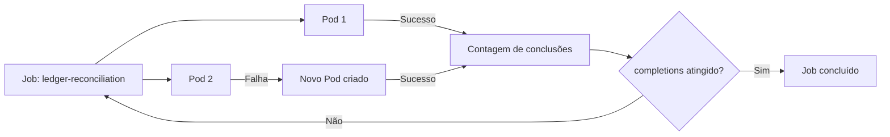

# Batch Job

## Descrição

O padrão Batch Job executa uma unidade de trabalho finita e isolada em Pods de vida curta, usando o recurso Job do Kubernetes para garantir que ela termine com sucesso mesmo diante de falhas de contêiner ou de nó. Diferente de um Deployment ou ReplicaSet, que mantém processos rodando indefinidamente, um Job considera o trabalho concluído quando o número esperado de Pods termina com êxito, e não cria mais nenhum.

Um Pod avulso não é recriado se o nó falhar. O Job assume essa responsabilidade: ele reagenda Pods que falharam, respeita um limite de tentativas e pode rodar várias execuções em paralelo. O campo `completions` define quantas execuções bem-sucedidas são necessárias, `parallelism` quantas rodam ao mesmo tempo (o valor é um teto desejado, não uma garantia, e zero pausa o Job) e `restartPolicy` precisa ser `OnFailure` ou `Never`. A combinação dos dois campos produz três tipos de Job: o **Pod único**, com os valores padrão, concluído quando o Pod termina com êxito; o de **contagem fixa**, com `completions` maior que um, indicado quando o número de itens é conhecido e cada um justifica um Pod; e o de **fila de trabalho**, sem `completions` e com `parallelism` maior que um, em que os Pods coordenam entre si o que processar e o Job termina quando um deles sai com sucesso e os demais também terminaram.

## Problemas que resolve

- Tarefas finitas que precisam terminar de forma confiável, sem depender de um Pod avulso que se perde se o nó cair
- Processamentos que devem ser repetidos automaticamente quando falham, com limite de tentativas
- Trabalho em volume que deve ser dividido entre várias execuções paralelas
- Recursos presos por processos que já terminaram, quando o trabalho deveria liberar capacidade ao acabar

## Quando usar

- Em migrações de dados, conciliações, geração de relatórios e cargas pontuais
- Quando o trabalho tem começo e fim bem definidos e pode ser repetido com segurança
- Quando é preciso paralelizar o processamento de uma fila ou de um conjunto de itens indexados
- Quando o resultado só importa depois de concluir, e o custo de computação deve ser pago apenas durante a execução

## Quando evitar

- Para serviços que precisam ficar no ar continuamente: use um Deployment
- Para trabalho recorrente em horários definidos: prefira o [Periodic Job](/architecture/kubernetes-patterns/behavioral/periodic-job)
- Quando a tarefa não é idempotente e não há como tolerar execuções repetidas após uma falha
- Para fluxos longos com dependências complexas entre etapas, que pedem um orquestrador de workflows

## Trade-offs

| Ganho | Custo / Risco |
| --- | --- |
| Execução confiável, com reagendamento automático após falhas | Uma tarefa pode rodar mais de uma vez, então precisa ser idempotente |
| Paralelismo configurável sem código extra de coordenação | Exige dimensionar `completions`, `parallelism` e limites de tentativa |
| Recursos liberados quando o trabalho termina | Pods concluídos permanecem até serem limpos, o que pede uma política de retenção |
| Modelo declarativo e simples para tarefas pontuais | Sem dependências entre Jobs: orquestrar etapas exige outra ferramenta |

- **Idempotência:** após uma falha, o Pod é refeito do início; grave resultados de forma que repetir não duplique lançamentos.
- **Limites:** defina `backoffLimit` e `activeDeadlineSeconds` para que um Job defeituoso não tente para sempre.
- **Limpeza:** use `ttlSecondsAfterFinished` para remover Jobs concluídos automaticamente.
- **Tipo de Job:** a contagem fixa serve a itens grandes e conhecidos; a fila de trabalho serve a itens pequenos, em que um Pod por item seria custo excessivo, e exige que os Pods se coordenem.
- **Mapeamento de itens:** um Job por item permite acompanhar e escalar cada um, mas sobrecarrega a plataforma; um Job para todos os itens exige um framework de batch dentro da aplicação.
- **Fluxo contínuo:** para um fluxo ilimitado de itens, um ReplicaSet é mais adequado que um Job.

## Diagrama



O Job cria Pods em paralelo, substitui os que falham e só é marcado como concluído quando o número de execuções bem-sucedidas chega ao valor de `completions`.

## Exemplo

Uma conciliação diária do razão contábil da fintech, executada por quatro Pods em duas frentes paralelas, com limite de tentativas e limpeza automática.

```yaml
apiVersion: batch/v1
kind: Job
metadata:
  name: ledger-reconciliation
  namespace: fintech
spec:
  completions: 4
  parallelism: 2
  backoffLimit: 3
  activeDeadlineSeconds: 3600
  ttlSecondsAfterFinished: 86400
  template:
    metadata:
      labels:
        app: ledger-service
    spec:
      restartPolicy: OnFailure
      containers:
        - name: reconciler
          image: registry.fintech.example/ledger-service:1.4.2
          args: ["reconcile", "--date=2026-11-15"]
          resources:
            requests:
              cpu: 500m
              memory: 512Mi
```

O `restartPolicy: OnFailure` é obrigatório em um Job, e os limites `backoffLimit` e `activeDeadlineSeconds` impedem tentativas infinitas.

## Padrões relacionados

- [Periodic Job](/architecture/kubernetes-patterns/behavioral/periodic-job) — o CronJob cria Jobs em horários definidos, somando a dimensão de tempo
- [Predictable Demands](/architecture/kubernetes-patterns/foundational/predictable-demands) — declarar requests e limits do Job ajuda o agendador a acomodá-lo
- [Managed Lifecycle](/architecture/kubernetes-patterns/foundational/managed-lifecycle) — o Pod do Job precisa tratar o sinal de término e encerrar com o código de saída correto
- [Init Container](/architecture/kubernetes-patterns/structural/init-container) — prepara dados ou dependências antes do contêiner principal do Job
- [Idempotent Consumer](/architecture/cloud-design-patterns/messaging/idempotent-consumer) — torna seguro reprocessar itens quando um Pod é reexecutado

## Referência

- [Kubernetes Patterns, capítulo 7: Batch Job](https://k8spatterns.com/)
- [Jobs na documentação do Kubernetes](https://kubernetes.io/docs/concepts/workloads/controllers/job/)
