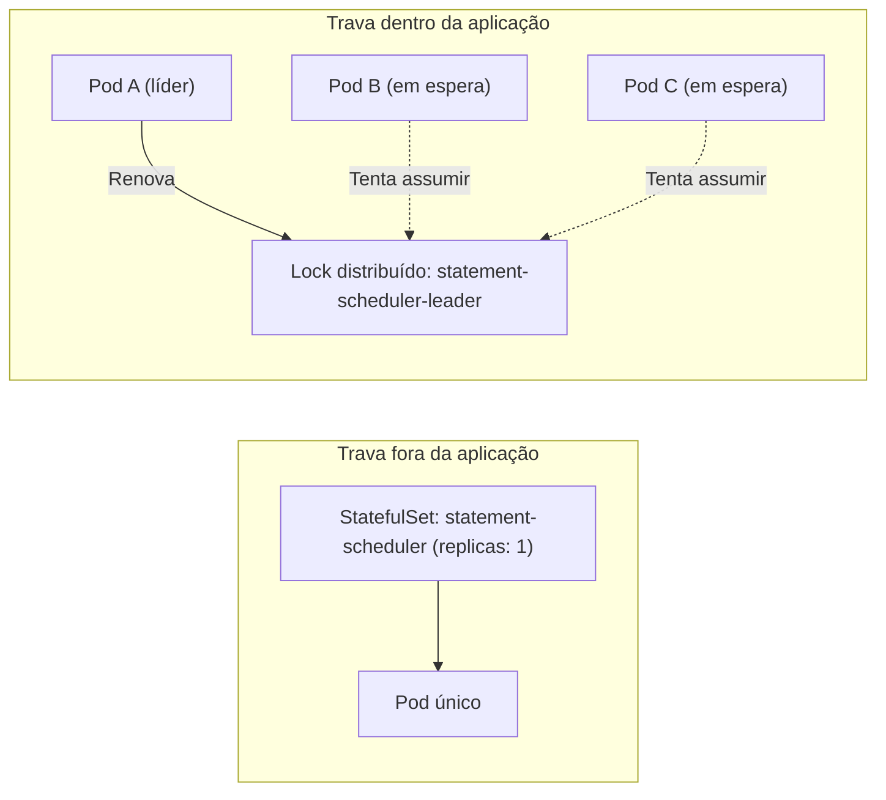

# Singleton Service

## Descrição

O padrão Singleton Service garante que apenas uma instância ativa de um serviço esteja em execução por vez, seja por controle externo da plataforma, seja por uma disputa de liderança dentro da própria aplicação. Ele atende tarefas que não podem ser executadas em paralelo, como um consumidor que precisa processar mensagens em ordem estrita ou um agendador que não deve disparar a mesma rotina duas vezes.

Não confunda com o Singleton do GoF, que limita instâncias de uma classe dentro de um processo. Aqui a restrição vale para Pods em um cluster distribuído. Há duas abordagens. Na **trava fora da aplicação**, o Kubernetes impõe a unicidade: um StatefulSet com uma réplica oferece semântica de no máximo uma instância, pois só recria o Pod depois de confirmar que o anterior terminou, enquanto um ReplicaSet com uma réplica prioriza disponibilidade e pode, em casos de partição, ter momentaneamente duas. Na **trava dentro da aplicação**, várias instâncias rodam, mas apenas a líder trabalha, com a eleição feita por um lock distribuído, como ZooKeeper, Consul, Redis ou etcd, ou pela própria API do Kubernetes, que oferece bloqueio otimista na edição de recursos como ConfigMap e Lease, de modo que só um Pod consegue atualizá-lo por vez. As demais instâncias ficam passivas, tentando adquirir o lock, e assumem se a líder falhar. Esse caminho também evita o risco de alguém aumentar o número de réplicas por engano, algo que a plataforma não impede na abordagem externa, e permite travar apenas um componente da aplicação, mantendo o restante escalável.

O PodDisruptionBudget é complementar: em vez de limitar quantas instâncias rodam, limita quantas podem ficar indisponíveis por remoções voluntárias, como a drenagem de um nó.

## Problemas que resolve

- Tarefas que, executadas em paralelo, corrompem dados ou duplicam efeitos, como consumo ordenado de uma fila
- Componentes com estado local ou com lock exclusivo, que não toleram duas instâncias ativas
- Alta disponibilidade de um serviço que só pode ter um executor, com tomada de controle rápida na falha
- Duplicação de agendamentos e de gatilhos quando a aplicação roda com várias réplicas

## Quando usar

- Quando a lógica exige execução serial, como fechar o dia contábil ou aplicar migrações de forma coordenada
- Quando um recurso externo permite um único consumidor ativo por vez
- Quando é preciso escolher entre unicidade estrita (no máximo um) e disponibilidade (pelo menos um) e a primeira é o requisito
- Com eleição de líder, quando o tempo de recuperação de uma única réplica é longo demais

## Quando evitar

- Para serviços que escalam horizontalmente: um singleton vira gargalo e ponto único de falha
- Quando é possível tornar a lógica idempotente e aceitar execuções concorrentes
- Quando o trabalho é finito e agendado: prefira um [Periodic Job](/architecture/kubernetes-patterns/behavioral/periodic-job)
- Quando a complexidade da eleição de líder supera o benefício para um caso simples

## Trade-offs

| Ganho | Custo / Risco |
| --- | --- |
| Execução serial garantida, sem concorrência indesejada | Capacidade limitada a uma instância e risco de gargalo |
| Trava externa simples, sem código extra na aplicação | Recuperação mais lenta, pois o Pod só é recriado após confirmar o término do anterior |
| Eleição interna com failover rápido entre instâncias em espera | Aumenta a complexidade e depende de um armazenamento de consenso |
| Garantia de no máximo uma instância com StatefulSet | Durante a recuperação, o serviço fica momentaneamente indisponível |

- **At-most-one versus at-least-one:** StatefulSet prefere consistência e ReplicaSet prefere disponibilidade; escolha pelo requisito do negócio.
- **Contagem de réplicas:** na trava externa, nada na plataforma impede que o número de réplicas seja aumentado por acidente.
- **Singleton parcial:** se só parte da aplicação deve ser única, a trava externa impede escalar o todo; separar o componente em outra unidade de implantação ou travar só ele por dentro resolve.
- **Interrupções voluntárias:** um PodDisruptionBudget, com `minAvailable` ou `maxUnavailable` (nunca os dois), limita remoções voluntárias como a drenagem de nós; também serve a aplicações baseadas em quórum.
- **Serviço headless:** com StatefulSet, um Service sem IP de cluster expõe o Pod por um nome DNS estável.
- **Eleição de líder:** use locks com tempo de expiração e renove-os com regularidade, tratando a perda de liderança como motivo para parar o trabalho de imediato.

## Diagrama



À esquerda, a plataforma garante a unicidade com uma única réplica; à direita, várias réplicas disputam um lock e só a líder executa o trabalho.

## Exemplo

Um agendador de lançamentos recorrentes da fintech que não pode rodar em duplicidade, com uma única réplica em StatefulSet e um PodDisruptionBudget que impede remoção voluntária.

```yaml
apiVersion: apps/v1
kind: StatefulSet
metadata:
  name: statement-scheduler
  namespace: fintech
spec:
  serviceName: statement-scheduler
  replicas: 1
  selector:
    matchLabels:
      app: statement-scheduler
  template:
    metadata:
      labels:
        app: statement-scheduler
    spec:
      containers:
        - name: scheduler
          image: registry.fintech.example/statement-service:1.4.2
          args: ["run-scheduler"]
---
apiVersion: policy/v1
kind: PodDisruptionBudget
metadata:
  name: statement-scheduler
  namespace: fintech
spec:
  maxUnavailable: 0
  selector:
    matchLabels:
      app: statement-scheduler
```

O StatefulSet com `replicas: 1` impõe no máximo uma instância, e o PodDisruptionBudget com `maxUnavailable: 0` bloqueia remoções voluntárias, como drenagem de nós, que seriam feitas sem coordenação.

## Padrões relacionados

- [Singleton](/coding/gof/creational/singleton) — o Singleton do GoF limita instâncias de uma classe em um processo, enquanto aqui a unicidade vale para Pods em um cluster
- [Leader Election](/architecture/cloud-design-patterns/distributed-coordination/leader-election) — base da abordagem de trava dentro da aplicação, escolhendo qual instância trabalha
- [Stateful Service](/architecture/kubernetes-patterns/behavioral/stateful-service) — o StatefulSet fornece a identidade e a garantia de no máximo uma instância usadas aqui
- [Periodic Job](/architecture/kubernetes-patterns/behavioral/periodic-job) — alternativa para tarefas agendadas que só precisam rodar uma vez por período
- [Health Probe](/architecture/kubernetes-patterns/foundational/health-probe) — probes ajudam a detectar a falha da instância única e acelerar a recuperação

## Referência

- [Kubernetes Patterns, capítulo 10: Singleton Service](https://k8spatterns.com/)
- [StatefulSets na documentação do Kubernetes](https://kubernetes.io/docs/concepts/workloads/controllers/statefulset/)
- [Leases na documentação do Kubernetes](https://kubernetes.io/docs/concepts/architecture/leases/)
