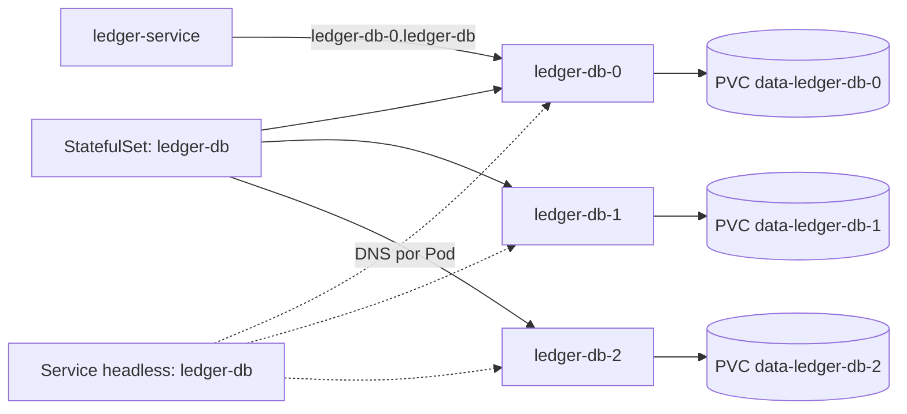

# Stateful Service

## Descrição

O padrão Stateful Service executa aplicações com estado usando o recurso StatefulSet, que dá a cada Pod uma identidade estável, armazenamento persistente próprio e uma ordem previsível de criação, atualização e remoção. É a base para bancos de dados, filas e sistemas de consenso, em que cada instância precisa ser reconhecida pelas outras e manter seus dados entre reinícios.

Em um ReplicaSet, os Pods são intercambiáveis e descartáveis, com nomes e discos arbitrários. O StatefulSet muda isso em quatro frentes. Na **identidade**, cada Pod recebe um nome com índice ordinal fixo, como `ledger-db-0`, que se mantém ao ser recriado. No **armazenamento**, `volumeClaimTemplates` cria um PersistentVolumeClaim por réplica, e o volume sobrevive à substituição do Pod. Na **rede**, um Service headless fornece um nome DNS estável por Pod, permitindo que os pares se encontrem. Na **ordenação**, o padrão é subir os Pods em sequência crescente e removê-los na inversa, com opção de modo paralelo quando a ordem não importa. Há ainda garantia de no máximo uma instância por identidade e atualizações em etapas com `partition`. Sem o StatefulSet, as alternativas são manuais: um ReplicaSet com várias réplicas e um PVC faria todas compartilharem o mesmo volume, e um ReplicaSet com uma réplica por instância, cada um com seu PVC e Service, não oferece uma abstração única para gerenciar o conjunto. Requisitos que vão além disso, como quórum e tolerância a duplicatas, variam de caso a caso e levam a CustomResourceDefinitions e Operators.

## Problemas que resolve

- Aplicações em que cada instância precisa de nome e endereço estáveis para formar um cluster
- Dados que precisam permanecer vinculados a uma réplica específica após reinícios e reagendamentos
- Sistemas que exigem ordem de inicialização, como eleger um primário antes de iniciar as réplicas
- Evitar duas instâncias com a mesma identidade escrevendo no mesmo dado

## Quando usar

- Para bancos de dados, mecanismos de busca, brokers de mensagens e sistemas de consenso
- Quando cada réplica tem armazenamento persistente próprio e não compartilhado
- Quando os pares precisam se endereçar individualmente, por exemplo para replicação
- Quando a unicidade estrita da instância importa mais que a disponibilidade imediata

## Quando evitar

- Para aplicações sem estado local, que escalam melhor e mais simples em um Deployment
- Quando é viável usar um serviço de dados gerenciado, em vez de operar o próprio
- Quando o estado pode viver em um armazenamento externo e a aplicação permanece descartável
- Quando a equipe não consegue operar backup, restauração e replicação: um Operator pode ser mais adequado

## Trade-offs

| Ganho | Custo / Risco |
| --- | --- |
| Identidade e dados estáveis entre reinícios | Escala e atualizações mais lentas e mais cuidadosas que as de um Deployment |
| Descoberta individual dos pares por DNS | Exige um Service headless e a lógica de formação do cluster na aplicação |
| Ordem previsível de criação, atualização e remoção | Um Pod com defeito pode bloquear os seguintes em uma atualização ordenada |
| Garantia de no máximo uma instância por identidade | Falha de nó pode deixar a réplica indisponível até o nó voltar ou ser removido |

- **Armazenamento:** o StatefulSet cria PVCs, mas não gerencia PersistentVolumes, que precisam ser provisionados antes ou sob demanda por uma storage class; reduzir as réplicas remove os Pods e mantém os PVCs, de propósito, para evitar perda de dados, e a remoção é manual.
- **Service governante:** `serviceName` é obrigatório e o Service headless deve existir antes do StatefulSet; também é possível criar outros Services com balanceamento sobre os mesmos Pods.
- **Quebra da garantia:** forçar a exclusão de um Pod ou apagar do API Server o objeto de um nó ainda ativo pode gerar duplicatas; faça isso só com certeza de que o processo parou.
- **Backup:** o StatefulSet não faz backup nem replicação; isso fica por conta da aplicação ou de um [Operator](/architecture/kubernetes-patterns/advanced/operator).
- **Modo de gerenciamento:** `OrderedReady` serializa as operações, e `Parallel` acelera quando a ordem é irrelevante.
- **Atualização em etapas:** `partition` permite atualizar só os Pods de índice maior e validar antes de seguir.
- **Dimensionamento:** requests, limits e a classe de armazenamento afetam desempenho e custo de cada réplica.

## Diagrama



Cada Pod tem nome fixo, volume próprio e um registro DNS individual pelo Service headless, de modo que `ledger-service` e os próprios pares conseguem endereçar réplicas específicas.

## Exemplo

O banco do razão contábil da fintech com três réplicas, volume por réplica e Service headless para a descoberta dos pares.

```yaml
apiVersion: v1
kind: Service
metadata:
  name: ledger-db
  namespace: fintech
spec:
  clusterIP: None
  selector:
    app: ledger-db
  ports:
    - name: sql
      port: 5432
---
apiVersion: apps/v1
kind: StatefulSet
metadata:
  name: ledger-db
  namespace: fintech
spec:
  serviceName: ledger-db
  replicas: 3
  selector:
    matchLabels:
      app: ledger-db
  template:
    metadata:
      labels:
        app: ledger-db
    spec:
      containers:
        - name: db
          image: registry.fintech.example/ledger-db:15.4
          ports:
            - containerPort: 5432
          volumeMounts:
            - name: data
              mountPath: /var/lib/db
  volumeClaimTemplates:
    - metadata:
        name: data
      spec:
        accessModes: ["ReadWriteOnce"]
        resources:
          requests:
            storage: 50Gi
```

O `clusterIP: None` cria o Service headless, e `volumeClaimTemplates` gera os volumes `data-ledger-db-0`, `data-ledger-db-1` e `data-ledger-db-2`, que acompanham cada Pod.

## Padrões relacionados

- [Singleton Service](/architecture/kubernetes-patterns/behavioral/singleton-service) — usa a garantia de no máximo uma instância do StatefulSet com uma única réplica
- [Service Discovery](/architecture/kubernetes-patterns/behavioral/service-discovery) — o Service headless expõe cada Pod por um nome DNS próprio
- [Operator](/architecture/kubernetes-patterns/advanced/operator) — automatiza backup, failover e atualização que o StatefulSet sozinho não resolve
- [Health Probe](/architecture/kubernetes-patterns/foundational/health-probe) — a prontidão define quando o próximo Pod ordenado pode subir
- [Leader Election](/architecture/cloud-design-patterns/distributed-coordination/leader-election) — bancos replicados elegem um primário entre os Pods do StatefulSet

## Referência

- [Kubernetes Patterns, capítulo 12: Stateful Service](https://k8spatterns.com/)
- [StatefulSets na documentação do Kubernetes](https://kubernetes.io/docs/concepts/workloads/controllers/statefulset/)
- [Volumes persistentes na documentação do Kubernetes](https://kubernetes.io/docs/concepts/storage/persistent-volumes/)
