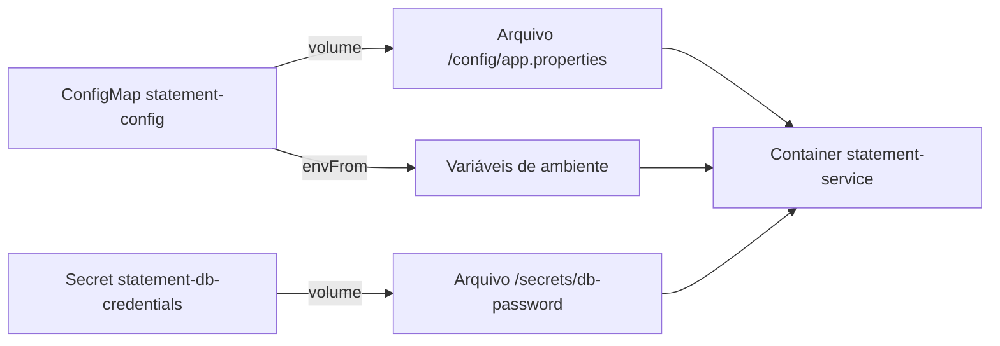

# Configuration Resource

## Descrição

O padrão Configuration Resource guarda a configuração de uma aplicação em recursos nativos do Kubernetes, ConfigMap para dados comuns e Secret para dados confidenciais, desacoplando o ciclo de vida da configuração do ciclo de vida da aplicação. Os dois recursos armazenam pares chave-valor e são usados da mesma forma; a diferença técnica está na codificação em Base64 dos valores de um Secret e nos cuidados adicionais que a plataforma aplica a eles.

As chaves podem ser consumidas de duas maneiras: como variáveis de ambiente (por chave com `configMapKeyRef` ou todas de uma vez com `envFrom`) ou como arquivos em um volume montado no Pod, em que cada chave vira um nome de arquivo. Arquivos montados são atualizados quando o recurso muda, o que permite recarga a quente se a aplicação suportar; variáveis de ambiente, não.

Um Secret não é criptografia: Base64 equivale a texto puro. O que o torna mais seguro é o tratamento da plataforma, como distribuí-lo só aos nós que precisam, mantê-lo em memória (tmpfs) nos nós e permitir criptografia em repouso no etcd, além de controle de acesso por RBAC. Esse padrão é parente do [External Configuration Store](/architecture/cloud-design-patterns/deployment-and-topology/external-configuration-store), mas distinto: aqui o armazenamento é o próprio cluster e a entrega ocorre pelo Pod, sem um serviço externo consultado pela aplicação.

## Problemas que resolve

- Limites do EnvVar Configuration: muitos parâmetros e arquivos inteiros não cabem em variáveis de ambiente
- Definições espalhadas por imagem, manifestos e plataforma, sem um único lugar para consultar
- Necessidade de alterar a configuração sem reconstruir a imagem nem editar o manifesto do workload
- Separação entre dados comuns e dados sensíveis, com políticas de acesso distintas

## Quando usar

- Quando a configuração inclui arquivos (propriedades, YAML, JSON) ou muitos pares chave-valor
- Quando se quer concentrar a configuração em um recurso versionado e gerenciado pela API do Kubernetes
- Quando a aplicação consegue recarregar arquivos de configuração sem reiniciar
- Quando credenciais e certificados precisam de um recurso próprio, com RBAC e criptografia em repouso

## Quando evitar

- Quando a configuração é enorme: o limite total de um ConfigMap ou Secret é de cerca de 1 MB, imposto pelo etcd
- Para dados de aplicação que não são configuração, como arquivos binários grandes
- Quando é preciso garantir imutabilidade e rastreio de versão fora do cluster (considere Immutable Configuration)
- Quando há quotas rígidas de ConfigMaps por namespace ou quando o acesso por RBAC aos Secrets não é bem controlado

## Trade-offs

| Ganho | Custo / Risco |
| --- | --- |
| Configuração em um único lugar, gerenciada pela API do Kubernetes | Limite de aproximadamente 1 MB por recurso e quotas por namespace |
| Desacopla a definição da configuração do seu uso | Quem cria Pods em um namespace pode ler os Secrets e ConfigMaps desse namespace |
| Arquivos montados são atualizados sem recriar o Pod | Variáveis de ambiente derivadas do recurso não se atualizam sem reiniciar |
| Recurso nativo, sem componentes extras | Base64 não é criptografia; é preciso habilitar criptografia em repouso e RBAC |

- **Chaves:** use maiúsculas para chaves consumidas como variáveis de ambiente e nomes de arquivo reais para as montadas em volume.
- **Atualização:** mudar o recurso não reinicia o Pod; combine com um hash do conteúdo no template ou com recarga na aplicação.
- **Segredos:** nunca versione valores reais em Git; use ferramentas de gerenciamento de segredos e trate o manifesto como se fosse público.
- **Escopo de acesso:** restrinja leitura por ServiceAccount e evite permitir criação de Pods a quem não deveria ver os Secrets do namespace.
- **Externo ao cluster:** para um repositório central compartilhado por vários sistemas, avalie o External Configuration Store.

## Diagrama



O ConfigMap alimenta variáveis de ambiente e arquivos, e o Secret é montado como arquivo; apenas os arquivos montados são atualizados quando os recursos mudam.

## Exemplo

```yaml
apiVersion: v1
kind: ConfigMap
metadata:
  name: statement-config
  namespace: fintech
data:
  STATEMENT_PAGE_SIZE: "50"
  application.properties: |
    statement.retention-days=365
    statement.export.max-rows=10000
```

```yaml
apiVersion: apps/v1
kind: Deployment
metadata:
  name: statement-service
  namespace: fintech
spec:
  replicas: 2
  selector:
    matchLabels:
      app: statement-service
  template:
    metadata:
      labels:
        app: statement-service
    spec:
      containers:
        - name: statement-service
          image: registry.fintech.example/statement-service:2.1.0
          envFrom:
            - configMapRef:
                name: statement-config
          volumeMounts:
            - name: config
              mountPath: /config
              readOnly: true
            - name: db-credentials
              mountPath: /secrets
              readOnly: true
      volumes:
        - name: config
          configMap:
            name: statement-config
        - name: db-credentials
          secret:
            secretName: statement-db-credentials
```

O ConfigMap carrega um valor simples e um arquivo de propriedades; o Deployment os consome como variáveis de ambiente e como arquivo, e monta o Secret (criado fora do repositório) em `/secrets`.

## Padrões relacionados

- [EnvVar Configuration](/architecture/kubernetes-patterns/configuration/envvar-configuration) — forma mais simples de configurar, adequada a poucos valores
- [Immutable Configuration](/architecture/kubernetes-patterns/configuration/immutable-configuration) — alternativa para configuração grande, imutável e versionada em imagem
- [Configuration Template](/architecture/kubernetes-patterns/configuration/configuration-template) — usa um ConfigMap só com os parâmetros que variam e gera os arquivos completos
- [Init Container](/architecture/kubernetes-patterns/structural/init-container) — prepara configuração vinda de fontes externas em um volume compartilhado
- [External Configuration Store](/architecture/cloud-design-patterns/deployment-and-topology/external-configuration-store) — armazena a configuração fora do cluster e da implantação, consultada pela aplicação

## Referência

- [Kubernetes Patterns, capítulo 20: Configuration Resource](https://k8spatterns.com/)
- [ConfigMaps](https://kubernetes.io/docs/concepts/configuration/configmap/)
- [Secrets](https://kubernetes.io/docs/concepts/configuration/secret/)
