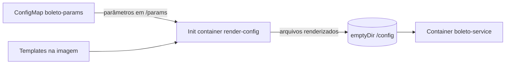

# Configuration Template

## Descrição

O padrão Configuration Template gera, na inicialização da aplicação, arquivos de configuração grandes e complexos a partir de um modelo único e de um pequeno conjunto de parâmetros específicos do ambiente. Em vez de copiar o arquivo inteiro para um ConfigMap por ambiente, guarda-se o template uma só vez e apenas os valores que realmente mudam, como endereços de banco e formatos de log.

No Kubernetes, a abordagem mais atraente usa um [Init Container](/architecture/kubernetes-patterns/structural/init-container) que contém o processador de templates e os próprios templates. Os parâmetros chegam por um ConfigMap montado como volume; o init container renderiza os arquivos finais em um volume `emptyDir` compartilhado e, quando termina, o contêiner da aplicação inicia lendo a configuração pronta. Uma alternativa é colocar o processamento no ENTRYPOINT da imagem, com parâmetros vindos de variáveis de ambiente.

O ganho principal é manutenção sem duplicação: quando a configuração comum muda, atualiza-se um único template, e levar a aplicação de um ambiente a outro altera só o ConfigMap de parâmetros, não o Deployment. Isso evita que cópias quase idênticas divirjam com o tempo.

## Problemas que resolve

- Arquivos de configuração grandes embutidos em ConfigMaps, difíceis de escapar e fáceis de quebrar
- Duplicação de conteúdo quase idêntico entre ambientes, com risco de divergência ao longo do tempo
- Limite de cerca de 1 MB do conjunto de valores de ConfigMaps e Secrets
- Necessidade de produzir configurações específicas de um ambiente a partir de uma fonte comum

## Quando usar

- Quando a aplicação exige arquivos de configuração extensos e só uma pequena fração depende do ambiente
- Quando se quer um único ponto de manutenção para a parte comum da configuração
- Quando os parâmetros por ambiente já estão em um ConfigMap ou em variáveis de ambiente
- Quando copiar o arquivo completo para cada ambiente funciona hoje, mas está condenado a divergir

## Quando evitar

- Quando a configuração é pequena ou cabe com folga em variáveis de ambiente ou em um ConfigMap simples
- Quando a equipe não quer assumir mais peças móveis, como um processador de templates e uma imagem extra
- Quando a configuração precisa ser validada e inspecionada como um artefato final antes do deploy
- Quando os ambientes diferem de forma estrutural, e não apenas em alguns valores

## Trade-offs

| Ganho | Custo / Risco |
| --- | --- |
| Elimina duplicação e deriva entre ambientes (DRY) | Mais componentes: init container, processador e imagem com os templates |
| Mudanças comuns são feitas em um único template | Erros de template só aparecem na inicialização do Pod |
| O Deployment é igual em todos os ambientes; só os parâmetros mudam | Depurar o resultado exige inspecionar o volume compartilhado |
| Evita embutir arquivos grandes e escapados em ConfigMaps | A configuração final não existe como recurso inspecionável no cluster |

- **Falha cedo:** se um parâmetro obrigatório faltar, o init container deve falhar, impedindo que a aplicação suba com configuração incompleta.
- **Parâmetros:** mantenha apenas valores que variam por ambiente no ConfigMap, e deixe o restante dentro do template.
- **Atualização:** como a renderização ocorre na inicialização, alterar o ConfigMap exige recriar o Pod para refletir a mudança.
- **Segredos:** não coloque valores sensíveis em ConfigMaps; passe-os por Secret, e evite deixá-los em arquivos renderizados legíveis por outros contêineres.
- **Complexidade:** adote o padrão apenas quando a configuração for realmente grande; caso contrário, [Configuration Resource](/architecture/kubernetes-patterns/configuration/configuration-resource) é mais simples.

## Diagrama



O init container combina os templates da imagem com os parâmetros do ConfigMap, grava a configuração final em um volume compartilhado e só então a aplicação inicia.

## Exemplo

```yaml
apiVersion: v1
kind: ConfigMap
metadata:
  name: boleto-params
  namespace: fintech
data:
  params.yaml: |
    environment: production
    bankSlipDueDays: 3
    finePercentBasisPoints: 200
    registrationApiUrl: https://registration.fintech.example
```

```yaml
apiVersion: apps/v1
kind: Deployment
metadata:
  name: boleto-service
  namespace: fintech
spec:
  replicas: 2
  selector:
    matchLabels:
      app: boleto-service
  template:
    metadata:
      labels:
        app: boleto-service
    spec:
      initContainers:
        - name: render-config
          image: registry.fintech.example/boleto-config-templates:1.0.0
          volumeMounts:
            - name: params
              mountPath: /params
              readOnly: true
            - name: config
              mountPath: /out
      containers:
        - name: boleto-service
          image: registry.fintech.example/boleto-service:1.9.4
          volumeMounts:
            - name: config
              mountPath: /config
              readOnly: true
      volumes:
        - name: params
          configMap:
            name: boleto-params
        - name: config
          emptyDir: {}
```

A imagem `boleto-config-templates` contém os modelos e o processador, lê `/params` e grava os arquivos finais em `/out`; para outro ambiente, só o ConfigMap `boleto-params` muda, e o Deployment permanece idêntico.

## Padrões relacionados

- [Init Container](/architecture/kubernetes-patterns/structural/init-container) — executa o processamento dos templates antes do contêiner da aplicação
- [Configuration Resource](/architecture/kubernetes-patterns/configuration/configuration-resource) — fornece o ConfigMap com os parâmetros que alimentam os templates
- [Immutable Configuration](/architecture/kubernetes-patterns/configuration/immutable-configuration) — alternativa que empacota a configuração completa de cada ambiente em uma imagem
- [EnvVar Configuration](/architecture/kubernetes-patterns/configuration/envvar-configuration) — outra fonte possível dos parâmetros do template
- [Sidecar](/architecture/cloud-design-patterns/integration-and-modernization/sidecar) — pode manter a configuração renderizada atualizada durante a vida do Pod

## Referência

- [Kubernetes Patterns, capítulo 22: Configuration Template](https://k8spatterns.com/)
- [Init Containers](https://kubernetes.io/docs/concepts/workloads/pods/init-containers/)
- [ConfigMaps](https://kubernetes.io/docs/concepts/configuration/configmap/)
