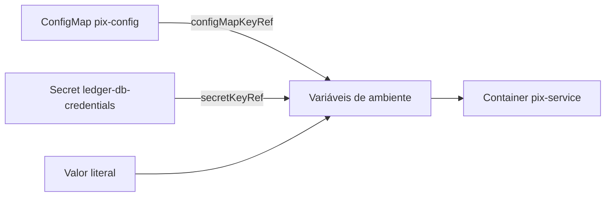

# EnvVar Configuration

## Descrição

O padrão EnvVar Configuration externaliza a configuração de uma aplicação em variáveis de ambiente, o mecanismo mais simples e universalmente suportado para alterar o comportamento de um contêiner sem reconstruir a imagem. Todo sistema operacional e toda linguagem sabem lidar com variáveis de ambiente, o que torna a abordagem portável entre plataformas.

No Kubernetes, as variáveis são declaradas no campo `env` do contêiner dentro do template do Pod de um Deployment. Cada variável pode receber um valor literal ou uma referência (`valueFrom`) a uma chave de um ConfigMap, para dados não sensíveis, ou de um Secret, para dados confidenciais. A indireção permite gerenciar os valores separadamente da definição do workload.

Valores padrão podem ser embutidos na imagem e sobrescritos na execução, mas convém usá-los com cautela: mudar um padrão depois exige novo build e surpreende quem dependia dele. Para parâmetros que dependem do ambiente, como credenciais e endereços de banco, é melhor não ter padrão e falhar cedo quando o valor não for informado.

## Problemas que resolve

- Configuração fixada no código ou na imagem, que obriga a reconstruir o artefato a cada ambiente
- Necessidade de um mecanismo de configuração simples, que funcione em qualquer linguagem e plataforma
- Parâmetros de ajuste fino (limites, endereços, flags) que mudam entre desenvolvimento, homologação e produção
- Acoplamento entre a definição do workload e valores que deveriam ser gerenciados à parte

## Quando usar

- Quando o conjunto de parâmetros é pequeno e cada valor é simples (texto, número, booleano)
- Quando a aplicação já lê a configuração do ambiente, como nas aplicações no estilo Twelve-Factor
- Quando a configuração só precisa ser lida na inicialização e uma mudança pode vir com uma nova versão do Pod
- Quando se quer o mesmo contrato de configuração em execução local, em testes e no cluster

## Quando evitar

- Quando há dezenas de parâmetros ou arquivos de configuração inteiros: o gerenciamento fica confuso e propenso a erros
- Para segredos de alto risco: variáveis de ambiente são fáceis de ler e podem vazar em logs e dumps de diagnóstico
- Quando a aplicação precisa recarregar configuração em tempo de execução, pois o ambiente de um processo não muda depois que ele inicia
- Quando a mesma variável é definida em vários níveis (imagem, manifesto, plataforma) e ninguém sabe mais de onde vem o valor final

## Trade-offs

| Ganho | Custo / Risco |
| --- | --- |
| Simplicidade e suporte universal em linguagens e plataformas | Não escala bem para configurações grandes ou estruturadas |
| Valores independentes do código e da imagem | Valores sensíveis ficam expostos no ambiente do processo e podem aparecer em logs |
| Indireção via ConfigMap e Secret separa ciclo de vida da configuração e do workload | Definições espalhadas em vários níveis dificultam rastrear a origem de cada variável |
| Reforça a imutabilidade: mudar a configuração significa trocar o Pod | Não há ajuste "a quente"; qualquer mudança exige reiniciar o contêiner |

- **Sem padrões ambíguos:** para dados que dependem do ambiente, prefira exigir o valor e falhar na inicialização a assumir um padrão silencioso.
- **Rastreabilidade:** concentre as definições em poucos lugares, de preferência em ConfigMaps versionados, para facilitar a depuração.
- **Segredos:** use `secretKeyRef` e controle o acesso, mas lembre que o valor continua legível dentro do processo; considere montar o Secret como arquivo.
- **Evolução:** quando a quantidade de variáveis crescer, migre para [Configuration Resource](/architecture/kubernetes-patterns/configuration/configuration-resource) ou [Configuration Template](/architecture/kubernetes-patterns/configuration/configuration-template).

## Diagrama



O contêiner recebe variáveis de ambiente cujos valores vêm de literais, de um ConfigMap ou de um Secret; o Pod precisa ser recriado para refletir qualquer mudança.

## Exemplo

```yaml
apiVersion: apps/v1
kind: Deployment
metadata:
  name: pix-service
  namespace: fintech
spec:
  replicas: 2
  selector:
    matchLabels:
      app: pix-service
  template:
    metadata:
      labels:
        app: pix-service
    spec:
      containers:
        - name: pix-service
          image: registry.fintech.example/pix-service:1.4.2
          env:
            - name: LOG_LEVEL
              value: "info"
            - name: SETTLEMENT_WINDOW_SECONDS
              valueFrom:
                configMapKeyRef:
                  name: pix-config
                  key: settlement-window-seconds
            - name: LEDGER_DB_PASSWORD
              valueFrom:
                secretKeyRef:
                  name: ledger-db-credentials
                  key: password
```

O `LOG_LEVEL` é um literal, o prazo de liquidação vem de um ConfigMap e a senha do banco vem de um Secret (cujo valor real nunca aparece no manifesto).

## Padrões relacionados

- [Configuration Resource](/architecture/kubernetes-patterns/configuration/configuration-resource) — oferece ConfigMap e Secret para configurações maiores, com arquivos montados em volume
- [Immutable Configuration](/architecture/kubernetes-patterns/configuration/immutable-configuration) — empacota a configuração em uma imagem versionada quando é preciso imutabilidade
- [Configuration Template](/architecture/kubernetes-patterns/configuration/configuration-template) — gera arquivos grandes a partir de poucos parâmetros por ambiente
- [Declarative Deployment](/architecture/kubernetes-patterns/foundational/declarative-deployment) — a troca de uma variável é aplicada por uma atualização progressiva do Pod
- [External Configuration Store](/architecture/cloud-design-patterns/deployment-and-topology/external-configuration-store) — alternativa que move a configuração para fora do ciclo de implantação

## Referência

- [Kubernetes Patterns, capítulo 18: EnvVar Configuration](https://k8spatterns.com/)
- [Define Environment Variables for a Container](https://kubernetes.io/docs/tasks/inject-data-application/define-environment-variable-container/)
