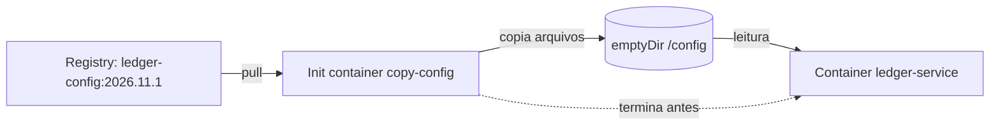

# Immutable Configuration

## Descrição

O padrão Immutable Configuration empacota os dados de configuração de um ambiente em uma imagem de contêiner passiva e versionada, que é ligada à aplicação apenas em tempo de execução. Como qualquer outra imagem, essa imagem de configuração é publicada em um registry, recebe tags de versão, pode ser inspecionada sem acesso ao cluster e não muda depois de construída: alterar a configuração significa gerar uma nova versão.

No Docker, a ligação pode ser feita expondo um diretório como volume na imagem de configuração e compartilhando-o com o contêiner da aplicação. No Kubernetes não há suporte direto para compartilhar diretórios de dentro de contêineres, então o padrão usa um [Init Container](/architecture/kubernetes-patterns/structural/init-container): ele roda a imagem de configuração, copia os arquivos para um volume `emptyDir` compartilhado e termina, para que o contêiner da aplicação inicie lendo os arquivos desse volume.

Trocar de ambiente passa a ser trocar a imagem do init container, o que pode ser parametrizado por ferramentas de template de manifestos. O padrão resolve a imutabilidade e o tamanho da configuração, mas não resolve a confidencialidade: dados sensíveis dentro de uma imagem continuam exigindo cuidados.

## Problemas que resolve

- Configuração que pode ser alterada em execução e deixa o sistema em um estado difícil de reproduzir
- Falta de versionamento e de processo de mudança controlado para a configuração de cada ambiente
- Configuração grande demais para variáveis de ambiente ou para o limite de cerca de 1 MB de um ConfigMap
- Necessidade de inspecionar e distribuir a configuração por um registry, sem acesso ao cluster

## Quando usar

- Quando a configuração deve ser imutável, versionada e auditável como um artefato de release
- Quando os arquivos de configuração são grandes e não cabem em variáveis de ambiente ou ConfigMaps
- Quando há um processo de mudança formal que exige promover a mesma configuração entre ambientes
- Quando a configuração precisa ser distribuída e examinada pelo mesmo registry das imagens da aplicação

## Quando evitar

- Quando um ConfigMap simples atende e a imutabilidade não é requisito: a complexidade não compensa
- Para dados sensíveis, pois a imagem não oferece proteção própria para segredos
- Quando a configuração muda com frequência e cada alteração não pode depender de um novo build e de um novo rollout
- Quando a equipe não quer manter um Deployment ou um template de manifesto diferente por ambiente

## Trade-offs

| Ganho | Custo / Risco |
| --- | --- |
| Configuração versionada, imutável e distribuída por registry | Mais artefatos para construir, publicar e manter |
| Sem limite prático de tamanho dos dados | Não resolve segredos; a imagem pode expor dados sensíveis |
| Pode ser examinada sem acessar o cluster | Exige um init container e um volume compartilhado em cada Pod |
| Mudanças passam por build, tag e rollout, o que favorece auditoria | É preciso gerenciar manifestos diferentes por ambiente ou parametrizá-los |

- **Imagem base:** o init container precisa de um utilitário de cópia; imagens mínimas com um shell costumam bastar.
- **Promoção entre ambientes:** mantenha a imagem da aplicação igual e troque apenas a tag da imagem de configuração.
- **Rollback:** voltar a configuração é voltar a tag da imagem, o que torna a reversão simples e previsível.
- **Segredos:** mantenha credenciais fora da imagem e injete-as por Secret ou por um gerenciador externo.
- **Alternativa mais simples:** se a imutabilidade não for necessária, [Configuration Resource](/architecture/kubernetes-patterns/configuration/configuration-resource) é suficiente.

## Diagrama



O init container copia a configuração da imagem versionada para um volume compartilhado e termina; só então o contêiner da aplicação inicia e lê os arquivos.

## Exemplo

```yaml
apiVersion: apps/v1
kind: Deployment
metadata:
  name: ledger-service
  namespace: fintech
spec:
  replicas: 3
  selector:
    matchLabels:
      app: ledger-service
  template:
    metadata:
      labels:
        app: ledger-service
    spec:
      initContainers:
        - name: copy-config
          image: registry.fintech.example/ledger-config:prod-2026.11.1
          args: ["/config"]
          volumeMounts:
            - name: config
              mountPath: /config
      containers:
        - name: ledger-service
          image: registry.fintech.example/ledger-service:3.2.0
          volumeMounts:
            - name: config
              mountPath: /config
              readOnly: true
      volumes:
        - name: config
          emptyDir: {}
```

A imagem `ledger-config` guarda os arquivos do ambiente de produção e copia o conteúdo para o diretório recebido como argumento; para outro ambiente, basta trocar a tag dessa imagem.

## Padrões relacionados

- [Init Container](/architecture/kubernetes-patterns/structural/init-container) — mecanismo que liga a imagem de configuração ao contêiner da aplicação
- [Configuration Resource](/architecture/kubernetes-patterns/configuration/configuration-resource) — alternativa nativa e mais simples quando a imutabilidade não é exigida
- [Configuration Template](/architecture/kubernetes-patterns/configuration/configuration-template) — outra forma de lidar com configuração grande que muda pouco entre ambientes
- [EnvVar Configuration](/architecture/kubernetes-patterns/configuration/envvar-configuration) — opção direta para poucos valores simples
- [Declarative Deployment](/architecture/kubernetes-patterns/foundational/declarative-deployment) — a troca da tag da imagem de configuração é aplicada por um rollout controlado

## Referência

- [Kubernetes Patterns, capítulo 20: Immutable Configuration](https://k8spatterns.com/)
- [Init Containers](https://kubernetes.io/docs/concepts/workloads/pods/init-containers/)
- [Volumes](https://kubernetes.io/docs/concepts/storage/volumes/)
