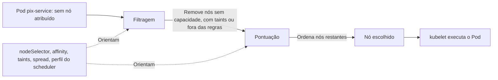

# Automated Placement

## Descrição

O padrão Automated Placement delega ao scheduler do Kubernetes a decisão de em qual nó cada Pod vai rodar, considerando os recursos solicitados e as regras de posicionamento declaradas, e permite influenciar essa decisão sem escolher os nós manualmente. Com dezenas ou centenas de serviços, atribuir processos a máquinas individualmente deixa de ser viável, e a forma como eles são distribuídos afeta disponibilidade, desempenho e custo.

O scheduler trabalha em duas etapas: primeiro **filtra** os nós que não atendem ao Pod (sem capacidade para os `requests`, sem o volume ou a porta necessários, com taints não tolerados) e depois **pontua** os restantes para escolher o melhor. A capacidade considerada é a alocável do nó, isto é, o total menos o que é reservado para o sistema e para os daemons do Kubernetes. Por isso o padrão depende de perfis de recursos declarados (Predictable Demands). Recursos consumidos por contêineres fora do controle do Kubernetes não entram nessa conta; um Pod de reserva, que apenas declara `requests`, pode representá-los.

Quando o comportamento padrão não basta, é possível orientar a decisão por mecanismos que vão do simples ao complexo: `nodeSelector` (rótulos exatos do nó), **node affinity** (regras obrigatórias ou preferenciais, com operadores mais ricos), **Pod affinity e anti-affinity** (aproximar ou espalhar Pods em relação a outros, por nó, zona ou região), **taints e tolerations** (o nó repele Pods que não toleram sua marca), `topologySpreadConstraints` (distribuição uniforme por domínio, com um desequilíbrio máximo tolerado, o `maxSkew`) e, em último caso, schedulers customizados. O descheduler, opcional, corrige distribuições que ficaram ruins ao longo do tempo. A recomendação é intervir o mínimo possível.

O próprio scheduler também é configurável. Nas versões atuais, a configuração é feita por **perfis** (`KubeSchedulerConfiguration`), que expõem as etapas do agendamento como pontos de extensão e permitem habilitar, desabilitar ou ponderar **plugins**, por exemplo trocar o plugin de pontuação de spread por um próprio. Isso substitui as antigas políticas de predicados e prioridades das versões anteriores à 1.23. Um mesmo scheduler pode ter vários perfis, e cada Pod escolhe o seu em `schedulerName`. A configuração cabe ao administrador do cluster; quem implanta aplicações apenas referencia perfis já existentes.

## Problemas que resolve

- Distribuição manual de dezenas de serviços em nós, inviável de manter conforme o cluster muda
- Réplicas de um mesmo serviço concentradas em um nó ou zona, que viram ponto único de falha
- Workloads que precisam de hardware específico (GPU, disco SSD) ou de nós dedicados
- Serviços que precisam ficar próximos (baixa latência) ou separados (isolamento de dados sensíveis)
- Recursos ociosos ou fragmentados em nós, com capacidade que ninguém consegue usar

## Quando usar

- Em qualquer workload em Kubernetes, já que o scheduler padrão atende bem à maior parte dos casos
- Quando as réplicas do `pix-service` devem se espalhar por zonas e nós para tolerar falhas de infraestrutura
- Quando workloads sensíveis, como o `card-service`, devem rodar em nós dedicados e isolados dos demais
- Quando serviços que se comunicam muito, como `credit-service` e seu cache, se beneficiam de ficar próximos
- Quando a anti-affinity rígida impediria um rolling update por falta de nós, e `topologySpreadConstraints` tolera um pequeno desequilíbrio
- Quando regras comuns não bastam, caso em que um perfil do scheduler com plugins próprios atende a necessidades específicas sem escrever um scheduler novo

## Quando evitar

- Para fixar Pods em nós com `nodeName` ou regras rígidas sem necessidade real, o que devolve o problema de gerenciar máquinas à mão
- Com excesso de regras obrigatórias, que podem deixar Pods sem nenhum nó elegível (`Pending`)
- Em clusters pequenos, em que anti-affinity rígida entre réplicas limita o número de Pods ao de nós
- Em configurações de scheduler ou schedulers customizados sem necessidade clara, já que mudam o comportamento de todo o cluster e são difíceis de prever
- Quando o problema é falta de capacidade ou perfis mal dimensionados, que regras de posicionamento não resolvem

## Trade-offs

| Ganho | Custo / Risco |
| --- | --- |
| Distribuição automática e contínua, sem decisão manual por Pod | Regras demais tornam o agendamento difícil de entender e podem deixar Pods `Pending` |
| Alta disponibilidade ao espalhar réplicas por nós e zonas | Anti-affinity e spread reduzem o empacotamento e podem aumentar o custo |
| Isolamento e uso de hardware específico via taints, tolerations e affinity | Pods já agendados não são movidos quando o cluster muda, a menos que se use o descheduler |
| Melhor aproveitamento dos nós com perfis de recursos corretos | Requisitos grosseiros ou nós pequenos geram recursos fragmentados e subutilizados |

- **Intervenção mínima:** declare perfis de recursos, rotule nós e Pods e use as regras mais simples que resolvam; evite `nodeName`.
- **Obrigatório versus preferencial:** use `required...` apenas para restrições reais e `preferred...` para otimizações; as regras valem só no momento do agendamento.
- **Taints para nós dedicados:** o nó repele Pods por padrão, o que evita rotular todos os Pods ao adicionar novos grupos de nós.
- **Spread em vez de anti-affinity rígida:** com duas réplicas e dois nós, a anti-affinity obrigatória impede o Pod extra de um rolling update; `topologySpreadConstraints` com `maxSkew: 1` admite esse desequilíbrio momentâneo. Quem escreve o Pod precisa conhecer os rótulos de topologia do cluster, e várias restrições devem ser satisfeitas ao mesmo tempo, então não podem entrar em conflito.
- **Configuração do scheduler:** prefira ajustar plugins de um perfil a manter um scheduler completo; um extensor HTTP é uma alternativa intermediária, e um scheduler próprio só se justifica para fatores externos ao cluster, como custo de hardware.
- **Descheduler:** executa sob demanda para remover Pods mal posicionados e deixar o scheduler distribuí-los de novo; ele preserva Pods críticos, sem controlador, de DaemonSet, com armazenamento local ou protegidos por `PodDisruptionBudget`.

## Diagrama



O scheduler filtra os nós inelegíveis, pontua os restantes e atribui o Pod ao melhor; as regras declaradas pelo usuário e os plugins do perfil do scheduler influenciam ambas as etapas.

## Exemplo

As quatro réplicas do `pix-service` exigem nós do pool de pagamentos e devem se espalhar entre as zonas, tolerando falhas de uma delas. A toleration permite usar os nós marcados como dedicados.

```yaml
apiVersion: apps/v1
kind: Deployment
metadata:
  name: pix-service
  namespace: fintech
spec:
  replicas: 4
  selector:
    matchLabels:
      app: pix-service
  template:
    metadata:
      labels:
        app: pix-service
    spec:
      affinity:
        nodeAffinity:
          requiredDuringSchedulingIgnoredDuringExecution:
            nodeSelectorTerms:
              - matchExpressions:
                  - key: pool
                    operator: In
                    values: ["payments"]
      tolerations:
        - key: dedicated
          operator: Equal
          value: payments
          effect: NoSchedule
      topologySpreadConstraints:
        - maxSkew: 1
          topologyKey: topology.kubernetes.io/zone
          whenUnsatisfiable: ScheduleAnyway
          labelSelector:
            matchLabels:
              app: pix-service
      containers:
        - name: pix-service
          image: registry.fintech.example/pix-service:1.4.2
          resources:
            requests:
              cpu: 250m
              memory: 256Mi
```

A regra obrigatória restringe o Pod ao pool `payments`, enquanto o spread, com `maxSkew: 1` e em modo preferencial (`ScheduleAnyway`), distribui as réplicas por zona sem impedir o agendamento caso não seja possível equilibrar perfeitamente; com `DoNotSchedule` a restrição seria obrigatória.

## Padrões relacionados

- [Predictable Demands](/architecture/kubernetes-patterns/foundational/predictable-demands) — fornece os `requests` e as dependências que o scheduler usa para filtrar e pontuar os nós
- [Daemon Service](/architecture/kubernetes-patterns/behavioral/daemon-service) — alternativa para rodar um Pod em cada nó (ou em um grupo deles), sem passar pelas decisões do scheduler
- [Elastic Scale](/architecture/kubernetes-patterns/advanced/elastic-scale) — novos Pods criados pelo autoscaling são posicionados pelo scheduler, e o cluster pode crescer em nós
- [Singleton Service](/architecture/kubernetes-patterns/behavioral/singleton-service) — o posicionamento ajuda a manter instâncias críticas separadas por falha, e um `PodDisruptionBudget` limita as remoções voluntárias
- [Service Deployment Platform](/architecture/microservices/deployment/service-deployment-platform) — a plataforma de execução em que a atribuição automática de serviços a máquinas é uma função central

## Referência

- [Kubernetes Patterns, capítulo 6: Automated Placement](https://k8spatterns.com/)
- [Assigning Pods to Nodes](https://kubernetes.io/docs/concepts/scheduling-eviction/assign-pod-node/)
- [Taints and Tolerations](https://kubernetes.io/docs/concepts/scheduling-eviction/taint-and-toleration/)
