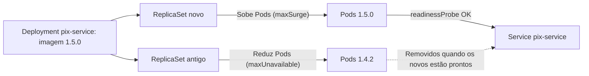

# Declarative Deployment

## Descrição

O padrão Declarative Deployment descreve a versão desejada de uma aplicação em um recurso `Deployment` e deixa que o Kubernetes execute, no servidor, todos os passos para sair da versão atual e chegar a ela, de forma repetível e com possibilidade de reverter. Em vez de um operador rodar comandos em sequência para subir Pods novos, esperar que fiquem prontos e remover os antigos, ele apenas altera o estado desejado, e um controller faz o resto.

Por trás do `Deployment`, cada versão é um `ReplicaSet`, e o campo `strategy` define como a troca acontece. A estratégia **RollingUpdate** (padrão) substitui os Pods aos poucos, controlada por `maxSurge` (quantos Pods extras podem existir) e `maxUnavailable` (quantos podem faltar), e evita indisponibilidade desde que haja `readinessProbe`. A estratégia **Recreate** encerra todos os Pods antigos antes de iniciar os novos, aceitando uma janela de indisponibilidade em troca de nunca ter duas versões ao mesmo tempo.

Sobre essas primitivas é possível montar estratégias de release mais elaboradas, em geral com decisão humana: **Blue-Green**, em que duas versões coexistem em Deployments separados e o tráfego é trocado alterando o seletor do `Service`, e **Canary**, em que uma pequena parcela das réplicas roda a nova versão antes da substituição completa. O histórico de revisões permite pausar, retomar e desfazer a atualização com `kubectl rollout`.

## Problemas que resolve

- Atualizações manuais ou scriptadas, sujeitas a erro humano e difíceis de repetir entre ambientes
- Indisponibilidade durante a troca de versão de um serviço
- Dificuldade de saber qual versão está de fato em execução e como voltar à anterior
- Processo de release que vira gargalo conforme cresce o número de microsserviços
- Lógica de orquestração da atualização espalhada em clientes e scripts, em vez de centralizada na plataforma

## Quando usar

- Em serviços sem estado que precisam ser atualizados com frequência e sem indisponibilidade, como o `pix-service`
- Quando se quer o estado desejado versionado em Git e aplicado de forma idêntica em todos os ambientes
- Quando é preciso reverter rapidamente uma versão com problema
- Como base para releases Blue-Green e Canary, combinadas com `Service` e roteamento de tráfego

## Quando evitar

- Para workloads com identidade ou armazenamento próprio por réplica, que pedem `StatefulSet` (veja Stateful Service)
- Com `RollingUpdate` quando duas versões simultâneas são incompatíveis, como mudança de contrato sem retrocompatibilidade: prefira `Recreate`
- Para atualizar dependências do Pod, como `ConfigMap` e esquema de banco, que o `Deployment` não gerencia sozinho
- Quando se precisa de rollout totalmente automatizado com análise de métricas, que exige ferramentas adicionais

## Trade-offs

| Ganho | Custo / Risco |
| --- | --- |
| Atualização repetível, versionada e executada pelo servidor | Depende de `readinessProbe` e de encerramento limpo para ser realmente sem downtime |
| Rollback simples pelo histórico de `ReplicaSet` | Duas versões convivem durante o rolling update, exigindo compatibilidade |
| Controle fino do ritmo com `maxSurge` e `maxUnavailable` | `Recreate` causa indisponibilidade, e Blue-Green exige o dobro da capacidade temporariamente |
| Base para estratégias Blue-Green e Canary | Blue-Green e Canary exigem passos manuais ou ferramentas adicionais |

- **Compatibilidade entre versões:** durante o rolling update, `pix-service` v1 e v2 recebem tráfego juntos; mudanças de API e de esquema devem ser feitas em etapas.
- **Sondas obrigatórias:** sem `readinessProbe`, o Kubernetes considera o Pod pronto cedo demais e pode derrubar as réplicas antigas antes da hora.
- **Capacidade extra:** `maxSurge` consome recursos além do número de réplicas; garanta folga no cluster.
- **Dependências:** `ConfigMap`, `Secret` e migrações de banco precisam de estratégia própria de atualização e reversão.

## Diagrama



O `Deployment` aumenta o `ReplicaSet` novo e reduz o antigo em passos controlados; um Pod só recebe tráfego do `Service` depois de passar na `readinessProbe`.

## Exemplo

O `pix-service` tem quatro réplicas e é atualizado em rolling update sem reduzir a capacidade: sobe um Pod extra por vez e nunca deixa nenhum indisponível. A `readinessProbe` garante que a troca só avance quando o novo Pod estiver pronto.

```yaml
apiVersion: apps/v1
kind: Deployment
metadata:
  name: pix-service
  namespace: fintech
spec:
  replicas: 4
  revisionHistoryLimit: 5
  strategy:
    type: RollingUpdate
    rollingUpdate:
      maxSurge: 1
      maxUnavailable: 0
  selector:
    matchLabels:
      app: pix-service
  template:
    metadata:
      labels:
        app: pix-service
    spec:
      containers:
        - name: pix-service
          image: registry.fintech.example/pix-service:1.5.0
          ports:
            - containerPort: 8080
          readinessProbe:
            httpGet:
              path: /ready
              port: 8080
            periodSeconds: 5
```

Para voltar à versão anterior, basta executar `kubectl rollout undo deployment/pix-service -n fintech`; o histórico mantido por `revisionHistoryLimit` torna a reversão imediata.

## Padrões relacionados

- [Health Probe](/architecture/kubernetes-patterns/foundational/health-probe) — a `readinessProbe` decide quando o rolling update pode avançar para a próxima réplica
- [Managed Lifecycle](/architecture/kubernetes-patterns/foundational/managed-lifecycle) — o tratamento de SIGTERM permite encerrar os Pods antigos sem perder requisições em andamento
- [Stateful Service](/architecture/kubernetes-patterns/behavioral/stateful-service) — alternativa para workloads com identidade e armazenamento próprios, cuja atualização segue regras diferentes
- [Service Deployment Platform](/architecture/microservices/deployment/service-deployment-platform) — o Kubernetes é uma implementação dessa plataforma, e o `Deployment` é sua primitiva de release
- [Controller](/architecture/kubernetes-patterns/advanced/controller) — o `Deployment` funciona porque um controller reconcilia continuamente o estado atual com o desejado

## Referência

- [Kubernetes Patterns, capítulo 3: Declarative Deployment](https://k8spatterns.com/)
- [Deployments](https://kubernetes.io/docs/concepts/workloads/controllers/deployment/)
- [Performing a Rolling Update](https://kubernetes.io/docs/tutorials/kubernetes-basics/update/update-intro/)
