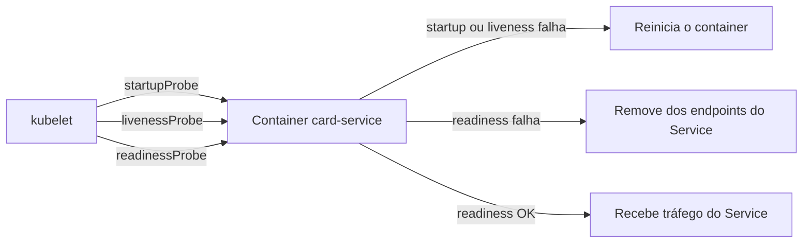

# Health Probe

## Descrição

O padrão Health Probe faz a aplicação expor ao Kubernetes sinais sobre o seu próprio estado, por meio de sondas que o kubelet executa periodicamente, para que a plataforma decida se deve reiniciar o contêiner ou parar de enviar tráfego a ele. Verificar apenas se o processo está de pé não basta: uma aplicação pode estar travada em um deadlock, sem memória ou ainda aquecendo, e continuar com o processo ativo.

Há três tipos de sonda. A **livenessProbe** pergunta se o contêiner ainda está saudável, e a ação corretiva em caso de falha é reiniciá-lo. A **readinessProbe** pergunta se ele está pronto para atender requisições, e a falha apenas o remove dos endpoints do `Service`, sem reiniciar, dando tempo para que se recupere sozinho. A **startupProbe** protege aplicações de inicialização lenta, adiando as outras duas até que a primeira verificação passe. Cada sonda pode usar uma requisição HTTP (`httpGet`), uma conexão TCP, um comando (`exec`) ou, nas versões recentes, gRPC, com parâmetros de intervalo, tempo limite e número de falhas tolerado.

O resultado das sondas alimenta outras automações: o rolling update só avança quando o novo Pod fica pronto, e o balanceamento de carga só envia requisições a Pods prontos. Complementam as sondas os logs em saída padrão e as métricas, usados para investigação e alertas em vez de ações automáticas.

## Problemas que resolve

- Processos ativos, mas travados ou sem capacidade de atender, que o kubelet não reiniciaria por conta própria
- Tráfego enviado a Pods que ainda estão iniciando, carregando cache ou aquecendo conexões
- Aplicações sobrecarregadas que precisam se proteger temporariamente de novas requisições
- Rollouts que avançam antes de a nova versão estar de fato apta a atender
- Falhas que exigem intervenção manual para serem detectadas e corrigidas

## Quando usar

- Em todo serviço que recebe tráfego, ao menos com uma `readinessProbe` para controlar o roteamento
- Quando a aplicação pode travar sem encerrar o processo, justificando uma `livenessProbe`
- Quando a inicialização é lenta ou variável, caso em que a `startupProbe` evita reinícios prematuros
- Como pré-requisito de rolling updates sem downtime e de autoscaling confiável

## Quando evitar

- Em `livenessProbe` que verificam dependências externas, como o banco: uma queda do banco reiniciaria todas as réplicas sem resolver nada
- Quando reiniciar o contêiner não corrige o problema, pois a sonda só produziria ciclos de reinício
- Em verificações pesadas ou lentas, que consomem recursos e provocam falhas por timeout
- Em jobs de execução única, em que o ciclo de vida já é definido pelo término do processo

## Trade-offs

| Ganho | Custo / Risco |
| --- | --- |
| Recuperação automática de aplicações travadas | Uma sonda mal calibrada derruba ou remove Pods saudáveis |
| Tráfego apenas para réplicas realmente prontas | Exige implementar e manter endpoints de saúde na aplicação |
| Rollouts e escalonamento mais seguros | Sondas agressivas aumentam a carga e podem gerar reinícios em cascata |
| Mais visibilidade do estado da aplicação para a plataforma | Falsa sensação de segurança se a sonda não reflete a saúde real do serviço |

- **Liveness enxuta:** verifique apenas se o próprio processo consegue responder, sem consultar dependências; deixe a avaliação de dependências para a readiness, com cuidado.
- **Readiness e dependências:** incluir dependências na readiness protege o usuário, mas uma dependência compartilhada fora do ar tira todas as réplicas do ar ao mesmo tempo.
- **Parâmetros:** ajuste `periodSeconds`, `timeoutSeconds` e `failureThreshold` ao comportamento real; na inicialização lenta, use `startupProbe`.
- **Encerramento:** o Pod deixa de receber tráfego ao ser encerrado independentemente da readiness; combine com tratamento de SIGTERM.

## Diagrama



Falhas de liveness (e de startup, após esgotar as tentativas) levam ao reinício do contêiner; falhas de readiness apenas retiram o Pod do balanceamento até que ele volte a responder.

## Exemplo

O `card-service` leva até um minuto para iniciar. A `startupProbe` concede esse tempo, a `livenessProbe` detecta travamentos depois disso e a `readinessProbe` controla a entrada no balanceamento.

```yaml
apiVersion: apps/v1
kind: Deployment
metadata:
  name: card-service
  namespace: fintech
spec:
  replicas: 3
  selector:
    matchLabels:
      app: card-service
  template:
    metadata:
      labels:
        app: card-service
    spec:
      containers:
        - name: card-service
          image: registry.fintech.example/card-service:2.3.0
          ports:
            - containerPort: 8080
          startupProbe:
            httpGet:
              path: /health/started
              port: 8080
            periodSeconds: 5
            failureThreshold: 12
          livenessProbe:
            httpGet:
              path: /health/live
              port: 8080
            periodSeconds: 10
            failureThreshold: 3
          readinessProbe:
            httpGet:
              path: /health/ready
              port: 8080
            periodSeconds: 5
            failureThreshold: 2
```

A `livenessProbe` só consulta o próprio processo, enquanto `/health/ready` pode incluir verificações adicionais, como a conclusão do carregamento de cache.

## Padrões relacionados

- [Health Endpoint Monitoring](/architecture/cloud-design-patterns/resiliency/health-endpoint-monitoring) — parente próximo: um monitor externo consulta endpoints de saúde para verificar a disponibilidade, enquanto aqui o kubelet usa as sondas para agir sobre o Pod
- [Managed Lifecycle](/architecture/kubernetes-patterns/foundational/managed-lifecycle) — o outro lado do contrato: as sondas extraem informação da aplicação, e os eventos de ciclo de vida enviam comandos a ela
- [Declarative Deployment](/architecture/kubernetes-patterns/foundational/declarative-deployment) — depende da `readinessProbe` para saber quando avançar no rolling update
- [Self Awareness](/architecture/kubernetes-patterns/behavioral/self-awareness) — outro canal de comunicação entre a aplicação e a plataforma, para introspecção de metadados
- [Elastic Scale](/architecture/kubernetes-patterns/advanced/elastic-scale) — réplicas só devem entrar em rotação, e contar para as métricas, depois de prontas

## Referência

- [Kubernetes Patterns, capítulo 4: Health Probe](https://k8spatterns.com/)
- [Liveness, Readiness, and Startup Probes](https://kubernetes.io/docs/concepts/configuration/liveness-readiness-startup-probes/)
- [Configure Liveness, Readiness and Startup Probes](https://kubernetes.io/docs/tasks/configure-pod-container/configure-liveness-readiness-startup-probes/)
