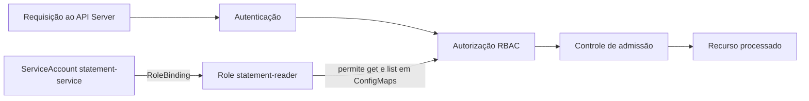

# Access Control

## Descrição

O padrão Access Control define quem pode fazer o quê no servidor de API do Kubernetes, concedendo a cada usuário e a cada carga de trabalho apenas as permissões estritamente necessárias por meio de RBAC. Toda requisição à API passa por três estágios: autenticação (quem é o sujeito), autorização (que ações ele pode executar) e controle de admissão (últimas verificações e modificações antes de a requisição ser processada).

Os sujeitos podem ser usuários humanos, que não existem como recursos na API e são autenticados por mecanismos externos (OIDC, certificados de cliente, proxy de autenticação, entre outros), ou `ServiceAccount`s, a identidade de carga de trabalho dos Pods, com token JWT temporário montado por um volume projetado. Também há grupos, como `system:authenticated` ou `system:serviceaccounts`. As permissões são descritas em um `Role` (regras com `apiGroups`, `resources` e `verbs`, restrito a um namespace) ou em um `ClusterRole` (vale para todo o cluster, ou é reutilizado em vários namespaces), e ligadas aos sujeitos por um `RoleBinding` ou `ClusterRoleBinding`. Um `ClusterRole` com `aggregationRule` agrega regras de outros `ClusterRole`s por seletores de labels.

A força do padrão está no menor privilégio: sem curingas (`*`), sem `cluster-admin` para Pods e sem montar automaticamente o token da `ServiceAccount` quando a aplicação não usa a API.

## Problemas que resolve

- Cargas de trabalho com privilégios excessivos que leem ou alteram recursos de outras aplicações
- Escalada de privilégios a partir de um Pod comprometido que usa o token da `ServiceAccount` para falar com a API
- Permissões amplas e difíceis de auditar, concedidas por curingas ou por `ClusterRoleBinding`s desnecessários
- Operadores e controladores que precisam de acesso privilegiado a recursos do cluster e exigem restrições finas
- Falta de separação entre o que humanos e o que cargas de trabalho podem fazer no cluster

## Quando usar

- Em todo cluster compartilhado, para conceder acesso por papel a pessoas, times e automações
- Quando uma aplicação fala com a API do Kubernetes, como controladores, operadores e ferramentas de implantação
- Para reaproveitar o mesmo conjunto de regras em vários namespaces com um `ClusterRole` e `RoleBinding`s
- Para restringir quais `Secret`s uma `ServiceAccount` pode montar e como ela puxa imagens de registros privados

## Quando evitar

- Para autorização no nível da aplicação (quem pode ver o extrato de qual cliente): RBAC cobre o acesso à API do Kubernetes, não a lógica de negócio
- `ClusterRoleBinding` quando bastam `RoleBinding`s por namespace: o primeiro vale para todos os namespaces, inclusive `kube-system`
- Curingas em `apiGroups`, `resources` ou `verbs`, salvo exceções bem justificadas
- Atribuir `cluster-admin` a qualquer Pod, nunca

## Trade-offs

| Ganho | Custo / Risco |
| --- | --- |
| Permissões granulares e auditáveis por sujeito, recurso e verbo | Modelo poderoso, porém complexo de entender e de depurar |
| Reuso de regras com `ClusterRole` e agregação | `ClusterRoleBinding` e curingas concedem acesso amplo e abrem caminho para escalada de privilégios |
| Tokens de `ServiceAccount` temporários e vinculados ao Pod | Tokens montados por padrão ampliam o dano de um Pod comprometido |
| Prevenção de escalada embutida (verbos `escalate` e `bind`) | Exige disciplina para manter as regras mínimas ao longo do tempo |

- **Sem curingas:** adote uma política geral de "sem curingas", relaxada só por exceções justificadas.
- **Sem `cluster-admin` em Pods:** uma `ServiceAccount` com privilégios altos pode ler `Secret`s e alterar permissões em qualquer namespace.
- **Não monte o token sem necessidade:** com `automountServiceAccountToken: false`, um invasor que comprometa o Pod não tem credenciais da API.
- **Depuração:** `kubectl auth can-i` (com `--as`) consulta a API de revisão de acesso; ferramentas como rakkess e KubiScan ajudam a ver a matriz de permissões e a achar permissões arriscadas.
- **Autenticação e admissão:** são, em geral, responsabilidade do administrador; controle de admissão por webhooks valida ou altera recursos antes de gravá-los.

## Diagrama



Cada requisição passa por autenticação, autorização e admissão; no estágio de autorização, o `RoleBinding` conecta a `ServiceAccount` ao `Role` que lista exatamente o que ela pode fazer.

## Exemplo

```yaml
apiVersion: v1
kind: ServiceAccount
metadata:
  name: statement-service
  namespace: fintech
automountServiceAccountToken: false
---
apiVersion: rbac.authorization.k8s.io/v1
kind: Role
metadata:
  name: statement-reader
  namespace: fintech
rules:
  - apiGroups: [""]
    resources: ["configmaps"]
    verbs: ["get", "list", "watch"]
---
apiVersion: rbac.authorization.k8s.io/v1
kind: RoleBinding
metadata:
  name: statement-service-reader
  namespace: fintech
subjects:
  - kind: ServiceAccount
    name: statement-service
    namespace: fintech
roleRef:
  apiGroup: rbac.authorization.k8s.io
  kind: Role
  name: statement-reader
```

A `ServiceAccount` do `statement-service` só pode ler `ConfigMap`s no namespace `fintech`, sem curingas. Com `automountServiceAccountToken: false`, os Pods dessa conta não recebem o token por padrão; um Pod que realmente chame a API deve habilitar o token no seu próprio spec.

## Padrões relacionados

- [Network Segmentation](/architecture/kubernetes-patterns/security/network-segmentation) — `AuthorizationPolicy` no nível da aplicação é distinto do RBAC, que protege a API do Kubernetes
- [Secure Configuration](/architecture/kubernetes-patterns/security/secure-configuration) — as regras de RBAC definem quem lê os `Secret`s dentro do cluster
- [Controller](/architecture/kubernetes-patterns/advanced/controller) — controladores observam recursos do cluster e exigem permissões finas de leitura e escrita
- [Operator](/architecture/kubernetes-patterns/advanced/operator) — operadores estendem a API com CRDs e precisam de papéis bem restritos
- [Gatekeeper](/architecture/cloud-design-patterns/security-and-access/gatekeeper) — ambos colocam um ponto de verificação entre o solicitante e o recurso, aqui no estágio de autorização e admissão da API
- [Federated Identity](/architecture/cloud-design-patterns/security-and-access/federated-identity) — a autenticação por OIDC delega a identidade dos usuários a um provedor externo

## Referência

- [Kubernetes Patterns, capítulo 26: Access Control](https://k8spatterns.com/)
- [Using RBAC Authorization](https://kubernetes.io/docs/reference/access-authn-authz/rbac/)
- [Configure Service Accounts for Pods](https://kubernetes.io/docs/tasks/configure-pod-container/configure-service-account/)
