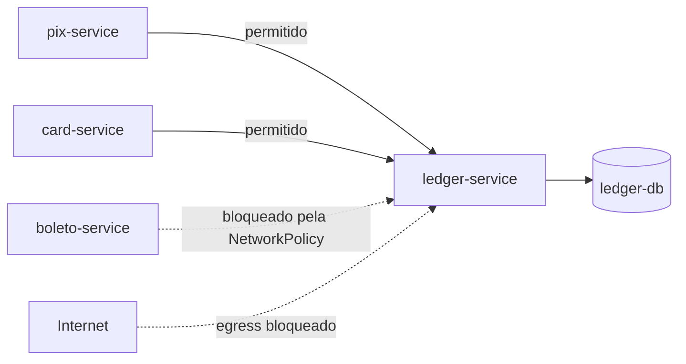

# Network Segmentation

## Descrição

O padrão Network Segmentation divide a rede plana do Kubernetes em segmentos isolados, definidos pelos próprios desenvolvedores como "firewalls de aplicação" que controlam quem pode falar com quem. Por padrão, qualquer Pod alcança qualquer outro Pod do cluster, independentemente do namespace, o que é um risco quando várias aplicações de times diferentes dividem o mesmo cluster.

Há duas formas complementares de aplicar o padrão. A primeira usa o recurso nativo `NetworkPolicy`, que atua nas camadas L3 e L4: um seletor de Pods por labels indica quais Pods são afetados, e listas de regras de `ingress` e `egress` indicam as origens e os destinos permitidos (por Pod, namespace, faixa de IP ou porta). As regras são aplicadas pelo plugin CNI, que precisa suportar `NetworkPolicy`. A segunda usa um service mesh como o Istio, cujo recurso `AuthorizationPolicy` permite filtrar por parâmetros HTTP (métodos, caminhos, identidade), na camada L7. Os dois mecanismos se somam: o tráfego só chega ao Pod se ambos permitirem.

A prática recomendada é partir de uma política "deny-all" e liberar apenas as rotas necessárias, usando labels consistentes (por exemplo, um label `app` por aplicação e labels de papel) para traduzir o grafo de dependências da aplicação em regras.

## Problemas que resolve

- Comunicação irrestrita entre Pods de aplicações e times diferentes, que amplia o raio de impacto de uma invasão
- Tráfego de saída (egress) sem controle, permitindo exfiltração de dados ou acesso a destinos externos indevidos
- Dependência de administradores de firewall que não conhecem o grafo de dependências da aplicação
- Isolamento de rede leve entre inquilinos em clusters compartilhados (multitenancy)
- Necessidade de restringir chamadas por método e caminho HTTP, que a camada L3/L4 não enxerga

## Quando usar

- Quando várias aplicações ou times compartilham o mesmo cluster
- Quando serviços sensíveis (por exemplo, o banco de dados do ledger) só devem ser acessados por componentes específicos
- Para limitar o tráfego de saída de Pods ao que é estritamente necessário
- Quando a política precisa de filtros HTTP ou de identidade, adicionando um service mesh

## Quando evitar

- Em clusters cujo plugin CNI não suporta `NetworkPolicy`: as regras são aceitas pela API, mas não têm efeito
- Em ambientes pequenos e de confiança total, onde o custo de manter as políticas supera o benefício
- Para isolamento forte entre inquilinos: pode ser preciso algo mais encapsulado, como um plano de controle virtual por tenant

## Trade-offs

| Ganho | Custo / Risco |
| --- | --- |
| Menor raio de impacto de uma violação de segurança | Muitos recursos `NetworkPolicy` para criar e manter à medida que o grafo cresce |
| Desenvolvedores definem a topologia junto da aplicação | Depuração mais difícil quando `NetworkPolicy` e `AuthorizationPolicy` precisam ser verificadas em paralelo |
| Isolamento leve entre inquilinos sem infraestrutura extra | Não há política padrão válida para todo o cluster: cada namespace precisa da sua |
| Filtros por método e caminho HTTP com service mesh | O service mesh adiciona componentes e consumo de recursos |

- **Comece com deny-all:** sem uma política restritiva por padrão, qualquer Pod esquecido continua aberto. Atenção: uma lista vazia (`ingress: []`) nega tudo, enquanto uma lista com um elemento vazio (`[{}]`) permite tudo.
- **Egress com pragmatismo:** negar todo o egress é inviável, pois todo Pod precisa de DNS; uma abordagem comum é permitir o egress interno ao cluster, bloquear o externo e liberar destinos externos pontualmente.
- **`policyTypes`:** para uma política somente de egress, declare `policyTypes: [Egress]`; senão, o ingress também é considerado e acaba bloqueado.
- **Ferramentas:** para sistemas existentes, ferramentas baseadas em eBPF, como Inspektor Gadget e Cilium (modo de auditoria), ajudam a descobrir o tráfego real e a gerar políticas; a qualidade do resultado depende da cobertura dos casos de uso exercitados.

## Diagrama



Só `pix-service` e `card-service` alcançam o `ledger-service`; qualquer outro Pod, ou destino externo, é barrado pela política que parte de deny-all.

## Exemplo

```yaml
apiVersion: networking.k8s.io/v1
kind: NetworkPolicy
metadata:
  name: default-deny-ingress
  namespace: fintech
spec:
  podSelector: {}
  policyTypes:
    - Ingress
---
apiVersion: networking.k8s.io/v1
kind: NetworkPolicy
metadata:
  name: allow-ledger-clients
  namespace: fintech
spec:
  podSelector:
    matchLabels:
      app: ledger-service
  policyTypes:
    - Ingress
  ingress:
    - from:
        - podSelector:
            matchLabels:
              app: pix-service
        - podSelector:
            matchLabels:
              app: card-service
      ports:
        - protocol: TCP
          port: 8080
```

A primeira política nega todo o tráfego de entrada dos Pods do namespace `fintech`. A segunda libera a porta 8080 do `ledger-service` apenas para Pods `pix-service` e `card-service`.

## Padrões relacionados

- [Process Containment](/architecture/kubernetes-patterns/security/process-containment) — contém o processo dentro do nó, enquanto este padrão contém o que ele alcança pela rede
- [Access Control](/architecture/kubernetes-patterns/security/access-control) — protege o acesso à API do Kubernetes, enquanto a segmentação protege o tráfego entre Pods
- [Service Discovery](/architecture/kubernetes-patterns/behavioral/service-discovery) — os nomes de serviço que os Pods usam para se encontrar são o que as políticas de rede passam a restringir
- [Sidecar](/architecture/cloud-design-patterns/integration-and-modernization/sidecar) — é como o service mesh intercepta o tráfego L7 para aplicar `AuthorizationPolicy`
- [Ambassador](/architecture/cloud-design-patterns/integration-and-modernization/ambassador) — o proxy do mesh atua como embaixador do tráfego de saída da aplicação
- [Gatekeeper](/architecture/cloud-design-patterns/security-and-access/gatekeeper) — outro ponto de controle que valida requisições antes de chegarem ao recurso protegido

## Referência

- [Kubernetes Patterns, capítulo 24: Network Segmentation](https://k8spatterns.com/)
- [Network Policies](https://kubernetes.io/docs/concepts/services-networking/network-policies/)
- [Declare Network Policy](https://kubernetes.io/docs/tasks/administer-cluster/declare-network-policy/)
